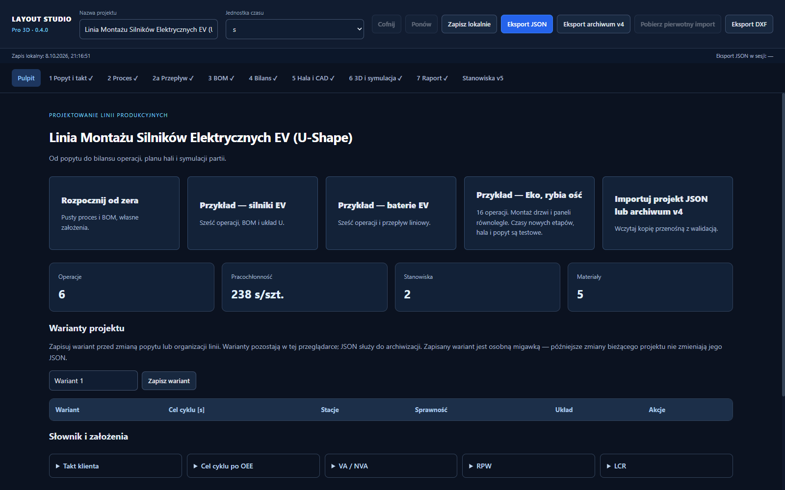

# Layout Studio Pro 3D — Podręcznik Użytkownika

Wersja aplikacji: **0.4.0**  
Aktualizacja podręcznika: **18.10.2026 — odbiór funkcji Etapów 1–4 (7.8.1), edytora hali B (5.2) oraz narzędzi zaznaczenia, grup, zespołów stanowisk i przyciągania (5.3–5.5)**.
Przeznaczenie: **Inżynieria procesów produkcyjnych, bilansowanie linii, projektowanie layoutu 2D/3D oraz symulacja przepływu partii**.

Źródłem edytowalnym tego podręcznika jest plik Markdown. HTML i PDF są wersjami do czytania i wydruku. Starszy dokument Word oznaczony v0.2 pozostaje materiałem historycznym. Screeny nowych funkcji pochodzą z lokalnych odbiorów UI; pokazują dane syntetyczne i nie są pomiarami produkcji klienta. Etapy 5–7 nie są jeszcze odebrane w całości.

---

## 1. Jak uruchomić program

Aplikacja działa w przeglądarce. Adres wersji hostowanej: [Layout Studio Pro 3D](https://layout-studio-pro-3d.vercel.app/). Aktualizacja GitHub nie potwierdza automatycznie, że hostowana wersja zawiera ostatni pakiet; niniejszą instrukcję sprawdzono względem kodu i lokalnych odbiorów projektu.

1. **Uruchomienie skrótem**: Kliknij dwukrotnie plik `Uruchom_Layout_Studio_v0.3.bat` w głównym katalogu programu.
2. **Uruchomienie z terminala**:
   ```bash
   npm run build
   npm start
   ```
3. Otwórz przeglądarkę pod adresem: [http://127.0.0.1:4173](http://127.0.0.1:4173) (lub port wskazanym w konsoli).
4. **Bezpieczeństwo danych**: Zapisy projektów znajdują się w pamięci danej przeglądarki i adresu aplikacji (`localStorage`). Zapis lokalny na Vercel i na localhost nie jest wspólny. Przed usunięciem danych witryny wykonaj **Eksport JSON** lub **Eksport archiwum** oraz osobno pobierz szkic 6 i warianty, jeżeli z nich korzystasz. Sam plik aktywnego projektu nie zastępuje kopii osobnego szkicu i biblioteki wariantów.

---

## 2. Krok po kroku: Praca z aplikacją

### Krok 1: Pulpit projektu (Wybór szablonu lub własny proces)
Na ekranie startowym możesz wybrać jeden z gotowych przykładów referencyjnych lub rozpocząć czysty projekt:
- **Rozpocznij od zera**: Czysta baza do wprowadzenia własnego procesu klienta i BOM.
- **Przykład — silniki EV**: 6 operacji w gnieździe U-Shape.
- **Przykład — baterie EV**: 6 operacji w przepływie liniowym.
- **Przykład — Eko, rybia ość**: Złożony proces montażowy (16 operacji, 60 pozycji BOM, równoległe podmontaże).



Na pasku górnym masz stały dostęp do:
- **Cofnij / Ponów**: Historia do 40 operacji w danej sesji.
- **Jednostka czasu**: Globalne przełączanie między sekundami (`s`), minutami (`min`) i godzinami (`h`).
- **Zapis lokalny & Eksport JSON / Archiwum**: Natychmiastowe zabezpieczenie stanu pracy.
- **Eksport DXF**: Eksport rzutu hali do systemów CAD.

---

### Krok 2: Zakładka 1 — Popyt, Takt i Czas Pracy
Zdefiniuj założenia wejściowe klienta:
- **Popyt roczny i dni robocze**: Wyliczają średni popyt dzienny.
- **Liczba zmian, godziny zmiany i planowane przerwy**: Wyliczają dostępny czas netto.
- **Rezerwa OEE / Dostępność [%]**: Założenie planistyczne uwzględniające straty operacyjne.
- Program automatycznie oblicza kluczowe wskaźniki Lean: **Takt klienta** oraz **Docelowy takt po OEE (Cycle Time Target)**.


---

### Krok 3: Zakładka 2 — Proces i operacje technologiczne
Tabela operacji pozwala na pełną kontrolę struktury technologicznej:
- **ID i Nazwa operacji**: Unikalne identyfikatory kroków (np. `OP10`, `OP20`).
- **Czas standardowy, VA (wartość dodana) i NVA (strata)**: Rozbicie czasu pracy.
- **Zależności (Poprzednicy i Następnicy)**: Definiowanie relacji logicznych (AND) – program pilnuje spójności grafu i blokuje powstawanie cykli.
- **Import / Eksport XLSX & CSV**: Możliwość pobrania gotowego wzorca (`Szablon XLSX` / `Szablon CSV`) z osobnym arkuszem specyfikacji kolumn.


---

### Krok 4: Zakładka 2a — Wizualny diagram przepływu
Interaktywny edytor grafu sieciowego:
- **Kafelki operacji**: Prezentują ID, czas, udział VA oraz liczbę przypisanych części.
- **Przeciąganie i układ**: Pełna swoboda rozmieszczania, siatka 20 px, zoom oraz funkcja *Ułóż według zależności*.
- **Łączenie**: Możliwość tworzenia połączeń technologicznych bezpośrednio z portów `+`.


---

### Krok 5: Zakładka 3 — BOM i logistyka pojemników
Zarządzanie strukturą materiałową:
- Powiązanie komponentów z konkretnymi operacjami procesu.
- Dobór nośników logistycznych: **BoxKLT**, **Tray**, **Carton**, **Pallet**.
- Automatyczne wyliczanie: zapotrzebowania dziennego, liczby pojemników na zmianę oraz kosztu materiałowego wyrobu.


---

### Krok 6: Zakładka 4 — Bilansowanie linii i wykres Yamazumi
Narzędzie do optymalizacji obsady i równoważenia obciążenia:
- **Algorytmy i ręczny balans**: Wsparcie dla metod RPW, LCR lub ręcznego podziału na stacje.
- **Dynamiczny wykres Yamazumi**: Słupki reprezentują obciążenie poszczególnych stanowisk względem linii taktu docelowego (żółta linia przerywana).
- **Zasoby stacji**: Możliwość definiowania liczby operatorów (1–20), równoległych kopii stanowiska (1–20) oraz dedykowanego cyklu zespołu.


---

### Krok 7: Zakładka 5 — Hala i edytor CAD 2D
Projektowanie przestrzenne rozmieszczenia stacji roboczych:
- **Geometria hali**: Szerokość, długość i wysokość obiektu oraz regulowana siatka przyciągania.
- **Automatyczny generator layoutu**: Generowanie układów w kształcie **U**, **Liniowym**, **L** lub **Z procesu (rybia ość)**.
- **Elementy składowe stanowiska**: Stół ESD, regał buforowy FIFO, strefa pracy operatora.
- **Relacje technologiczne**: Fioletowe linie łączące stoły wskazują kierunek przepływu detalu.

Edytor korzysta z wariantu B: rzut zajmuje dostępną szerokość, a panele otwierają się nad nim na żądanie. **Biblioteka i drzewo** otwiera listę wyposażenia i przeszkód po lewej. Wybranie pozycji otwiera **Właściwości** po prawej; można też wybrać obiekt na rzucie. **Parametry hali** udostępnia wymiary, siatkę i ustawienia generatora. Jeden panel jest otwarty naraz; zamyka go przycisk × albo Escape. Na mniejszych ekranach długie formularze przewijają się wewnątrz panelu.

Zmiany we właściwościach zatwierdź przyciskiem **Zapisz obiekt** albo **Zapisz przeszkodę**. Zmiany parametrów hali działają od razu. **Cofnij/Ponów** przywraca dane projektu i usuwa niezatwierdzony formularz, aby nie zapisać nieaktualnej geometrii. Przesuwanie wyposażenia nadal wymaga przełączenia trybu przyciskiem **Przesuwaj widok / Przesuwaj obiekty**.

Pod rzutem znajdują się zwijane listy wyposażenia i przeszkód oraz **Wyniki i oś czasu — aktywny projekt 4**. Otwarcie wyników uruchamia istniejącą symulację tego projektu, z jej jawnymi założeniami: zerowy transport, dedykowani operatorzy i kolejki bez limitu. Poprawny proces, popyt, hala i bilans są wymagane. Zwijanie wyników zachowuje bieżący przebieg; przejście do innej zakładki uruchamia osobny widok symulacji. Harmonogram szkicu 6 pozostaje w warsztacie tego szkicu.


**Wiele obiektów i grupy (5.3).** Wyposażenie dodajesz do zaznaczenia lub usuwasz z niego przez Shift/Ctrl + wybór na rzucie albo w drzewie. W drzewie dostępne są też pola wyboru, przydatne na ekranach bez klawiatury. **Zaznacz wyposażenie** wybiera wszystkie elementy wyposażenia; **Wyczyść zaznaczenie** usuwa wybór. Przeszkody mają osobny edytor i nie należą do tych grup.

**Do lewej/prawej/góry/dołu** wyrównuje obrócone obrysy do pierwszego wybranego obiektu lub grupy. Grupa jest przesuwana jako całość, zachowując odstępy. W trybie **Przesuwaj obiekty** przeciągnięcie zaznaczonego elementu przesuwa całe zaznaczenie jednym gestem; siatka dotyczy punktu zaczepienia, a wzajemne pozycje pozostają zachowane.

Rozwiń **Grupowanie i kopiowanie wyposażenia**. **Grupuj zaznaczone** zapisuje wizualną grupę; późniejsze wybranie jednego członka wybiera całą grupę. **Rozgrupuj zaznaczone** usuwa to powiązanie. Grupowanie nie tworzy stanowiska technologicznego. Aby skopiować zaznaczenie, wpisz jawne przesunięcia X i Y w mm (zero jest dozwolone) i wybierz **Kopiuj zaznaczone**. Kopie mają nowe ID, nowe grupy i nie mają przypisania do stanowiska; nie zwiększają liczby kopii produkcyjnych ani zdolności linii. Sprawdź kolizje po skopiowaniu. Grupowanie, wyrównanie, wspólne przesunięcie i kopiowanie cofasz jako pojedyncze akcje. Grupy i kopie pozostają w zapisie lokalnym i JSON; ponowna automatyczna generacja zastępuje ręczny layout wraz z grupami po potwierdzeniu.


**Przenoszenie zespołu stanowiska (5.4).** Domyślnie aktywna opcja **Przenoś stanowisko z FIFO i strefą** na pasku narzędzi sprawia, że przeciągnięcie na rzucie lub zmiana współrzędnych X/Y we **Właściwościach** dla stołu, regału FIFO albo strefy pracy operatora przypisanych do tego samego stanowiska (lub tej samej kopii `-COPY-N`) przesuwa cały zespół stanowiska o ten sam wektor, zachowując wzajemne odstępy, identyfikatory, przypisanie `workstationId` oraz fioletowe linie relacji technologicznych. Również wyrównywanie wielu stanowisk (**Do lewej/prawej/góry/dołu**) przesuwa całe zespoły stanowisk. Przycisk **Zaznacz zespół stanowiska** jawnie rozszerza bieżące zaznaczenie na wszystkie elementy wybranych stanowisk. Aby skorygować położenie pojedynczego regału FIFO lub maty względem stołu, odznacz **Przenoś stanowisko z FIFO i strefą**.


**Przyciąganie do siatki, krawędzi i punktów połączeń oraz wyłączanie przyciągania (5.5).** Na pasku narzędzi nad rzutem dostępne są trzy niezależne przełączniki: **Przyciąganie do siatki** (według kroku `Siatka [mm]` w parametrach hali), **Przyciąganie do krawędzi** (wyrównanie lub dosunięcie obrysu przesuwanego obiektu do krawędzi innych obiektów wyposażenia oraz przeszkód z wyświetleniem przerywanej niebieskiej prowadnicy) oraz **Przyciąganie do punktów połączeń** (dokowanie środków boków i punktu centralnego stołu/obiektu z wizualnymi znacznikami portów oraz żółtą prowadnicą). Przycisk **Wyłącz przyciąganie / Włącz przyciąganie** pozwala jednym kliknięciem wyłączyć lub włączyć wszystkie tryby przyciągania (również przytrzymanie klawisza `Alt` podczas przeciągania tymczasowo wyłącza przyciąganie, umożliwiając swobodny ruch z dokładnością 1 mm).


**Wymiarowanie, pomiary odległości, warstwy i blokowanie obiektów (5.6).** Pasek narzędzi **Warstwy i pomiary odległości** pozwala niezależnie włączać i ukrywać siedem warstw rzutu: **Warstwa: Podkład hali**, **Warstwa: Stanowiska**, **Warstwa: Bufory i logistyka**, **Warstwa: Strefy operatorów**, **Warstwa: Relacje technologiczne**, **Warstwa: Przeszkody** oraz **Warstwa: Wymiary i pomiary** (etykiety gabarytów `szerokość × głębokość mm` na obiektach i przeszkodach oraz linie wymiarowe). Po zaznaczeniu co najmniej dwóch obiektów automatycznie wyświetlana jest linia wymiarowa oraz odczyt **Pomiar zaznaczonych** z prześwitem krawędzi obróconych obrysów (`prześwit ... mm`), odległością `środek–środek` oraz składowymi `ΔX` i `ΔY`. Przycisk **Mierz odległość** uruchamia interaktywną miarkę punkt–punkt na rzucie (z przyciąganiem do portów lub siatki i przyciskiem **Wyczyść pomiar**). Przyciski **Zablokuj zaznaczone / Odblokuj zaznaczone** na pasku wielokrotnego zaznaczenia oraz pole **Zablokuj pozycję i wymiary obiektu** w panelu **Właściwości** oznaczają obiekt symbolem `🔒` i przerywanym obrysem, chroniąc go przed przesunięciem myszą, zmianą współrzędnych/wymiarów, przesunięciem podczas wyrównywania oraz usunięciem (zablokowany obiekt może natomiast służyć jako nieruchoma baza odniesienia przy wyrównywaniu innych obiektów do jego obrysu).


**Podkład hali i kalibracja skali (5.7).** W panelu **Parametry hali** sekcja **Podkład hali i kalibracja skali** pozwala wczytać rysunek architektoniczny posadzki (**Wczytaj podkład (PNG/JPG/SVG/WebP)**, do 3 MB). Wczytany podkład jest wyświetlany pod siatką wyposażenia na warstwie **Warstwa: Podkład hali** z etykietą gabarytów i skali (`mm/px`). Skala może być wpisana bezpośrednio w polu **Skala podkładu [mm/px]** albo wyznaczona dwupunktowo z rysunku: kliknij **Wskaż 2 punkty kalibracji na rzucie** (lub przycisk **Kalibruj skalę podkładu** na pasku warstw), kliknij na rzucie punkt początkowy `A` i końcowy `B` odcinka o znanym wymiarze rzeczywistym, wpisz **Rzeczywista odległość A–B [mm]** i wybierz **Zastosuj kalibrację skali** — aplikacja przeliczy skalę `mm/px` oraz rzeczywiste wymiary podkładu w milimetrach. Pola **Przesunięcie podkładu X/Y [mm]** oraz **Przezroczystość podkładu [0.05–1]** pozwalają precyzyjnie zgrać rysunek z początkiem układu współrzędnych hali, a przycisk **Dopasuj wymiary hali do podkładu** ustawia szerokość i długość hali na skalibrowany wymiar podkładu. Podkład wraz z kalibracją jest zapisywany w projekcie lokalnym i przenośnym pliku JSON oraz obsługuje **Cofnij / Ponów**.


**Import geometrii DXF z weryfikacją jednostek i raportem pominiętej geometrii (5.8).** W panelu **Parametry hali** sekcja **Import geometrii DXF** umożliwia wczytanie tekstowego pliku CAD (`.dxf`, do 5 MB). Obsługiwany podzbiór geometrii 2D w sekcji `ENTITIES` obejmuje zamknięte polilinie `LWPOLYLINE` oraz `POLYLINE` (`VERTEX` + `SEQEND`), okręgi `CIRCLE` (np. słupy konstrukcyjne), osiowe odcinki `LINE` na warstwach hali/przeszkód (`FACILITY`, `HALA`, `BOUNDARY`, `OBSTACLES`, `COLUMNS`, `WALLS`) oraz etykiety `TEXT` i `MTEXT` parowane z obrysami na tej samej warstwie. Aplikacja odczytuje zmienną nagłówkową `$INSUNITS` (`4` = mm, `5` = cm, `6` = m, `1` = in, `2` = ft); jeżeli plik nie deklaruje jednoznacznej jednostki (`$INSUNITS=0` lub brak nagłówka), wyświetlany jest komunikat ostrzegawczy, a przycisk **Zastosuj import DXF** pozostaje zablokowany do momentu jawnego wyboru jednostki w polu **Jednostki pliku DXF**. Wszystkie nieobsługiwane encje CAD (m.in. `INSERT` — nierozbite bloki, `SPLINE`, `ARC`, `ELLIPSE`, `HATCH`, `DIMENSION`, `3DFACE`, polilinie z łukami `bulge` lub mniej niż 3 wierzchołkami) nie są milcząco gubione, lecz zestawiane w **Raporcie pominiętej geometrii** z podaniem typu encji, warstwy, liczby wystąpień i przyczyny pominięcia. Pole **Zakres importu DXF** pozwala wybrać aktualizację **Wymiary hali i przeszkody**, **Tylko przeszkody do istniejącej hali** albo **Pełny rzut CAD (hala, przeszkody i obiekty wizualne)** (z opcją **Zastąp istniejące przeszkody przy imporcie**).


**Strefy obsługi, odkładania i komunikacji oraz rozróżnienie ostrzeżeń geometrycznych od oceny zgodności BHP (5.9).** Na rzucie 2D warstwa **Warstwa: Strefy obsługi, odkładania i komunikacji** (włączana i wyłączana na pasku **Warstwy i pomiary odległości**) czytelnie wyróżnia trzy rodzaje stref funkcjonalnych kreskowanymi obrysami i etykietami:
- **Strefa obsługi (`Strefa obsługi (...)`)** — zielona kreskowana otoczka wokół maty ergonomicznej operatora (`+150 mm`) lub przedni pas roboczy (`800 mm` głębokości) przed stołem stanowiska nieposiadającego maty.
- **Strefa odkładania (`Strefa odkładania (...)`)** — bursztynowa kreskowana otoczka wokół regałów buforowych FIFO, stref wejścia materiału oraz wyrobów gotowych (`+140 mm`).
- **Strefa komunikacji (`Strefa komunikacji międzyrzędowej` / `Strefa komunikacji wzdłuż linii`)** — błękitny pas komunikacyjny wyznaczany na podstawie parametru `Przejście / odstęp ramion [mm]`.

Pod rzutem panel **Strefy funkcjonalne i kontrola geometryczna rzutu (nie BHP)** wyświetla liczniki wyznaczonych stref oraz listę ostrzeżeń geometrycznych oznaczonych etykietą **`Geometria rzutu (nie BHP)`** (wykroczenie poza obrys hali, nakładanie obrysu 2D ze słupem/przeszkodą, kolizja dwóch obiektów wyposażenia, zbyt mały prześwit między stołami oraz wejście przeszkody w obrys strefy obsługi/odkładania/komunikacji) z przyciskiem **Zaznacz obiekt / Zaznacz kolidujące obiekty** oraz wyróżnieniem kolidującego obiektu na rzucie przerywaną czerwoną ramką. Panel zawiera jawne zastrzeżenie, że kontrola ma wyłącznie charakter geometryczny (prostokątne obrysy 2D i zadane prześwity modelowe w mm) i **nie stanowi formalnej oceny zgodności z przepisami BHP, ergonomii, ochrony przeciwpożarowej ani dopuszczenia stanowisk do eksploatacji** — również brak ostrzeżeń geometrycznych nie zastępuje odbioru BHP.


---

### Krok 8: Zakładka 6 — Widok 3D i Symulacja partii produkcyjnej
Cyfrowy bliźniak i symulator zdarzeniowy:
- **Nawigacja 3D**: Lewy przycisk myszy – obrót sceny, prawy – przesuwanie (pan), kółko – zoom.
- **Tryb edycji 3D**: Przesuwanie wyposażenia po posadzce hali z zachowaniem siatki.
- **Deterministyczna symulacja w tle (Web Worker)**:
  - Ustawienie wielkości partii (np. 30 sztuk) oraz odstępu uruchamiania detali.
  - Szybkości odtwarzania od 1× do 5000× z zachowaniem pełnej precyzji zdarzeń.
  - Wskaźniki w czasie rzeczywistym: czas symulowany, ukończone wyroby, WIP (produkcja w toku), średnia wydajność linii (szt./h) oraz stan poszczególnych stacji.
  - Eksport dokładnego przebiegu zdarzeń do pliku CSV.

**Wspólne zaznaczenie i dane 2D–3D, skróty klawiszowe, blokowanie i podpowiedzi (5.10).**
- **Wspólny stan zaznaczenia 2D–3D**: Wybór obiektu na rzucie 2D (`5 Hala i CAD`) pozostaje aktywny po przełączeniu na zakładkę symulacji 3D (`6 Widok 3D i symulacja`), a kliknięcie obiektu w 3D natychmiast synchronizuje zaznaczenie i formularz właściwości w 2D.
- **Wizualna identyfikacja 3D**: Zaznaczony obiekt w 3D posiada błękitną ramkę obwiedniową (`BoxHelper`), a obiekt zablokowany – ostrzegawczą żółtą ramkę.
- **Ochrona obiektów zablokowanych (`locked`) w 3D**: Obiekty oznaczone jako zablokowane nie mogą być przypadkowo przesunięte przeciąganiem myszy w widoku 3D ani 2D. Formularz edycji 3D zawiera pole wyboru blokady oraz blokuje edycję pól współrzędnych.
- **Spójne skróty klawiszowe**:
  - Globalne: `Ctrl+Z` (Cofnij), `Ctrl+Y` (Ponów), `Ctrl+S` (Zapisz lokalnie w pamięci przeglądarki).
  - Nawigacja i rzut: `F` (Dopasuj cały layout / Dopasuj halę 3D), `T` (Widok prostopadle z góry w 3D), `G` (Przełącz przyciąganie do siatki / skoków kątowych), `M` (Przełącz tryb edycji / przesuwania myszą), `L` (Zablokuj / odblokuj zaznaczone obiekty), `S` (Relacje technologiczne procesu w 3D), `Strzałki` (Precyzyjne przesunięcie zaznaczonych obiektów o krok siatki; z klawiszem `Shift` krok 5×), `Escape` (Odznacz / zamknij panel / anuluj pomiar).
  - Manipulatory 3D (Gizmo) i widoczność (6.5): `W` (Manipulator przesuwania w osiach posadzki X, Z), `E` / `R` (Manipulator obrotu Yaw wokół osi pionowej), `Q` (Wyłącz manipulator 3D), `H` (Ukryj zaznaczone obiekty w widoku 3D), `Shift+H` / `N` (Pokaż wszystkie ukryte obiekty w 3D).
- **Spójne nazwy i podpowiedzi narzędzi**: Wszystkie przyciski pasków narzędziowych 2D i 3D posiadają atrybuty `title` z przypisanymi skrótami klawiszowymi.
- **Ściągawka skrótów pod rzutem i widokiem 3D**: Rozwijana sekcja **Skróty klawiszowe CAD i 3D** prezentuje pełną listę skrótów z czytelnymi oznaczeniami `<kbd>`.


**Parametryczne wyposażenie 3D oraz nakładki stref i obrysów kolizji (6.2).**
- **Rozpoznawalne, parametryczne modele 3D**: Każdy typ wyposażenia jest generowany proceduralnie na podstawie jego rzeczywistych wymiarów i specyfikacji:
  - *Stoły montażowe i warsztatowe*: Blat roboczy z opcjonalną matą ESD, rama z profili stalowych/aluminiowych ze stopkami poziomującymi, nadstawka pionowa, tablica perforowana 5S, belka oświetleniowa LED oraz przyrządy kontrolne.
  - *Regały przepływowe FIFO*: Pochylone bieżnie rolkowe grawitacyjne z prowadnicami bocznymi, niebieskie pojemniki KLT na torach, rurkowo-złączkowa konstrukcja lean pipe oraz dolna półka zwrotna pustych pojemników.
  - *Palety i pola odkładcze*: Realistyczna geometria europalety EPAL (1200×800×144 mm — 5 desek górnych, 3 poprzecznice, 9 klocków, 3 płozy dolne) oraz narożniki wyznaczenia pola odkładczego na posadzce z pasami bezpieczeństwa.
  - *Pojemniki KLT*: Znormalizowane skrzynki VDA 4500 (obrzeże sztaplowania, ożebrowanie podstawy, uchwyty, etykiety).
  - *Wózki transportowe i AMR/AGV*: Rama platformowa ze stalowymi burtami, dyszel holowniczy i 4 koła na poziomie posadzki; roboty AGV z podwoziem, skanerami LIDAR, pierścieniem LED 360° i stołem nożycowym.
  - *Przenośniki rolkowe*: Ceowniki stalowe, ocynkowane rolki rozmieszczane automatycznie co 100 mm wzdłuż długości oraz podpory w układzie H ze stopami kotwionymi.
  - *Ergonomia i tablice 5S*: Maty amortyzujące ze skosami bezpieczeństwa, tablice cieni z narzędziami oraz 3-kolorowe kolumny sygnalizacyjne Andon.
- **Wizualne nakładki stref obsługi i obrysów kolizji 3D**:
  - Przycisk **Strefy 3D** (`Pokaż/ukryj strefy obsługi i odkładania w 3D`) wyświetla półprzezroczyste zielone prostopadłościanowe strefy pracy operatora na poziomie posadzki (zgodne z normą PN-EN ISO 14738).
  - Przycisk **Obrysy kolizji 3D** (`Pokaż/ukryj obrysy kolizji z marginesem bezpieczeństwa w 3D`) wyświetla żółte półprzezroczyste prostopadłościany skrajni z ostrzegawczymi ramkami krawędziowymi, ułatwiając natychmiastowe zlokalizowanie kolizji przestrzennych.
  - Punkty transportowe (dokowania) są wyróżnione niebieskimi markerami ze strzałkami kierunku podejścia wózka lub AGV.
- **Gospodarka pamięcią i niezależność technologiczna**: Zastosowano współdzieloną paletę materiałów PBR oraz automatyczne zwalnianie pamięci GPU WebGL (`disposeEquipmentGroup`). Zgodnie z Zasadą 6 zmiana geometrii 3D ma charakter wyłącznie wizualny i nie wpływa na czasy operacji ani wynik symulacji.

**Automatyczna pierwsza propozycja layoutu, uwzględnienie BOM i oznaczenia założeń wizualnych (5.13).**
- **Natychmiastowa propozycja layoutu**: Po wprowadzeniu lub zaimportowaniu poprawnego procesu technologicznego system automatycznie generuje i prezentuje pierwszą propozycję rozmieszczenia stanowisk opartą na grafie operacji i wstępnym bilansie (zależności technologiczne, czas taktu i wyznaczone stacje). Użytkownik nie musi szukać ani klikać osobnego przycisku generowania pierwszej propozycji.
- **Wsparcie w docelowym modelu stanowisk (schemat 5)**: Mechanizm automatycznej propozycji działa w pełni także w `Warsztacie stanowisk v5` (`deriveStationProject`), automatycznie tworząc początkowe wyposażenie z trwałymi identyfikatorami stanowisk i zapobiegając błędom braku stołów przy migracji lub imporcie nowego procesu.
- **Prezentacja przepływu materiałów z uwzględnieniem BOM**: Etykiety i oznaczenia regałów buforowych FIFO automatycznie zawierają przypisane numery części z zestawienia materiałowego BOM (`BOMComponent.partNumber`). Brak zestawienia BOM lub jego niekompletność nie blokuje utworzenia szkicu rozmieszczenia stanowisk – regały FIFO są wówczas prezentowane z ogólnym oznaczeniem stanowiska.
- **Oznaczenie założeń wizualnych (koncepcyjnych)**: Wygenerowane domyślne obrysy, gabaryty i wyposażenie otrzymują znacznik `isVisualAssumption: true` oraz są czytelnie wyróżnione odznaką `Założenie wizualne` w panelach właściwości 2D i 3D oraz banerem informacyjnym. Podkreśla to, że propozycja ma charakter geometryczno-koncepcyjny i nie przypisuje wyposażeniu automatycznej zdolności technologicznej.
- **Zastrzeżenie przy braku potwierdzonych wymiarów hali**: Jeżeli wymiary hali nie zostały zweryfikowane poprzez skalibrowany podkład posadzki (`underlay.calibratedDistanceMm`) ani potwierdzone przez użytkownika (`facility.isConfirmed`), w edytorze 2D i widoku 3D wyświetlana jest nota informująca, że model nie deklaruje dopasowania do rzeczywistej przestrzeni fizycznej.
- **Ścisła ochrona ręcznych pozycji (`layoutMode: 'manual'`)**: Jakakolwiek ręczna modyfikacja pozycji (przeciągnięcie myszą, przesunięcie klawiaturą, zmiana parametrów we właściwościach) przełącza projekt w tryb ręczny. Pozycje ręczne są bezwzględnie chronione przed automatycznym nadpisaniem przy aktualizacjach procesu i bilansu; ponowna automatyczna generacja wymaga jawnego wyboru typu układu i potwierdzenia w oknie dialogowym.
- **Weryfikacja na procesach niezależnych**: Działanie automatycznej propozycji, integracji z BOM i ochrony pozycji zostało przetestowane i odebrane na niezależnych procesach przemysłowych: montażu silników elektrycznych EV (`PROJ-MOTOR-01`, układ U) oraz montażu modułów baterii EV (`PROJ-BATTERY-02`, przepływ ciągły liniowy).


---

### Krok 9: Zakładka 7 — Raport inżynierski
Zestawienie podsumowujące projekt:
- Parametry popytu, taktu i dostępności.
- Bilans stanowisk, obsada, wąskie gardła i wyliczona sprawność.
- Struktura kosztowa BOM i weryfikacja kolizji layoutu.
- Przycisk generowania wydruku / zapisu do PDF bezpośrednio z przeglądarki.

---

### Krok 10: Moduł zaawansowany — Stanowiska v5 i Szkic Schematu 6
Dedykowane środowisko dla złożonych procesów montażowych:
- **Trwałe identyfikatory (`ST-...`)**: Powiązania odnoszą się do ID, nie numeru na liście. Wycofanie stanowiska z zasobami wymaga jawnego rozstrzygnięcia jego powiązań; komunikatu walidacji nie należy omijać przez ręczną zmianę JSON.
- **Kontrola layoutu**: Zabezpieczenie przed brakującymi stołami lub wyposażeniem przed uruchomieniem symulacji.
- **Nowy model procesu (Szkic 6)**:
  - Rejestr fizycznych instancji wyrobu / korpusu i ich przemieszczeń.
  - Operatorzy współdzieleni i rezerwacje pracowników bez podwójnego przypisania.
  - Indywidualne kalendarze zmian i przerw.
  - Reguły dopuszczalnej równoległości montażu.


---

## 3. Praca ze szkicem 6 po Etapach 1–4

### 3.1. Wybierz właściwe środowisko i zabezpiecz dane

Zakładki procesu, bilansu, hali i 3D dotyczą aktywnego projektu 4. Warsztat **Stanowiska v5** przechowuje osobny projekt z trwałymi ID stanowisk. W tym warsztacie znajduje się **Model procesu — szkic schematu 6**, z odrębnym zapisem i własnym harmonogramem. Wynik szkicu nie steruje automatycznie bilansem ani animacją projektów 4/5.

- Otwórz **Stanowiska v5**, następnie **Podgląd z bieżącego projektu 4** albo **Podgląd z warsztatu 5**. Sprawdź operacje, przypisania i listę brakujących danych.
- Zaznacz, że rozumiesz pozostawienie braków, i wybierz **Zapisz niekompletny szkic 6**. Nie traktuj migracji jako uzupełnienia osób, wyposażenia, kalendarzy lub pomiarów.
- Przy istniejącym szkicu najpierw użyj **Pobierz szkic z oryginałem**. Zastąpienie szkicu jest osobną, potwierdzaną czynnością. Uszkodzony zapis pozostaje zachowany do pobrania surowej kopii.
- Przed istotną zmianą pobierz także **źródło**. **Cofnij dane szkicu / Ponów dane szkicu** obejmuje bieżącą sesję; nie zastępuje eksportu. Po przeładowaniu dane pozostają zapisane, ale historia sesji i obliczony wynik nie muszą pozostać dostępne.


### 3.2. Uzupełnij osoby, czasy, kompetencje i wyposażenie

- W edytorze osób dodaj rzeczywiste ID i nazwy; pule są jawnymi listami osób. Liczba operatorów starego stanowiska nie tworzy automatycznie tożsamości pracowników.
- W profilach czasu operacji podaj czas całkowity i rozdziel pracę ręczną, maszynową oraz obecność operatora. Wskaż, czy czas jest zmierzony, czy założony. Praca ręczna musi mieścić się w okresie obecności.
- Dla obsady zadeklaruj minimum i jawne warianty czasu. Następnie w wyborze zespołu przebiegu zapisz skład, liczebność dla każdej operacji i dopuszczone osoby. Większa obsada nie dzieli czasu automatycznie.
- W **Kompetencjach obsady** dodaj słownik ID/nazw, zaznacz kompetencje osób i wymagania operacji, następnie wybierz **Zapisz kompetencje**. Obsada może się uzupełniać: każda wymagana kompetencja musi wystąpić u co najmniej jednej rzeczywiście wybranej osoby.
- Tabela pokrycia dotyczy zapisanych danych. Kompetencje wszystkich dopuszczonych osób nie wystarczą, jeśli żadna obsada wybranej liczebności nie pokrywa wymagań. Brak wyboru obsady oznacza brak oceny; brak wymagań nie jest potwierdzeniem uprawnień.
- Zapisane ID kompetencji są stałe. Przed usunięciem definicji odznacz jej przypisania i wymagania. **Odrzuć zmiany kompetencji** usuwa niezapisane edycje formularza.
- Wyposażenie definiuj osobno od jego geometrii. Jawnie wskaż operacje, które urządzenie może wykonywać, jego stanowisko i kopię, a następnie wymagane egzemplarze w dopuszczeniu operacji. Typ stołu lub nazwa modelu 3D nie nadaje możliwości technologicznych.


### 3.3. Kalendarze, kopie i fizyczny transport

Wprowadź jawne zmiany i przerwy osób oraz stanowisk. Harmonogram korzysta ze wspólnej dostępności wybranego zespołu i kopii, a rezerwacje chronią osoby przed nakładaniem prac. Brak wymaganego kalendarza lub wariantu czasu wymaga uzupełnienia danych, nie przyjęcia domyślnej dostępności.

- Zadeklaruj dopuszczone kopie każdej operacji i wymagane wyposażenie. Najwcześniejszy start ma pierwszeństwo; potwierdzona trasa rozstrzyga właściwe remisy zgodnie z konfiguracją.
- Dla fizycznego korpusu określ role operacji, rzeczywiste instancje i lokalizacje początkowe oraz przypisanie do sztuk przebiegu. Nie twórz kilku lokalizacji tego samego korpusu.
- Trasa wymaga potwierdzonej długości i źródła oraz wpisanego czasu lub jawnych parametrów obliczenia. Czas wyliczony pozostaje założeniem.
- W transporcie montażu określ konkretne wózki/przenośniki i obsadę. Dojazdy pustych wózków w zestawie odbywają się kolejno według zapisanej kolejności urządzeń, także przy rozłącznych załogach. Przewóz czeka na wszystkie wymagane wózki.
- Jawnie określ zachowanie po rozładunku i trasy/obsadę powrotów. Nie zakładaj teleportacji ani domyślnej pracy magazynierów. Zaopatrzenie magazynowe opisuje dostępność materiału, nie rezerwacje operatorów magazynu.
- Dla podzespołów zadeklaruj ilości, jednostki i wykonania producenta/odbiorcy. Cała jawna partia jest dostępna po zakończeniu producenta, a przypisane zużycie następuje atomowo przy starcie odbiorcy.

Dalsze przykłady korpusu i ról opisano w [Korpus_v6.md](Korpus_v6.md). Jawna grupa równoległości jest tylko dopuszczeniem: nie znosi poprzedników, ograniczeń miejsca ani wyłączności zasobów.

### 3.4. Bufory i zaopatrzenie montażu

W **Buforach stanowisk** wybierz stanowisko, zakres kopii, pojemności wejścia/wyjścia i politykę operatora. Zapisz konfigurację. „Wszystkie kopie osobno” oznacza tę samą pojemność osobno dla każdej kopii, nie wspólną pulę. Nie nakładaj reguły wszystkich kopii na osobną regułę tej samej kopii.

- Pojemność wejścia 0 oznacza odbiór bez składowania: odbiorca musi być gotowy przy przyjeździe. Miejsce docelowe jest zabezpieczane przed wyjazdem.
- Pełne wyjście blokuje po zakończeniu pracy. Stanowisko i wyposażenie pozostają zajęte; polityka określa, czy operator jest zatrzymany, czy zwolniony.
- Wyjście 0 utrzymuje korpus na stanowisku do rzeczywistego wyjazdu. Kolejne operacje na tej samej kopii pozostawiają korpus na miejscu; oczekiwanie lokalne jest odrębne od blokady wyjścia.


W **Zaopatrzeniu materiałowym** zadeklaruj pozycję materiałową przy stanowisku, zapas początkowy, jednostkę, dostawy i zużycie przypisane do operacji. Ilości nie powstają z BOM. Dostawa cykliczna wymaga jawnego pierwszego terminu do wykonania; nie zakładaj terminu 0. Całe zużycie następuje przy rzeczywistym starcie operacji, a dostawy są przetwarzane przed pobraniem przy równym czasie.


### 3.5. Oblicz harmonogram i znajdź przyczynę zatrzymania

- W panelu **Harmonogram zespołu — szkic 6** podaj wielkość partii oraz dodatni, jawny odstęp przybycia sztuk. Wybierz **Oblicz harmonogram szkicu 6**. Obliczenia można anulować.
- Domyślnie obowiązuje skonfigurowany transport. Opcja **Symulacja bez transportu — wszystko dostępne just in time** świadomie pomija transport i fizyczne położenia oraz zakłada dostępność materiału. Zachowuje zależności i ograniczenia zasobów montażu. Nie usuwa zapisanej konfiguracji.
- Wynik pokazuje operacje, osoby, kopie, czasy pracy/oczekiwania i blokady. W Gantcie przełącz widok operacji, stanowisk lub pracowników; zaznaczenie wiąże wykres z inspekcją wykonania.
- Przy zatrzymaniu przeczytaj diagnostykę: niewystarczający materiał, brak dostępnej obsady, wyczerpanie kalendarza, blokada bufora lub transportu nie są poprawnym zakończeniem partii.
- Panel **Co ogranicza przebieg — dowody z harmonogramu** prowadzi od obserwacji do wykonania na Gantcie. Oczekiwania mieszane nie mają znanego udziału każdej przyczyny. Najdłużej pracująca kopia jest kandydatem do analizy, a nie dowiedzionym wąskim gardłem.


### 3.6. Przygotuj i zatwierdź bilans z ograniczeniami

W **Bilansie z wyposażeniem i kompetencjami** podaj limit obciążenia kopii w s/szt. oraz priorytet RPW lub LCR. Wybierz **Oblicz propozycję bilansu szkicu 6**. Wymagane są jawne dopuszczenia kopii i wybór czasu obsady wszystkich operacji.

Propozycja wykorzystuje wyłącznie istniejące dopuszczone kopie. Pokazuje ID, wyposażenie i czas wybranego wariantu z pochodzeniem. Limit dotyczy sumy czasów technologicznych na kopię; nie jest prognozą rzeczywistej przepustowości. Bilans respektuje blokady stanowisk, miejsca zaopatrzenia i kolejność ręcznego rejestru. Limit przeszukiwania oznacza nierozstrzygniętą wykonalność, nie dowód braku rozwiązania.

Przejrzyj przypisania i zaznacz akceptację przed **Zatwierdź przydziały bilansu szkicu 6**. Zapis zawęża dopuszczenia do pokazanych kopii. Trasy, geometria, wyposażenie i trwałe ID są zachowane; poprzednie alternatywy przywraca **Cofnij dane szkicu**. Następnie ponownie oblicz harmonogram.


### 3.7. Zapisz i porównaj warianty

- W panelu **Porównanie wariantów szkicu 6** nazwij przygotowany szkic, wybierz typ **Wariant bazowy** i użyj **Zapisz wariant szkicu 6**. Biblioteka przechowuje migawki, nie żywe odsyłacze do późniejszych edycji szkicu.
- Przygotuj zmianę na podstawie jawnych danych, np. inny wariant obsady lub dopuszczoną kopię. Zapisz pod inną nazwą i właściwym typem. Sama etykieta „Dodatkowy pracownik” nie dodaje osoby.
- Zaznacz co najmniej dwa kompatybilne warianty, wybierz **Wariant bazowy odniesienia**, wspólną partię, odstęp przybycia i tryb transportu. Warianty z innym źródłem nie są automatycznie traktowane jako porównywalne.
- Kliknij **Porównaj warianty w symulacji**. Porównuj dopiero ukończone wyniki; odmowę lub brak danych odróżniaj od zerowej wartości wskaźnika.
- **Wczytaj do szkicu 6** zastępuje roboczy szkic migawką wariantu, korzystając z historii szkicu. Pobrany **JSON** zabezpiecza wariant. Biblioteka jest lokalna; nie oznacza współpracy online ani synchronizacji między przeglądarkami.


### 3.8. Czytaj metryki i jawne koszty

Tabela syntezy porównuje wydajność, czas partii, czas przejścia, WIP, obsadę oraz powierzchnie. Zwracaj uwagę na definicje i jednostki. Powierzchnia obrysów wyposażenia nie jest powierzchnią całej hali ani potwierdzeniem wymaganych przejść. Różnica względem bazy dotyczy danego przebiegu i jego warunków.

Stawki operatora, stanowiska i powierzchni są opcjonalne. Jeżeli je podajesz, określ walutę, podstawę oraz źródło/założenie. Wybierz właściwy sposób rozliczenia. Nie porównuj kosztu zasobów utrzymywanych przez całą partię z kosztem samych aktywności bez odnotowania zmiany podstawy. Brak stawki to brak wyliczenia, nie koszt 0. Koszt materiałów z BOM i koszt zasobów nie są tym samym.

Wynik i raport Markdown umożliwiają udokumentowanie warunków oraz założeń. Zmiana parametrów unieważnia wcześniejsze porównanie i wymaga nowych obliczeń.


### 3.9. Sprawdź propozycje usprawnień

Przycisk **Generuj i sprawdź propozycje zmian w symulacji (4.7)** analizuje roboczy szkic jako punkt odniesienia i sprawdza kandydatów przy wspólnych warunkach eksperymentu. Wykorzystuje wyłącznie zadeklarowane zasoby i warianty czasu; pominięte kategorie są wyjaśniane. Nie tworzy pomiarów, kompetencji, nowych urządzeń ani stawek.

Przeczytaj uzasadnienie, zakres zmiany oraz status: **Poprawa w symulacji**, **Brak zmiany**, **Pogorszenie** albo **Odmowa / niewykonalność**. Szacunek statycznej zdolności nie zastępuje wyniku dynamicznego. Również poprawa w symulacji nie jest gwarancją optimum ani potwierdzeniem wyniku rzeczywistej produkcji.

**Zapisz jako wariant** zachowuje propozycję w bibliotece do dalszego porównania. **Zastosuj do szkicu 6** zmienia roboczy szkic i korzysta z jego historii. Przed przyjęciem sprawdź szczególnie politykę zwolnienia operatora przy pełnym buforze: wynik symulacji nie potwierdza, że taka zmiana jest technologicznie dopuszczalna u klienta. Raport Markdown pozwala zachować propozycje, uzasadnienia, wyniki i założenia.


## 4. Ważne zasady Lean i ograniczenia modelu
1. **Czas nie dzieli się sam**: Dodanie drugiego pracownika do stacji nie skraca czasu automatycznie o połowę – należy podać zmierzony/założony czas zespołu.
2. **Animacja to nie obliczenia**: Ruch kamerą i szybkość odtwarzania 3D nie mają wpływu na matematyczny wynik symulacji partii.
3. **Ochrona geometrii**: Zmiana w technologii nie przestawia ręcznie dopracowanego layoutu w hali – program zgłasza ewentualną potrzebę korekty zamiast automatycznie niszczyć układ.
4. **Standard wyposażenia i niezależność wizualna (6.1 i 6.2)**: Model wizualny 3D i obrys CAD nie są źródłem prawdy technologicznej. Wymiana wyglądu obiektu, koloru, detali konstrukcyjnych lub siatki geometrycznej nie zmienia czasu operacji, zdolności maszynowej ani bilansu linii. Wymiary fizyczne podawane są w milimetrach [mm] (w silniku Three.js przeliczane jako 1 jednostka = 1 m). Generatory 3D tworzą parametryczne, rozpoznawalne stoły, regały FIFO, palety EPAL, wózki i przenośniki z opcją nakładek stref obsługi i obrysów kolizji. Strefy obsługi i odkładania są wytycznymi przestrzennymi i nie stanowią formalnej oceny zgodności z przepisami BHP.

## 5. Pomocnicza karta wyposażenia do modelowania (6.3a)

Jeżeli chcesz przygotować dane do charakterystycznego modelu maszyny lub wyrobu, otwórz lokalny plik **tools/equipment-editor/index.html** w Edge lub Chrome. Narzędzie jest osobne od aplikacji; działa bez serwera i internetu. Nie zastępuje projektu ani jego wyposażenia.

Wpisz nazwę/ID, znane wymiary zewnętrzne w mm, punkt bazowy i opis charakterystycznych elementów. Każdy wymiar ma osobne pochodzenie (pomiar, dokumentacja, potwierdzone dane albo założenie) i opis źródła. Nieznane liczby pozostaw puste — plik zachowa je jako `null`. Poziom podstawy nad posadzką wpisz jawnie, także gdy wynosi zero. Wybór typu z aplikacji nie wstawia wymiarów katalogowych.

Dodaj lokalizacje zdjęć, rysunków lub CAD i informację o uprawnieniach do materiałów. **Pobierz JSON** zapisuje kartę; **Wczytaj kartę JSON** pozwala wrócić do pracy. **Pobierz pusty szablon** udostępnia tę samą strukturę do ręcznego uzupełnienia. Lista braków pozwala zapisać szkic przed zgromadzeniem wszystkich informacji. Narzędzie nie zapisuje automatycznie, więc pobierz JSON przed zamknięciem.

Do wykonania modelu przekaż kartę i wskazane materiały osobno: JSON zawiera ścieżki/adresy, bez zdjęć i geometrii CAD. Karty nie importuj jako projektu Layout Studio. Obrys X/Y jest tylko orientacyjnym prostokątem, nie modelem maszyny ani potwierdzeniem jej gabarytów. Karta nie określa zdolności produkcyjnej. Szczegółowa instrukcja i opis formatu są w **tools/equipment-editor/README.md**.


### 5.1. Autorskie koncepty wyposażenia inspirowane kategoriami Jabama (6.3b)

W pomocniczym edytorze rozwiń **Trzy autorskie koncepty wyposażenia — inspiracje Jabama**. Są tam stanowisko montażowe z nadbudową, wózek półkowy i regał na drobne części. Każdy ma własny render oraz pliki Blender, GLB i JSON; odnośnik **Inspiracja** prowadzi do strony użytej jako odniesienie do ogólnego rodzaju wyposażenia. Nie skopiowano zdjęć, tekstur, oznaczeń ani modeli producenta.

**Użyj karty koncepcyjnej** ładuje przykład do formularza. Wszystkie jego gabaryty i uproszczone detale są autorskimi założeniami demonstracyjnymi — nie wymiarami katalogowymi ani parametrami stanowiska klienta. Dopasuj je do własnych danych i pobierz własny JSON. Niezapisana karta jest chroniona potwierdzeniem zastąpienia. Pliki GLB są w metrach, z osią Y pionowo; pliki Blender mają Z pionowo, a formularz wymiary w mm. Wysokość stanowiska obejmuje nadbudowę, nie tylko poziom blatu.

Koncepty nie są automatycznie wstawiane do głównej aplikacji, nie tworzą stanowisk technologicznych ani nie zwiększają zdolności linii. Wybór ich wyglądu dla zapisanego obiektu opisano w 6.4 poniżej. Specyfikacja, źródła inspiracji i sposób odtworzenia są w **tools/equipment-editor/concepts/README.md**.


### 5.2. Zmiana wyglądu wyposażenia w aplikacji (6.4)

W aktywnym projekcie wybierz zapisany obiekt na rzucie 2D, w drzewie albo w widoku 3D. W sekcji **Wygląd wyposażenia** wybierz model i kliknij **Zastosuj wygląd**. Sam wybór w polu nie zapisuje zmiany. Dostępne są dotychczasowy generator według typu oraz trzy koncepty 6.3b: stanowisko z nadbudową, wózek półkowy i regał na części. Nowy obiekt najpierw zapisz w projekcie.

Wybór modyfikuje tylko wygląd — dotychczasowy typ, ID, przypisanie do stanowiska, gabaryty, czasy, obsada i zdolności pozostają bez zmiany. Nawet wygląd wózka na obiekcie stołu nie zamienia stołu w środek transportu. Przy niezapisanych zmianach obiektu przycisk zatwierdzania wyglądu jest zablokowany; najpierw zapisz albo anuluj zmiany geometrii, aby ich nie utracić.

Koncept zachowuje proporcje i mieści się w zapisanych gabarytach, więc może być mniejszy od obrysu CAD. Wysoki model stanowiska wybrany dla niskiego obiektu zostanie zmniejszony w całości — aplikacja nie podnosi samodzielnie zapisanej wysokości. Fizyczne wymiary zmieniasz osobno, świadomie w edycji geometrii. Nakładki stref/portów i znaczniki operacji nadal korzystają z istniejących przypisań, a nie z wyglądu siatki.

Działają **Cofnij/Ponów**, zapis lokalny i JSON oraz ponowne otwarcie. Zmiana wyglądu zachowuje tryb automatyczny/ręczny. Aby wrócić do poprzedniego generatora, wybierz **Generowany według typu obiektu** i zatwierdź. Podgląd warsztatu v5 odczytuje zapisany wygląd, ale zachowuje swój dotychczasowy tryb tylko do odczytu; edycja jest dostępna w aktywnym edytorze projektu 4. Konfigurator konstrukcji/półek jest zaplanowany w 8.3, a import plików CAD w 8.4.


### 5.3. Manipulatory 3D przesuwania i obrotu oraz ukrywanie warstw i obiektów (6.5)

W widoku 3D (`6 Widok 3D i symulacja`) edycja położenia obiektów wyposażenia odbywa się za pomocą wygodnych manipulatorów przestrzennych (Three.js TransformControls) oraz precyzyjnych filtrów widoczności warstw:

- **Manipulatory 3D przesuwania i obrotu (Gizmo)**:
  - **Przesuwanie w osiach posadzki (`W`)**: Manipulator translacji pozwala płynnie przesuwać zaznaczony stół, regał czy wózek wzdłuż osi posadzki $X$ i $Z$ (odpowiadających współrzędnym CAD $X, Y$ w milimetrach). Przesuwanie w osi pionowej $Y$ jest zablokowane, dzięki czemu wyposażenie zawsze spoczywa stabilnie na poziomie posadzki hali ($Y=0$) i nie ma ryzyka niekontrolowanego uniesienia obiektu w powietrze.
  - **Obrót wokół osi pionowej (`E` / `R`)**: Manipulator rotacji (zielony pierścień Yaw) umożliwia precyzyjne obracanie obiektu wokół osi pionowej (kąt `rotationDeg` 0–360°).
  - **Wyłączenie manipulatora (`Q`)**: Klawisz `Q` lub przycisk `Wyłącz manipulator 3D (Q)` ukrywa gizmo, przywracając czysty podgląd bryły 3D.
  - **Przyciąganie do siatki i kątów 15° (`G`)**: Gdy włączony jest przełącznik `Siatka 3D (G)`, przesuwanie przyciąga pozycję do siatki posadzki (`gridSizeMm` w metrach), a obrót skokowo przyciąga do wielokrotności kąta 15°.
  - **Ochrona obiektów zablokowanych (`locked`)**: Jeżeli zaznaczony obiekt posiada aktywną blokadę (`locked: true`), manipulator 3D nie zostaje do niego podłączony, zapobiegając przypadkowemu przesunięciu. W nagłówku formularza 3D wyświetlana jest czytelna odznaka `🔒 Zablokowany (brak manipulacji)`.
  - **Jednokrokowa historia operacji (`Ctrl+Z` / `Ctrl+Y`)**: Przeciąganie manipulatora aktualizuje podgląd na żywo na ekranie, natomiast zapis do historii następuje wyłącznie na zakończenie ruchu (po zwolnieniu przycisku myszy). Pojedyncze przesunięcie lub obrót cofa się jednym naciśnięciem `Ctrl+Z`.

- **Ukrywanie i widoczność warstw w 3D**:
  - Rozwijane menu **Warstwy 3D** na górnym pasku narzędziowym widoku 3D pozwala niezależnie włączać i wyłączać widoczność 5 logicznych warstw zgodnych z rzutem CAD 2D: `Stanowiska`, `Bufory i logistyka`, `Strefy operatorów`, `Przeszkody` oraz `Połączenia procesu (spaghetti)`.
  - Przycisk menu dynamicznie informuje o liczbie ukrytych warstw (np. `Warstwy 3D (2 ukryte)`), a wewnątrz menu dostępne są przyciski szybkiego zaznaczenia `Wszystkie` oraz `Domyślne`.

- **Ukrywanie pojedynczych i zaznaczonych obiektów w 3D**:
  - Przycisk **Ukryj w 3D (H)** oraz skrót klawiszowy `H` natychmiast ukrywają aktualnie zaznaczony obiekt na scenie trójwymiarowej.
  - Przycisk **Pokaż ukryte w 3D (N)** oraz skrót `Shift+H` natychmiast przywracają widoczność wszystkich indywidualnie ukrytych obiektów.

- **Niezmiennik technologiczny (Zasada 6 i Plan 6.4)**:
  - Manipulatory 3D, wizualne obrysy oraz ukrywanie warstw i obiektów mają charakter wyłącznie ergonomiczno-wizualny. Nie wpływają na czasy operacji, marszrutę technologiczną, obsadę stanowisk ani wyniki symulacji partii.


### 5.4. Animacja 3D produktów, podzespołów i transportu oraz inspekcja stanu (6.6)

W widoku 3D (`6 Widok 3D i symulacja`) wprowadzono pełną synchronizację przestrzenną z deterministycznym harmonogramem symulacji partii:

- **Deterministyczna animacja przepływu na osi czasu**:
  - Każda sztuka z partii produkcyjnej jest reprezentowana w przestrzeni hali jako trójwymiarowy wyrób poruszający się ściśle według harmonogramu symulacji.
  - Wyroby w trakcie montażu lub obróbki (`processing`) spoczywają stabilnie na powierzchni stołu roboczego danego stanowiska (wysokość blatu $Z \approx 890\text{ mm}$).
  - Transport międzyoperacyjny (`in_transit`) oraz wprowadzenie na linię (`entering`) poruszają się po posadzce za pośrednictwem wózków platformowych (`CartTuggerPlatform`) lub autonomicznych wózków podnośnikowych (`AGVMiniLifter`).
  - Ukończone wyroby (`finished`) są automatycznie odkładane na palecie wyrobów gotowych (`FinishedGoods`).
  - Płynny scrubbing: przesunięcie suwaka czasu natychmiast przestawia pozycje wszystkich detali i pojazdów do dokładnego stanu z danej sekundy symulacji.

- **Mini-pasek sterowania odtwarzaniem w 3D (`.sim-mini-playback-bar`)**:
  - Bezpośrednio w oknie widoku 3D dostępny jest kompaktowy panel sterowania:
    - Przyciski `▶ Start` / `⏸ Pauza` oraz `⏮ Reset`.
    - Suwak czasu animacji z dokładnością do $0.1\text{ s}$.
    - Licznik czasu bieżącego i całkowitego partii.
    - Przycisk szybkiego włączania inspekcji `🔍 Inspekcja 3D`.

- **Karta inspekcji stanu detalu (`.simulation-inspector-card`)**:
  - Kliknięcie bezpośrednio w dowolny detal w widoku 3D lub naciśnięcie przycisku inspekcji wyświetla szczegółową kartę stanu:
    - **Numer sztuki**: Identyfikator wyrobu w partii (np. `Sztuka #1`).
    - **Faza cyklu życia**: Aktualny stan (`W toku`, `Transport`, `Kolejka / Bufor`, `Ukończono`).
    - **Stanowisko i kopia**: Nazwa stacji i numer równoległej kopii, na której detal się znajduje.
    - **Operacja technologiczna**: Kod i nazwa aktualnie realizowanego kroku procesu.
    - **Postęp etapu**: Pasek graficzny oraz wartość procentowa postępu.
    - **Pozostały czas**: Dokładny czas do ukończenia operacji oraz łączny czas trwania kroku.
    - **Części z BOM**: Wykaz komponentów i materiałów pobieranych w bieżącej operacji.
  - Badana sztuka zostaje w przestrzeni 3D oznaczona jaskrawoczerwonym pierścieniem inspekcyjnym.

- **Niezmiennik Zasady 6**:
  - Animacja 3D i inspekcja wyrobu mają charakter czysto odczytowy. Wyliczanie snapshotu animacji nie modyfikuje w żaden sposób wyników symulacji, czasów operacji ani struktury bilansu.


### 5.6. Warianty wyrobów, macierz przezbrojeń i zlecenia partii produkcyjnych (Plan 7.3)

W zaawansowanym modelu procesu (szkic 6) wprowadzono pełne wsparcie dla produkcji wielowariantowej (`ProductVariant`), macierzy czasów przezbrojeń (`ChangeoverMatrix`), sekwencjonowania zleceń partii produkcyjnych (`ProductionOrderBatch`) oraz ich integracji z symulacją i wykresem Gantta:

- **Definiowanie wariantów produktów (`ProductVariant`)**:
  - W module `Warianty wyrobów, macierz przezbrojeń i zlecenia partii` użytkownik definiuje unikalne warianty wyrobów (np. `VAR-A: Wariant standardowy`, `VAR-B: Wariant premium`).
  - Każdy wariant posiada jawne identyfikatory (`id`), nazwy (`name`), kody (`code`), opcjonalny opis oraz kolor identyfikacyjny na wykresach.

- **Macierz czasów przezbrojeń (`ChangeoverMatrix`) i hierarchia reguł**:
  - Czasy przezbrojeń określają czas przygotowania linii lub poszczególnych stanowisk przy przejściu z jednego wariantu wyrobu na inny (`fromVariantId → toVariantId`).
  - **Niezmiennik bazy czasu (Zasada 5)**: Każda reguła przezbrojenia wymaga jawnego określenia podstawy czasu: `measured` (czas zmierzony/potwierdzony) lub `assumed` (czas założony/szacowany). Zakaz zmyślania pomiarów produkcyjnych.
  - **Hierarchia dopasowania reguł przejść (determinizm)**:
    1. Reguła dedykowana dla konkretnego stanowiska i dokładnej pary wariantów (`stationId + fromVariantId → toVariantId`).
    2. Reguła dedykowana dla stanowiska z symbolem uniwersalnym (`stationId + wildcard *`).
    3. Ogólna reguła linii dla dokładnej pary wariantów (`line-wide + fromVariantId → toVariantId`).
    4. Ogólna reguła linii z symbolem uniwersalnym (`line-wide + wildcard *`).
    5. Czas domyślny macierzy (`defaultDurationSeconds`).
    6. Brak przezbrojenia (0 s) dla tego samego wariantu wyrobu.
  - Opcjonalne pole `cleanoutRequired` pozwala oznaczyć konieczność przeprowadzenia czyszczenia/mycia gniazda lub przedmuchania formy przed rozpoczęciem nowej partii.

- **Zlecenia partii produkcyjnych (`ProductionOrderBatch`) i strategie szeregowania**:
  - Zlecenia partii definiują sekwencję produkcyjną: identyfikator partii (`batchId`), wariant wyrobu (`variantId`), wielkość partii w sztukach (`quantity`) oraz priorytet.
  - Dostępne strategie automatycznego szeregowania sekwencji (`orderBatches`):
    - **`as-declared`**: zachowanie kolejności dokładnie według wprowadzonych zleceń w tabeli.
    - **`minimize-changeover-greedy`**: heurystyka najbliższego sąsiada minimalizująca łączny czas przezbrojeń (grupowanie partii o tych samych lub zbliżonych wariantach).
    - **`heijunka-leveling`**: równomierne poziomowanie miksu produkcyjnego poprzez przeplatanie partii różnych wariantów w cyklach powtarzalnych.

- **Wizualizacja przezbrojeń na wykresie Gantta**:
  - W silniku harmonogramowania (`bufferedProcessSchedule`, `workerSchedule`) przejście na inny wariant automatycznie rezerwuje stanowisko i zespół na czas trwania przezbrojenia przed rozpoczęciem obróbki kolejnej sztuki (`changeovers`).
  - Wykres Gantta (`GanttChart`) prezentuje dedykowane, pomarańczowe bloki przezbrojeń (`kind: changeover`), wyraźnie odróżniające się od pracy operacyjnej (`work`), transportu (`transfer`), oczekiwania buforowego (`blocked`) oraz przerw kalendarzowych (`pause`).
  - Bloki przezbrojeń są w pełni widoczne zarówno w widoku stanowisk roboczych (`Widok stanowisk`), jak i w widoku pracowników (`Widok pracowników`).

### 5.7. Symulacja stochastyczna Monte Carlo, zmienność czasów i awarie maszyn (Plan 7.4)

W zaawansowanym modelu procesu (szkic 6) wprowadzono moduł symulacji stochastycznej Monte Carlo (`StochasticSimulationConfig`), umożliwiający rzetelne badanie odporności linii produkcyjnej na niepewność i losowe zaburzenia:

- **Deterministyczny generator liczb pseudolosowych (Zasada 5 & Niezmiennik determinizmu)**:
  - Zastosowano wysokiej jakości algorytm PRNG (SplitMix32 / Mulberry32), który dla podanego ziarna (`seed`) gwarantuje w 100% identyczny, bitowo powtarzalny przebieg eksperymentu.
  - Dzięki temu inżynier procesu może przekazać współpracownikom dokładną wartość ziarna (np. `seed: 42`), uzyskując identyczne serie replikacji i identyczne przedziały statystyczne na dowolnym komputerze.
  - Wygodny przycisk `🎲 Losuj` umożliwia natychmiastowe wylosowanie nowego ziarna w celu przetestowania innego scenariusza losowego.

- **Modelowanie zmienności czasów operacji (`DurationVariabilityConfig`)**:
  - Użytkownik ma do wyboru uznane w inżynierii przemysłowej rozkłady prawdopodobieństwa:
    - **Trójkątny (`triangular`)**: parametryzowany mnożnikiem minimalnym (np. 0.85 = -15%), modalnym (1.0) i maksymalnym (1.15 = +15%). Idealny do modelowania naturalnej zmienności manualnej pracy operatora.
    - **Normalny Gaussa (`normal`)**: parametryzowany współczynnikiem zmienności / odchyleniem standardowym w procentach czasu nominalnego.
    - **Jednostajny (`uniform`)**: równomierne rozproszenie w zadanym przedziale `[min, max]`.
    - **Lognormalny (`lognormal`)**: rozkład asymetryczny z wydłużonym prawym ogonem, typowy dla trudnych manualnych operacji montażowych podatnych na incydentalne opóźnienia.
    - **Stały (`none`)**: brak zaburzeń (wartości nominalne).
  - Skalowanie czasu proporcjonalnie zachowuje relacje pracy ręcznej (`manualWork`) i maszynowej (`machineRun`).

- **Model awarii i napraw maszyn — MTBF / MTTR (`EquipmentBreakdownModel`)**:
  - Możliwość zdefiniowania niezawodności dla pojedynczych stanowisk lub globalnie dla całej linii:
    - **MTBF (Mean Time Between Failures)**: średni czas bezawaryjnej pracy w sekundach (czas do awarii generowany jest z rozkładu wykładniczego).
    - **MTTR (Mean Time To Repair)**: średni czas naprawy / usuwania przestoju w sekundach.
    - **Rozkład czasu naprawy**: stały (`constant`), wykładniczy (`exponential`) lub normalny (`normal`).
  - W trakcie symulacji awarie generują dynamiczne przerwy w kalendarzu stanowiska, blokując jego dostępność i wstrzymując obróbkę do chwili ukończenia naprawy.

- **Wielokrotne replikacje i agregacja statystyczna (`StochasticSummaryReport`)**:
  - Użytkownik określa liczbę replikacji (np. od 5 do 100 powtórzeń). Silnik wykonuje symulacje z postępem w czasie rzeczywistym.
  - Raport statystyczny wyznacza:
    - **Czas całkowity partii (Makespan [s])**: wartość minimalną, maksymalną, średnią arytmetyczną, medianę, odchylenie standardowe, 90% przedział ufności `[p10–p90]` oraz kwantyl 95% pewności (`p95`).
    - **Przepustowość linii (Throughput [szt./h])**: średnią przepustowość oraz zakresy niepewności w warunkach zmienności i awaryjności.
    - **Częstotliwość występowania wąskich gardeł (Bottleneck Frequency)**: wykaz stanowisk, które najczęściej stawały się ograniczeniem przepływu, wraz z procentowym udziałem w replikacjach.
    - **Szczegółową tabelę replikacji**: zestawienie wyników każdego pojedynczego przebiegu serii (Makespan, Przepustowość, łączny czas awarii, zidentyfikowane wąskie gardło).

### 5.8. Dekompozycja strat OEE i ochrona przed podwójnym naliczaniem strat (Plan 7.5)

W module planowania zapotrzebowania i czasu taktu (`DemandWizardView`) wprowadzono automatyczną dekompozycję strat OEE oraz mechanizm ochrony przed podwójnym buforowaniem strat:

- **Zrozumienie zjawiska podwójnego naliczania strat (*Double Counting of Operational Losses*)**:
  - Tradycyjny wzór na czas taktu wykorzystuje ogólny wskaźnik OEE (np. 80%), który zakłada ryczałtowe 20% strat na dostępność, wydajność i jakość.
  - W zaawansowanym modelu procesu (szkic 6) straty te są modelowane bezpośrednio na osi czasu:
    - awarie maszyn (MTBF / MTTR w symulacji stochastycznej),
    - przezbrojenia partii (`changeoverMatrix`),
    - przerwy obiadowe i technologiczne (`resourceCalendars`),
    - czasy dojazdu wózków i oczekiwanie na odjazd transportu (`assemblyTransport`),
    - blokady buforów wyjściowych (`bbas`).
  - Zastosowanie jednocześnie ryczałtowego OEE 80% w takcie oraz modelowania tych samych awarii w symulacji prowadziło do podwójnego obniżenia tempa i sztucznego przewymiarowania liczby operatorów i stanowisk roboczych.

- **Dekompozycja na straty jawne i rezerwę rezydualną**:
  - Karta `3. Dekompozycja Strat OEE` w widoku popytu w czasie rzeczywistym analizuje projekt i prezentuje:
    - **Straty jawne w symulacji**: dokładny procent czasu tracony na awarie, przezbrojenia, przerwy i transport.
    - **Rezerwę rezydualną OEE**: część wskaźnika OEE przeznaczoną wyłącznie na straty niemodelowane dynamicznie (np. braki jakościowe, drobne opóźnienia organizacyjne).
    - **Wskaźnik ryzyka podwójnego naliczenia**: alert zielony (`Spójny`), bursztynowy (`Umiarkowane`) lub czerwony (`Wysokie`).
  - **Przycisk szybkiej korekty Lean**: pozwala jednym kliknięciem dostosować suwak OEE do sugerowanego poziomu rezydualnego, eliminując dublowanie strat.
  - **Podgląd Taksu netto**: prezentacja Taksu skorygowanego (`adjustedTaktSeconds`) w karcie głównej ze wskazaniem zysku czasu cyklu.

### 5.9. Dystrybucja, uruchamianie offline i Disaster Recovery (Plan 7.6)

Wersja produkcyjna Layout Studio Pro 3D została zoptymalizowana pod kątem pełnej autonomii, bezpieczeństwa danych projektowych oraz niezawodności w środowiskach przemysłowych pozbawionych stałego dostępu do Internetu.

- **Dystrybucja i architektura 100% Offline-First**:
  - Aplikacja nie pobiera żadnych zasobów, czcionek, skryptów ani stylów z zewnętrznych sieci CDN w trakcie działania.
  - Wszystkie silniki (Three.js 3D, silnik fizyki, biblioteki DXF, generator PDF, Web Workery) są spakowane lokalnie w katalogu produkcyjnym `dist/`.
  - Uruchomienie na czystym stanowisku (Windows/Linux/macOS) wymaga jedynie środowiska Node.js (v20.19.0 LTS lub nowszego) oraz dowolnej nowoczesnej przeglądarki (Edge, Chrome, Firefox).

- **Skrót uruchomieniowy (`Uruchom_Layout_Studio.bat`)**:
  - Na komputerach z systemem Windows aplikację uruchamia się dwuklikiem w plik `Uruchom_Layout_Studio.bat`.
  - Skrypt automatycznie weryfikuje obecność skompilowanego pakietu `dist/` (w razie potrzeby buduje go automatycznie), uruchamia lokalny, bezpieczny serwer HTTP na porcie `4173` i otwiera domyślną przeglądarkę internetową pod adresem `http://127.0.0.1:4173`.

- **Kompleksowa kopia środowiska i Disaster Recovery (`.lsbackup.json`)**:
  - Dostęp do panelu kopii zapasowych uzyskuje się z poziomu paska narzędziowego (przycisk `Kopie i odzyskiwanie`) lub pulpitu startowego (karta `Kopia i odzyskiwanie (.lsbackup)`).
  - **Pobieranie pełnej kopii zapasowej (`Pobierz kopię środowiska (.lsbackup.json)`)**:
    - Eksportuje całe środowisko pracy do jednego, spójnego pliku JSON: aktywny projekt (Schema 4), biblioteki stanowisk i wyposażenia v5, szkice procesu v6, zdefiniowane warianty produkcyjne oraz konfiguracje scenariuszy symulacji.
    - Każda kopia posiada nagłówek metadanych (wersja aplikacji, data utworzenia) oraz kryptograficzną sumę kontrolną **SHA-256 (FIPS 180-4)** obliczaną deterministycznie z czystego payloadu.
  - **Integralność i bezpieczne przywracanie awaryjne (Disaster Recovery)**:
    - Przy próbie wgrania pliku `.lsbackup.json` silnik weryfikuje poprawność strukturalną, zgodność schematów oraz zgodność sumy SHA-256 (wykrywając jakiekolwiek uszkodzenia lub modyfikacje pliku).
    - **Automatyczny Rollback Snapshot**: Przed nadpisaniem pamięci lokalnej przeglądarki system automatycznie tworzy i zapisuje migawkę awaryjną aktualnego stanu (`layout_studio_rollback_snapshot`). W przypadku jakichkolwiek problemów użytkownik może natychmiast cofnąć przywrócenie jednym kliknięciem (`Przywróć stan sprzed ostatniego odzyskania`).

### 5.10. Zgodność licencyjna, prawa do modeli 3D i bezpieczeństwo (Plan 7.7)

Przed komercyjnym wdrożeniem i instalacją na komputerach zakładowych przeprowadzono całościowy audyt prawno-autorski oraz bezpieczeństwa kodu:

- **Pełna zgodność licencyjna zależności runtime (100% Permissive)**:
  - Wszystkie biblioteki ładowane do środowiska wykonawczego aplikacji (`react`, `react-dom`, `three`, `lucide-react`, `xlsx`, `@vercel/analytics`) objęte są wyłącznie uznanymi licencjami permisywnymi (**MIT**, **Apache-2.0**, **ISC**).
  - W aplikacji **nie występuje żadna zależność typu Copyleft** (GPL / AGPL), co gwarantuje pełną ochronę własności intelektualnej modeli procesowych klienta i pełną swobodę komercyjnego wykorzystania wewnątrz przedsiębiorstwa.
  - Narzędzia pomocnicze i kompilacyjne czasu budowania (np. `lightningcss` — MPL-2.0, `caniuse-lite` — CC-BY-4.0) są odseparowane i nie przenikają do kodu wynikowego klienta.

- **Prawa autorskie modeli 3D i wyposażenia**:
  - Wszystkie standardowe modele wyposażenia (16 typów w standardzie 6.1: stoły montażowe, regały FIFO, palety EPAL, wózki, roboty AGV, przenośniki) są generowane proceduralnie z kodu źródłowego Three.js i objęte licencją projektu (**MIT**).
  - Modele konceptualne (stanowisko z nadbudową, regał na części, wózek półkowy) stanowią autorskie opracowania demonstracyjne Blender/GLTF i nie naruszają praw osób trzecich ani wzorów przemysłowych.

- **Bezpieczeństwo i brak podatności (0 Vulnerabilities)**:
  - Przeprowadzono audyt bezpieczeństwa (`npm audit`), potwierdzając **0 luk podatności** (0 critical, 0 high, 0 moderate, 0 low).
  - Architektura odcięta od Internetu (Air-Gapped): aplikacja nie wykonuje w runtime żadnych zapytań sieciowych, a nagłówki serwera wymuszają rygorystyczną politykę bezpieczeństwa Content-Security-Policy (CSP).
  - Bezpieczne parsowanie formatów wejściowych (DXF, Excel, JSON): importy operują na rygorystycznie białej liście bezpiecznych struktur, uniemożliwiając wykonanie złośliwego kodu lub makr.
  - Automatyczna weryfikacja stanu licencji i podatności: polecenie `npm run audit:licenses`.

### 5.11. Profesjonalny raport inżynierski PDF i wykres Yamazumi (Plan 7.10)

W zakładce `4 Raport inżynierski` udostępniono zaawansowany generator dokumentacji technicznej, zoptymalizowany pod kątem formalnej akceptacji wdrożeń przemysłowych, audytów Lean Management oraz wydruku i eksportu do wielostronicowego formatu **PDF / A4 portrait**:

- **Hierarchia dokumentu i układ sekcji**:
  - **Nagłówek formalny**: nazwa i kod projektu, autor, data sporządzenia, wersja silnika aplikacji oraz wskaźnik statusu walidacji (`Zgodny`, `Ostrzeżenia`, `Błędy krytyczne`).
  - **1. Podsumowanie wykonawcze (KPI Cards)**: kluczowe metryki linii zestawione w kontrastowych kartach:
    - Czas taktu ($TT$),
    - Wąskie gardło ($CT_{max}$),
    - Liczba stanowisk roboczych i operatorów,
    - Efektywność zbalansowania linii ($Line\ Efficiency\ [\%]$),
    - Projektowa przepustowość linii ($[szt./h]$).
  - **2. Założenia produkcyjne i popytowe**: tabela parametrów wejściowych (czas pracy, wielkość zmiany, liczba dni roboczych, popyt w okresie, bufor bezpieczeństwa).
  - **3. Bilansowanie linii i Wykres Yamazumi**:
    - **Wektorowy wykres słupkowy Yamazumi (SVG/CSS)**: prezentuje czasy cyklu poszczególnych stanowisk roboczych z wyróżnieniem operacji dodających wartość (VA) i niedodających wartości (NVA).
    - Czerwona, przerywana linia odniesienia Takt Time ($TT$) pozwala natychmiast zidentyfikować stacje przeciążone ($CT > TT$) oraz stację stanowiącą wąskie gardło linii.
    - Szczegółowa tabela stanowisk z wyliczonym obciążeniem procentowym i przypisaną obsadą.
  - **4. Operacje technologiczne (Routing & Process)**: pełny wykaz kroków procesu z numeracją sekwencji, czasami standardowymi, relacjami poprzedników i przypisanymi stacjami.
  - **5. Zestawienie materiałowe (BOM) i koszty komponentów**: zestawienie części, indeksów magazynowych, typów pojemników logistycznych, wielkości opakowań oraz kalkulacja łącznego kosztu komponentów na sztukę wyrobu.
  - **6. Parametry przestrzenne hali i rozmieszczenia layoutu**: wymiary hali produkcyjnej, powierzchnia ($m^2$), typ przepływu linii (np. linia prosta, U-kształtna), tryb pozycjonowania stanowisk oraz zestawienie stref bezpieczeństwa i przeszkód OHS/BHP.
  - **7. Raport walidacji i Quality Gate**: automatyczny audyt poprawności technologicznej i przestrzennej (wykrywanie braków stacji, przekroczeń taktu, kolizji geometrycznych).
  - **8. Klauzule formalne i metryka akceptacji**:
    - Przypomnienie niezmienników inżynierskich: Zasada 5 (niefałszowanie danych produkcyjnych), Zasada 6 (niezależność stanu procesu od geometrii 3D), zgodność z normami OHS/BHP.
    - Metryka podpisów akceptacyjnych dla Inżyniera Procesu / Industrial Engineera oraz Kierownika Produkcji / Lean Championa.

- **Dedykowany arkusz wydruku (`@media print`)**:
  - Narzucony format `size: A4 portrait` z marginesami $12\text{ mm} \times 10\text{ mm}$.
  - Automatyczna ochrona przed ucinaniem wierszy (`break-inside: avoid; page-break-inside: avoid;`) na tabelach, kartach KPI, wykresie Yamazumi i blokach podpisów.
  - Powtarzanie nagłówków tabel na kolejnych stronach wydruku (`thead { display: table-header-group; }`).
  - Automatyczne ukrywanie elementów interfejsu studia, paska akcji raportu oraz nawigacji podczas drukowania i eksportu do PDF.

- **Przełącznik trybu widoku (`Widok dokumentu A4` / `Surowy Markdown`)**:
  - Domyślny widok A4 prezentuje sformatowany dokument inżynierski.
  - Tryb surowego tekstu Markdown umożliwia szybkie skopiowanie raportu do systemów ERP/MES lub edytorów zewnętrznych.

### 5.12. Uniwersalność procesowa: baterie EV i silniki elektryczne (Plan 7.11)

Aplikacja Layout Studio Pro 3D została zaprojektowana jako uniwersalne narzędzie dla Inżynierów Procesu oraz Konsultantów Lean Management, pracujących z wieloma różnorodnymi klientami i procesami przemysłowymi:

- **Brak założeń zakodowanych pod strukturę Eko**:
  - Silniki obliczeniowe (balansowanie RPW/LCR, wyznaczanie taktu, generowanie propozycji layoutu, harmonogramowanie sieciowe i symulacja partii) nie polegają na stałych, nazwach czy hierarchii przykładu Eko.
  - Dowolny proces o strukturze liniowej, zbieżnej, rozbieżnej lub gniazdowej może zostać wprowadzony ręcznie bądź zaimportowany ze standardowych arkuszy kalkulacyjnych Excel (`.xlsx`) lub plików `.csv`.

- **Procesy wzorcowe niezależne od Eko**:
  - **Montaż modułów baterii EV (Linear Continuous Flow)**:
    - Przepływ liniowy ciągły: 6 operacji technologicznych (sortowanie ogniw 21700, aplikacja pasty TIM, laserowe zgrzewanie busbarów, montaż BMS, skręcanie pokrywy kompozytowej, test HV i próba helowa).
    - 6 pozycji w zestawieniu materiałowym BOM (ogniwa, pasta termoprzewodząca, szyny Cu, PCBA sterownika, obudowa IP68, uszczelka).
    - Dedykowany pulpit startowy umożliwia natychmiastowe załadowanie wariantu bateryjnego (`Przykład — baterie EV`).
  - **Montaż silników trakcyjnych EV (U-Shape Assembly)**:
    - Układ gniazdowy U-kształtny: 6 operacji montażowych (pakiety blach stojana, nawijanie miedzi, wyważanie wirnika, montaż łożysk i wirnika w korpusie, dokręcanie śrub z kontrolą momentu, test EOL).
    - Zestawienie materiałowe oparte na drutach emaliowanych, magnesach NdFeB i korpusach odlewanych ciśnieniowo.
    - Szybki dostęp z pulpitu (`Przykład — silniki EV`).

- **Zadania Inżyniera Procesu i Konsultanta Lean**:
  - **Budowa wariantu bazowego**: import danych klienta, analiza wąskich gardeł, identyfikacja stacji przeciążonych ($CT > TT$), automatyczne wygenerowanie wstępnego rozmieszczenia stanowisk.
  - **Budowa wariantu usprawnionego**: modyfikacja wielkości partii lub popytu, dodanie równoległych stanowisk lub dodatkowego operatora, porównanie wskaźników Line Efficiency i Makespanu.
  - **Pełna izolacja danych**: projekty posiadają unikalne identyfikatory UUID, odrębne waluty (PLN / EUR / USD), niezależne biblioteki wariantów oraz niekolidujące przestrzenie geometryczne layoutu.
  - **Jawne braki danych**: w przypadku braku potwierdzonych pomiarów hali aplikacja jawnie oznacza wymiary jako niepotwierdzone (`isConfirmed: false`), a wygenerowane stanowiska oznacza etykietą założenia wizualnego (`isVisualAssumption: true`), chroniąc przed fałszowaniem danych inżynierskich (Zasada 5).


