# Layout Studio Pro 3D — Podręcznik Użytkownika

Wersja aplikacji: **0.4.0**
Aktualizacja podręcznika: **26.10.2026 — C2-B2b: zatrzymanie montera i bezpośredni odbiór jednej partii; C2-B2a: osobne bufory i zapas reszt; transport C1/C2 oraz odtwarzanie A2b2b.**
Przeznaczenie: **Inżynieria procesów produkcyjnych, bilansowanie linii, projektowanie layoutu 2D/3D oraz symulacja przepływu partii**.

Źródłem edytowalnym tego podręcznika jest plik Markdown. HTML i PDF są wersjami do czytania i wydruku. Starszy dokument Word oznaczony v0.2 pozostaje materiałem historycznym. Screeny nowych funkcji pochodzą z lokalnych odbiorów UI; pokazują dane syntetyczne i nie są pomiarami produkcji klienta. Etapy 5–7 nie są jeszcze odebrane w całości.

---

## 1. Jak uruchomić program

Aplikacja działa w przeglądarce. Adres wersji hostowanej: [Layout Studio Pro 3D](https://layout-studio-pro-3d.vercel.app/). Aktualizacja GitHub nie potwierdza automatycznie, że hostowana wersja zawiera ostatni pakiet; niniejszą instrukcję sprawdzono względem kodu i lokalnych odbiorów projektu.

1. **Uruchomienie skrótem**: Kliknij dwukrotnie plik `Uruchom_Layout_Studio_v0.3.bat` w głównym katalogu programu.
2. **Uruchomienie z terminala**:
   ```bash
   npm run build
   npm start
   ```
3. Otwórz przeglądarkę pod adresem: [http://127.0.0.1:4173](http://127.0.0.1:4173) (lub port wskazanym w konsoli).
4. **Bezpieczeństwo danych**: Zapisy projektów znajdują się w pamięci danej przeglądarki i adresu aplikacji (`localStorage`). Zapis lokalny na Vercel i na localhost nie jest wspólny. Przed usunięciem danych witryny wykonaj **Eksport JSON** lub **Eksport archiwum** oraz osobno pobierz szkic 6 i warianty, jeżeli z nich korzystasz. Sam plik aktywnego projektu nie zastępuje kopii osobnego szkicu i biblioteki wariantów.

---

## 2. Krok po kroku: Praca z aplikacją

### Nowa nawigacja (UI1a)

Na komputerze wybierz obszar na górnym pasku, a następnie jego podwidok. Na telefonie służą do tego listy **Obszar pracy** i **Widok obszaru**. Powrót do obszaru pamięta ostatni podwidok w bieżącej sesji; odświeżenie zaczyna od Pulpitu.

- **Pulpit** — projekt, przykłady i warianty projektu głównego.
- **Popyt i materiały** — Popyt i takt; Materiały (BOM).
- **Proces i stanowiska** — Operacje; Przepływ; Stanowiska i zasoby.
- **Bilansowanie** — bilans i Yamazumi.
- **Hala i symulacja** — Hala i CAD 2D; 3D i symulacja.
- **Raporty i eksport** — raport projektu głównego.

Wiersz pod nagłówkiem pokazuje źródło danych widoku. Obszar stanowisk nadal zawiera osobne dokumenty warsztatu i modelu domenowego; wspólna nawigacja nie scala ich z projektem głównym. W ich wnętrzu pozostają techniczne nazwy v5/szkic 6 do czasu dalszego wdrożenia. Starsze ilustracje szczegółowych funkcji mogą pokazywać dawny pasek etapów — dojście do nich wskazuje powyższa tabela.

Ikony **Cofnij**, **Ponów**, **Zapisz lokalnie** są stale dostępne. Kliknięcie nazwy projektu otwiera **Menu projektu**: ustawienia nazwy/jednostek, Nowy projekt, Otwórz projekt JSON lub archiwum, Pakiet projektu, Kopie i odzyskiwanie oraz warianty. **Eksport** zawiera JSON, archiwum v4, pierwotny import i DXF; pozycje niedostępne są wyłączone. **Ustawienia i pomoc** prowadzą do danych projektu, słownika i raportu.

**Dane projektu i jednostki** dotyczą projektu głównego. Zmiany w tym oknie są stosowane od razu i podlegają Cofnij/Ponów; Zamknij ustawienia zamyka okno, nie anuluje edycji. Zwykły stan zapisu jest krótki, a godzina i stan eksportów dostępne w **Szczegóły zapisu i eksportów**. Błędy zapisu oraz ostrzeżenia o nieaktualnych eksportach pozostają widoczne bez rozwijania.

Menu obsługuje Tab, strzałki, Home/End i Escape; Escape przywraca focus do przycisku. Wybór Nowy/Otwórz lub przywracania nadal wymaga właściwych potwierdzeń. Plików i reguł migracji nie zmieniono.


### Krok 1: Pulpit projektu (Wybór szablonu lub własny proces)
Bez zapisu lokalnego aplikacja otwiera **Nowy projekt linii**: zero operacji i materiałów. Istniejący poprawny zapis jest nadal odczytywany. Początkowe parametry hali i popytu są ustawieniami domyślnymi; sprawdź je przed analizą.

- **Rozpocznij od zera** — pusty proces i BOM; zastąpienie bieżącego projektu wymaga dotychczasowego potwierdzenia.
- **Wczytaj pakiet projektu** — otwiera importer z kopią ratunkową i potwierdzeniem. Wskaż plik projekt-pokazowy.json z wybranego katalogu: 01_zestaw_montazowy, 02_wozek_warsztatowy, 03_modul_urzadzenia lub 04_eko.
- **Importuj projekt JSON lub archiwum v4** — pojedynczy projekt główny.
- **Kopia i odzyskiwanie** — pełne środowisko robocze.

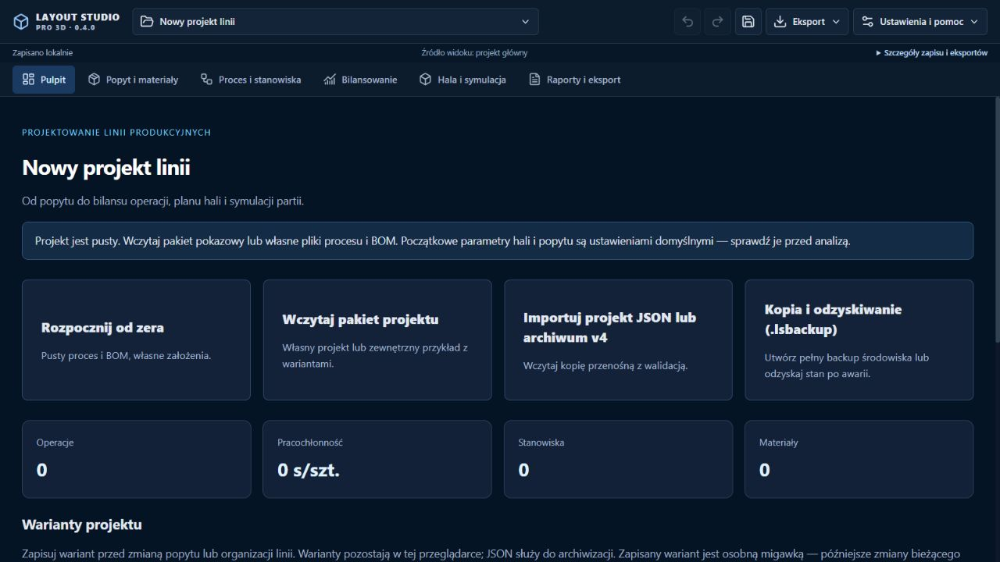

Na Pulpicie rozwiń **Przykłady do pobrania**. Katalog zawiera trzy projekty o rosnącej złożoności oraz dodatkowe Eko. Każda karta podaje pochodzenie danych i rozwijane **Warunki i ograniczenia**. Przykłady nie wczytują się automatycznie. Źródła projektu głównego i warsztatu nadal są oddzielne.

1. Wybierz **Pobierz projekt JSON**, aby otrzymać jeden plik do importera pakietów. **Pobierz komplet ZIP** zawiera cały osobny katalog: 12 plików, w tym arkusze procesu/BOM, warianty, referencje, instrukcję i manifest SHA-256.
2. Komunikat potwierdza sprawdzenie SHA-256 i przekazanie pliku do pobrania. Sprawdź jego zapis w pobranych plikach przeglądarki. Pobranie nie zmienia aktywnego projektu.
3. Wybierz **Wczytaj pobrany pakiet**, wskaż pobrany plik `.project.json`, sprawdź podgląd, pobierz kopię ratunkową i potwierdź zastąpienie danych. Z kompletu ZIP najpierw rozpakuj katalog i wybierz `projekt-pokazowy.json`. Zamknięcie importera przed zatwierdzeniem zachowuje pracę.

Katalog i pliki są częścią dystrybucji: lokalny serwer aplikacji udostępnia je bez internetu. Wersja hostowana wymaga połączenia do pobrania — nie zapewnia automatycznej pamięci offline. Zachowaj ZIP oraz kopie projektów lokalnie. Przy błędzie katalogu wybierz **Ponów odczyt katalogu**; przy błędzie lub niezgodnej sumie pliku ponów pobieranie po sprawdzeniu połączenia. Błąd nie zastępuje bieżącej pracy.

C1 w wersji pakietu **1.1.0** ma również fizyczny wzorzec: **3 sztuki, odstęp 1 s, JIT wyłączony → 460/385 s** (baza/reorganizacja). Wczytaj świeży pakiet z katalogu, a w **Proces i stanowiska → Stanowiska i zasoby** oblicz harmonogram. Monterzy stanowisk źródłowych wykonują przewozy i puste powroty trzech wózków; powrót 10 s to osobne założenie dydaktyczne. Siedem pozycji materiałowych ma po 10 jawnych jednostek początkowych, zużycie 1 na sztukę i pierwszą dostawę w 900 s. Partia ma 3 zadeklarowane korpusy; inna liczba sztuk wymaga dostosowania jawnych przypisań.

Próba dostawy C1: w edytorze zaopatrzenia zmień tylko zapas początkowy **SUP-RAMA** na 0, zapisz i ponownie oblicz. Baza kończy w **1360 s**, reorganizacja w **1285 s**; pierwsza dostawa nadal ma jawny termin 900 s. Przywrócenie zapisanego wariantu przywraca konfigurację. Próba blokady: baza, wyjście S1=1, wejście S2=0, początek zmiany S2=600 s. Drugi wyrób kończy obróbkę S1 w 120 s, ale zwalnia stanowisko w 590 s. Operator zostaje zwolniony zgodnie z polityką; korpus i stanowisko pozostają zajęte. Pełne referencje są w katalogu projektu. Wszystkie te parametry są syntetyczne.

C2 w pakiecie **1.1.0** ma odebrany podpakiet fizyczny A. Wczytaj go z katalogu, przejdź do **Proces i stanowiska → Stanowiska i zasoby**, ustaw **3 sztuki**, **odstęp przybycia 1000 s**, pozostaw JIT wyłączony i oblicz harmonogram. Wynik bazy to **2210 s**, wariantu z dwiema osobami na integracji **2180 s**; pierwsza sztuka kończy się w 210/180 s. Ten odstęp rozdziela zlecenia i służy kontroli połączenia gałęzi, a nie ocenie przepustowości przy spiętrzeniu. Monterzy przewożą podzespoły i korpus czterema wózkami oraz wykonują jawne powroty; osiem materiałów ma osobne zapasy i dostawy magazynowe realizowane przez inne osoby. Wszystkie wartości są syntetyczne.

Próba C2: zmień tylko zapas początkowy **SUP-MU-ZASIL** na 0, zapisz zaopatrzenie i oblicz ponownie przy tych samych warunkach. Gałąź A czeka do dostawy w 900 s; pierwsza sztuka kończy w 1100/1070 s. Końcowy wynik partii nadal wynosi 2210/2180 s, bo późniejsze sztuki pozostają bez opóźnienia. Rozwiń **Partie podzespołów (6)**, aby sprawdzić wytworzenie, przewóz, przybycie i zużycie przy starcie integracji. Przywrócenie zapisanego wariantu odtwarza pełne zapasy. Po odświeżeniu trzeba ponownie obliczyć harmonogram.

**Ograniczenie C2:** pobrany przykład C2-A nadal ma nieograniczone bufory gałęzi. Dostępne są osobne pojemności każdego podzespołu, obie polityki operatora w odebranym zakresie i bezpośredni odbiór jednej partii przy wejściu 0. Konfigurację wczytuje się z pakietu projektu. Osobny formularz, wspólny odbiór kilku partii/korpusu i symulacja gałęzi ze skończonymi buforami korpusów pozostają otwarte. Zatrzymanie operatora wymaga pełnej jawnej obecności podczas producenta. Nieobsługiwane kombinacje są odrzucane, nie upraszczane. Inspekcja partii nie oznacza oddzielnej animacji ich brył w 3D. Historia fizyczna pokazuje korpusy i wózki; bez geometrycznego przebiegu trasy pozycja w przejeździe pozostaje nieznana.

C1/C2 mają też osobne wyniki procesowe przy jawnym JIT: C1 390/315 s, C2 320/270 s dla 3 sztuk i odstępu 1 s. JIT nie sprawdza fizycznego transportu ani zapasów. Pełny fizyczny odbiór C2 pozostaje otwarty do ograniczonych buforów gałęzi. Eko: 1 sztuka, odstęp 1 s, JIT wyłączony — 13550/14150/14150 s. Pakowanie Eko ma dwie osoby przez 1320 s, a przypisania innych ról są testowe; nie odtwarzają znanych tylko łącznie 13 osób pomiaru.

---

### Krok 2: Popyt i materiały → Popyt i takt
Zdefiniuj założenia wejściowe klienta:
- **Popyt roczny i dni robocze**: Wyliczają średni popyt dzienny.
- **Liczba zmian, godziny zmiany i planowane przerwy**: Wyliczają dostępny czas netto.
- **Rezerwa OEE / Dostępność [%]**: Założenie planistyczne uwzględniające straty operacyjne.
- Program automatycznie oblicza kluczowe wskaźniki Lean: **Takt klienta** oraz **Docelowy takt po OEE (Cycle Time Target)**.

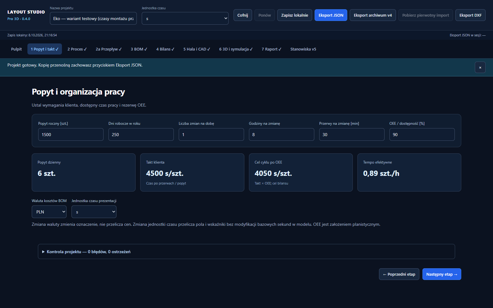

---

### Krok 3: Proces i stanowiska → Operacje
Tabela operacji pozwala na pełną kontrolę struktury technologicznej:
- **ID i Nazwa operacji**: Unikalne identyfikatory kroków (np. `OP10`, `OP20`).
- **Czas standardowy, VA (wartość dodana) i NVA (strata)**: Rozbicie czasu pracy.
- **Zależności (Poprzednicy i Następnicy)**: Definiowanie relacji logicznych (AND) – program pilnuje spójności grafu i blokuje powstawanie cykli.
- **Import / Eksport XLSX & CSV**: Możliwość pobrania gotowego wzorca (`Szablon XLSX` / `Szablon CSV`) z osobnym arkuszem specyfikacji kolumn.

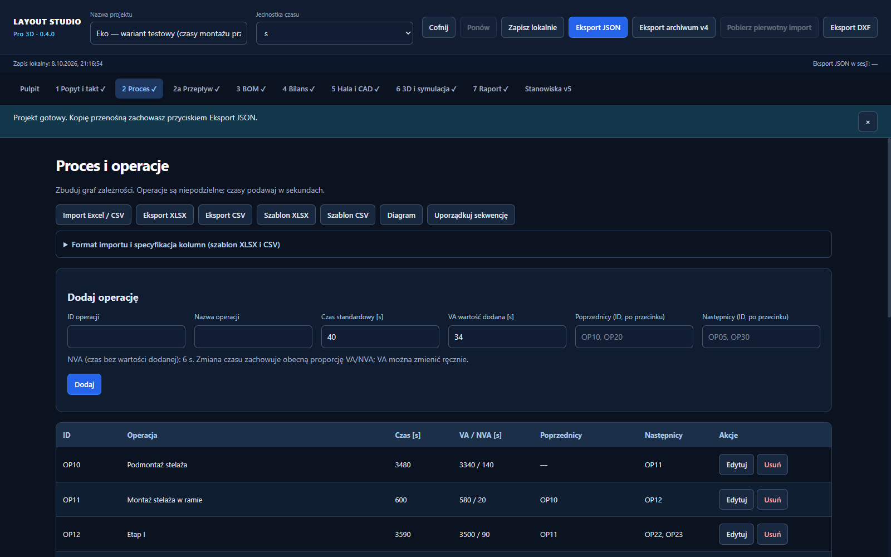

---

### Krok 4: Proces i stanowiska → Przepływ
Interaktywny edytor grafu sieciowego:
- **Kafelki operacji**: Prezentują ID, czas, udział VA oraz liczbę przypisanych części.
- **Przeciąganie i układ**: Pełna swoboda rozmieszczania, siatka 20 px, zoom oraz funkcja *Ułóż według zależności*.
- **Łączenie**: Możliwość tworzenia połączeń technologicznych bezpośrednio z portów `+`.

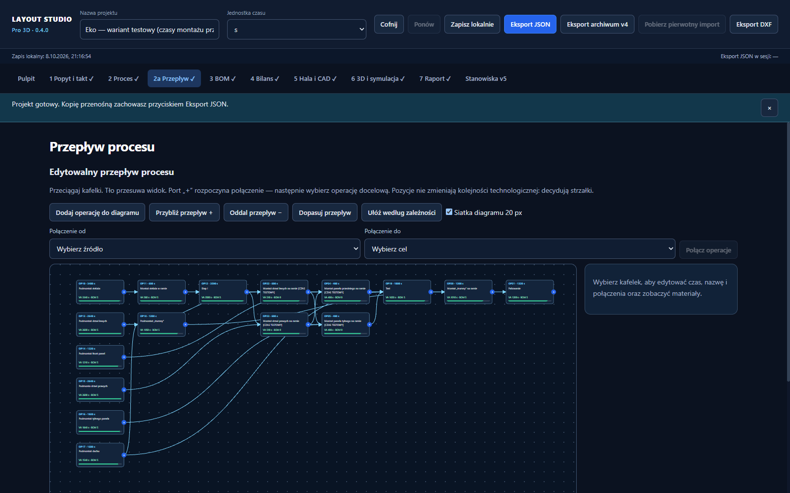

---

### Krok 5: Popyt i materiały → Materiały (BOM)
Zarządzanie strukturą materiałową:
- Powiązanie komponentów z konkretnymi operacjami procesu.
- Dobór nośników logistycznych: **BoxKLT**, **Tray**, **Carton**, **Pallet**.
- Automatyczne wyliczanie: zapotrzebowania dziennego, liczby pojemników na zmianę oraz kosztu materiałowego wyrobu.

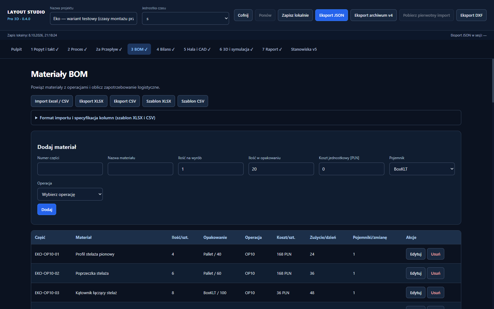

---

### Krok 6: Bilansowanie — bilans i Yamazumi
Narzędzie do optymalizacji obsady i równoważenia obciążenia:
- **Algorytmy i ręczny balans**: Wsparcie dla metod RPW, LCR lub ręcznego podziału na stacje.
- **Dynamiczny wykres Yamazumi**: Słupki reprezentują obciążenie poszczególnych stanowisk względem linii taktu docelowego (żółta linia przerywana).
- **Zasoby stacji**: Możliwość definiowania liczby operatorów (1–20), równoległych kopii stanowiska (1–20) oraz dedykowanego cyklu zespołu.

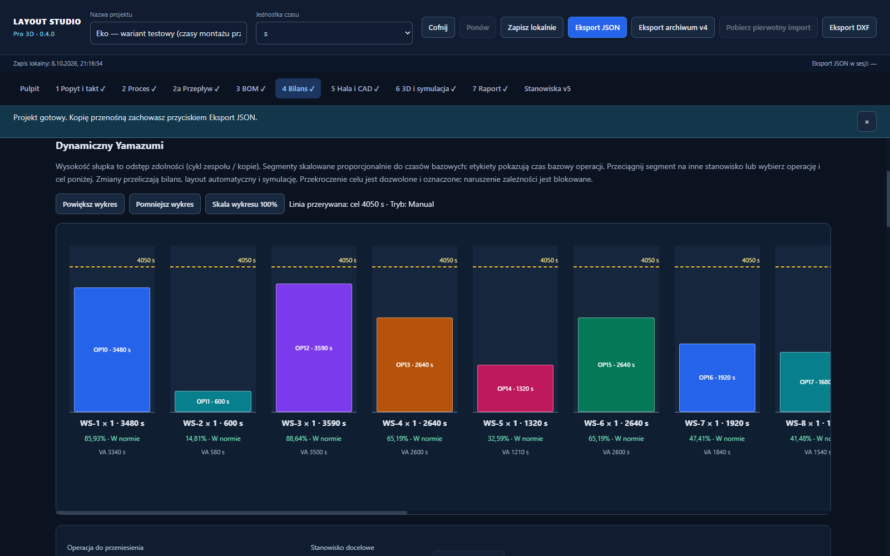

---

### Krok 7: Hala i symulacja → Hala i CAD 2D
Projektowanie przestrzenne rozmieszczenia stacji roboczych:
- **Geometria hali**: Szerokość, długość i wysokość obiektu oraz regulowana siatka przyciągania.
- **Automatyczny generator layoutu**: Generowanie układów w kształcie **U**, **Liniowym**, **L** lub **Z procesu (rybia ość)**.
- **Elementy składowe stanowiska**: Stół ESD, regał buforowy FIFO, strefa pracy operatora.
- **Relacje technologiczne**: Fioletowe linie łączące stoły wskazują kierunek przepływu detalu.

Edytor korzysta z wariantu B: rzut zajmuje dostępną szerokość, a panele otwierają się nad nim na żądanie. **Biblioteka i drzewo** otwiera listę wyposażenia i przeszkód po lewej. Wybranie pozycji otwiera **Właściwości** po prawej; można też wybrać obiekt na rzucie. **Parametry hali** udostępnia wymiary, siatkę i ustawienia generatora. Jeden panel jest otwarty naraz; zamyka go przycisk × albo Escape. Na mniejszych ekranach długie formularze przewijają się wewnątrz panelu.

Zmiany we właściwościach zatwierdź przyciskiem **Zapisz obiekt** albo **Zapisz przeszkodę**. Zmiany parametrów hali działają od razu. **Cofnij/Ponów** przywraca dane projektu i usuwa niezatwierdzony formularz, aby nie zapisać nieaktualnej geometrii. Przesuwanie wyposażenia nadal wymaga przełączenia trybu przyciskiem **Przesuwaj widok / Przesuwaj obiekty**.

Pod rzutem znajdują się zwijane listy wyposażenia i przeszkód oraz **Wyniki i oś czasu — aktywny projekt 4**. Otwarcie wyników uruchamia istniejącą symulację tego projektu, z jej jawnymi założeniami: zerowy transport, dedykowani operatorzy i kolejki bez limitu. Poprawny proces, popyt, hala i bilans są wymagane. Zwijanie wyników zachowuje bieżący przebieg; przejście do innej zakładki uruchamia osobny widok symulacji. Harmonogram szkicu 6 pozostaje w warsztacie tego szkicu.

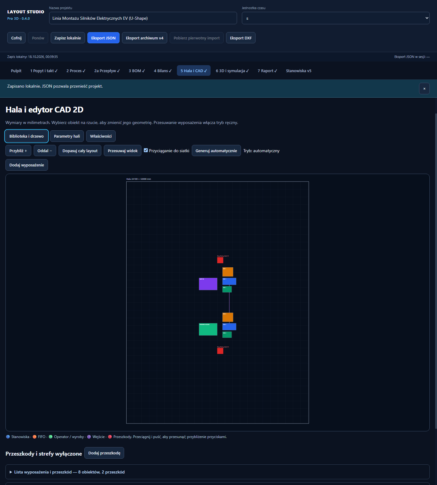

**Wiele obiektów i grupy (5.3).** Wyposażenie dodajesz do zaznaczenia lub usuwasz z niego przez Shift/Ctrl + wybór na rzucie albo w drzewie. W drzewie dostępne są też pola wyboru, przydatne na ekranach bez klawiatury. **Zaznacz wyposażenie** wybiera wszystkie elementy wyposażenia; **Wyczyść zaznaczenie** usuwa wybór. Przeszkody mają osobny edytor i nie należą do tych grup.

**Do lewej/prawej/góry/dołu** wyrównuje obrócone obrysy do pierwszego wybranego obiektu lub grupy. Grupa jest przesuwana jako całość, zachowując odstępy. W trybie **Przesuwaj obiekty** przeciągnięcie zaznaczonego elementu przesuwa całe zaznaczenie jednym gestem; siatka dotyczy punktu zaczepienia, a wzajemne pozycje pozostają zachowane.

Rozwiń **Grupowanie i kopiowanie wyposażenia**. **Grupuj zaznaczone** zapisuje wizualną grupę; późniejsze wybranie jednego członka wybiera całą grupę. **Rozgrupuj zaznaczone** usuwa to powiązanie. Grupowanie nie tworzy stanowiska technologicznego. Aby skopiować zaznaczenie, wpisz jawne przesunięcia X i Y w mm (zero jest dozwolone) i wybierz **Kopiuj zaznaczone**. Kopie mają nowe ID, nowe grupy i nie mają przypisania do stanowiska; nie zwiększają liczby kopii produkcyjnych ani zdolności linii. Sprawdź kolizje po skopiowaniu. Grupowanie, wyrównanie, wspólne przesunięcie i kopiowanie cofasz jako pojedyncze akcje. Grupy i kopie pozostają w zapisie lokalnym i JSON; ponowna automatyczna generacja zastępuje ręczny layout wraz z grupami po potwierdzeniu.

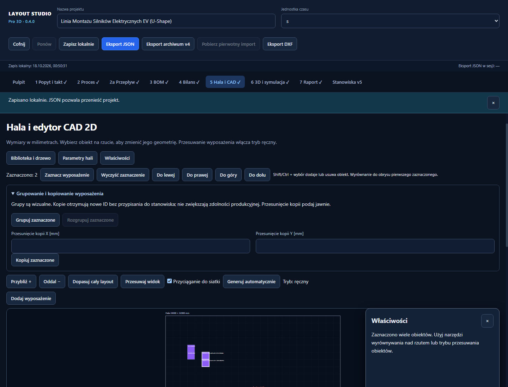

**Przenoszenie zespołu stanowiska (5.4).** Domyślnie aktywna opcja **Przenoś stanowisko z FIFO i strefą** na pasku narzędzi sprawia, że przeciągnięcie na rzucie lub zmiana współrzędnych X/Y we **Właściwościach** dla stołu, regału FIFO albo strefy pracy operatora przypisanych do tego samego stanowiska (lub tej samej kopii `-COPY-N`) przesuwa cały zespół stanowiska o ten sam wektor, zachowując wzajemne odstępy, identyfikatory, przypisanie `workstationId` oraz fioletowe linie relacji technologicznych. Również wyrównywanie wielu stanowisk (**Do lewej/prawej/góry/dołu**) przesuwa całe zespoły stanowisk. Przycisk **Zaznacz zespół stanowiska** jawnie rozszerza bieżące zaznaczenie na wszystkie elementy wybranych stanowisk. Aby skorygować położenie pojedynczego regału FIFO lub maty względem stołu, odznacz **Przenoś stanowisko z FIFO i strefą**.

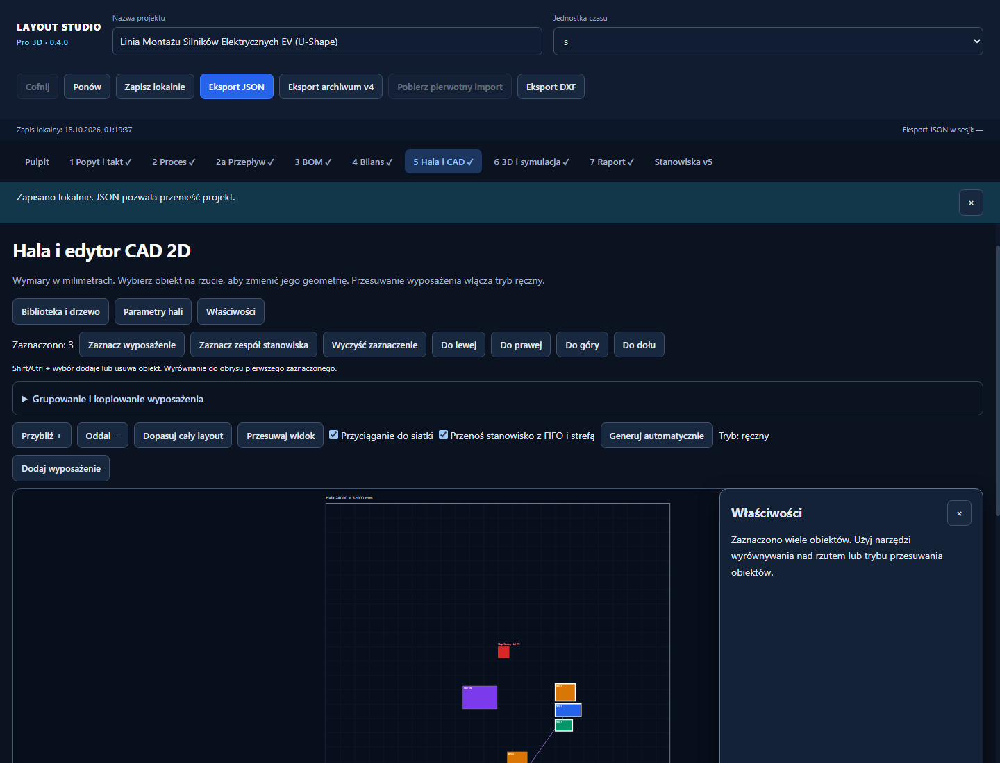

**Przyciąganie do siatki, krawędzi i punktów połączeń oraz wyłączanie przyciągania (5.5).** Na pasku narzędzi nad rzutem dostępne są trzy niezależne przełączniki: **Przyciąganie do siatki** (według kroku `Siatka [mm]` w parametrach hali), **Przyciąganie do krawędzi** (wyrównanie lub dosunięcie obrysu przesuwanego obiektu do krawędzi innych obiektów wyposażenia oraz przeszkód z wyświetleniem przerywanej niebieskiej prowadnicy) oraz **Przyciąganie do punktów połączeń** (dokowanie środków boków i punktu centralnego stołu/obiektu z wizualnymi znacznikami portów oraz żółtą prowadnicą). Przycisk **Wyłącz przyciąganie / Włącz przyciąganie** pozwala jednym kliknięciem wyłączyć lub włączyć wszystkie tryby przyciągania (również przytrzymanie klawisza `Alt` podczas przeciągania tymczasowo wyłącza przyciąganie, umożliwiając swobodny ruch z dokładnością 1 mm).

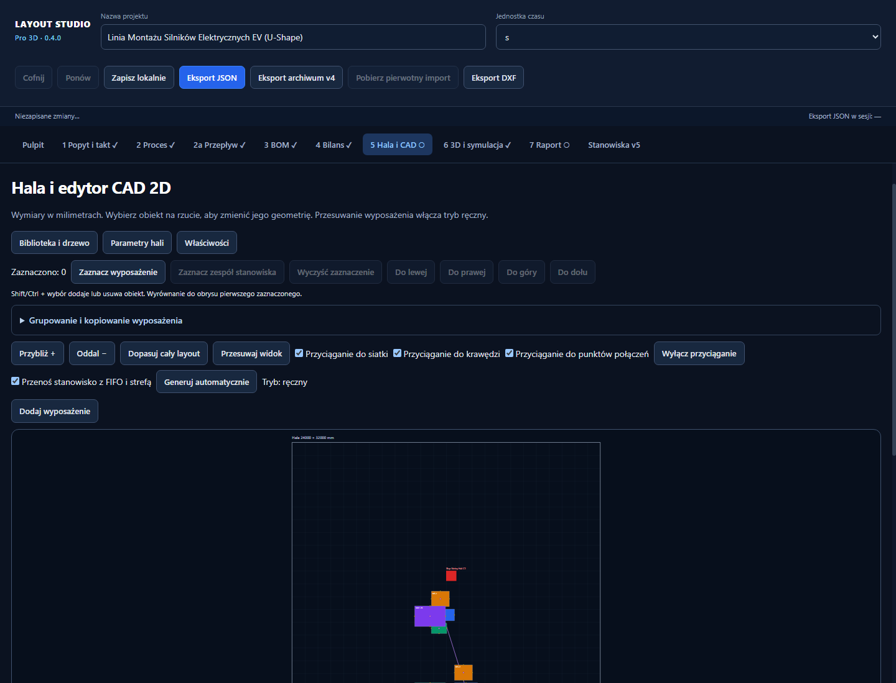

**Wymiarowanie, pomiary odległości, warstwy i blokowanie obiektów (5.6).** Pasek narzędzi **Warstwy i pomiary odległości** pozwala niezależnie włączać i ukrywać siedem warstw rzutu: **Warstwa: Podkład hali**, **Warstwa: Stanowiska**, **Warstwa: Bufory i logistyka**, **Warstwa: Strefy operatorów**, **Warstwa: Relacje technologiczne**, **Warstwa: Przeszkody** oraz **Warstwa: Wymiary i pomiary** (etykiety gabarytów `szerokość × głębokość mm` na obiektach i przeszkodach oraz linie wymiarowe). Po zaznaczeniu co najmniej dwóch obiektów automatycznie wyświetlana jest linia wymiarowa oraz odczyt **Pomiar zaznaczonych** z prześwitem krawędzi obróconych obrysów (`prześwit ... mm`), odległością `środek–środek` oraz składowymi `ΔX` i `ΔY`. Przycisk **Mierz odległość** uruchamia interaktywną miarkę punkt–punkt na rzucie (z przyciąganiem do portów lub siatki i przyciskiem **Wyczyść pomiar**). Przyciski **Zablokuj zaznaczone / Odblokuj zaznaczone** na pasku wielokrotnego zaznaczenia oraz pole **Zablokuj pozycję i wymiary obiektu** w panelu **Właściwości** oznaczają obiekt symbolem `🔒` i przerywanym obrysem, chroniąc go przed przesunięciem myszą, zmianą współrzędnych/wymiarów, przesunięciem podczas wyrównywania oraz usunięciem (zablokowany obiekt może natomiast służyć jako nieruchoma baza odniesienia przy wyrównywaniu innych obiektów do jego obrysu).

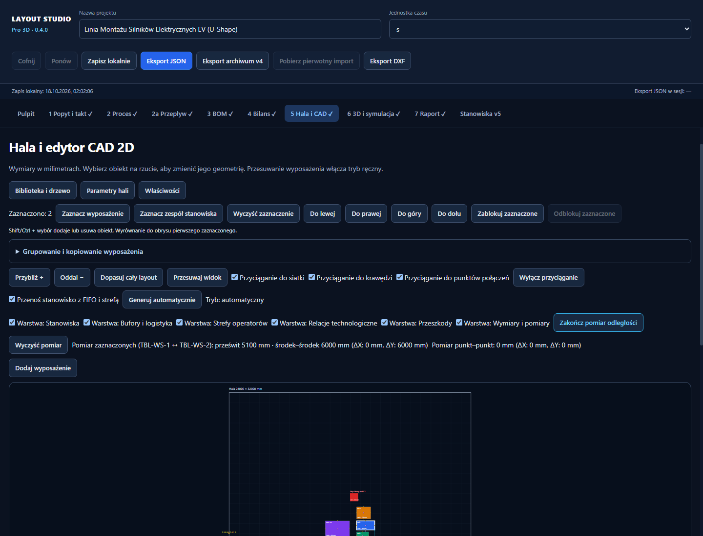

**Podkład hali i kalibracja skali (5.7).** W panelu **Parametry hali** sekcja **Podkład hali i kalibracja skali** pozwala wczytać rysunek architektoniczny posadzki (**Wczytaj podkład (PNG/JPG/SVG/WebP)**, do 3 MB). Wczytany podkład jest wyświetlany pod siatką wyposażenia na warstwie **Warstwa: Podkład hali** z etykietą gabarytów i skali (`mm/px`). Skala może być wpisana bezpośrednio w polu **Skala podkładu [mm/px]** albo wyznaczona dwupunktowo z rysunku: kliknij **Wskaż 2 punkty kalibracji na rzucie** (lub przycisk **Kalibruj skalę podkładu** na pasku warstw), kliknij na rzucie punkt początkowy `A` i końcowy `B` odcinka o znanym wymiarze rzeczywistym, wpisz **Rzeczywista odległość A–B [mm]** i wybierz **Zastosuj kalibrację skali** — aplikacja przeliczy skalę `mm/px` oraz rzeczywiste wymiary podkładu w milimetrach. Pola **Przesunięcie podkładu X/Y [mm]** oraz **Przezroczystość podkładu [0.05–1]** pozwalają precyzyjnie zgrać rysunek z początkiem układu współrzędnych hali, a przycisk **Dopasuj wymiary hali do podkładu** ustawia szerokość i długość hali na skalibrowany wymiar podkładu. Podkład wraz z kalibracją jest zapisywany w projekcie lokalnym i przenośnym pliku JSON oraz obsługuje **Cofnij / Ponów**.

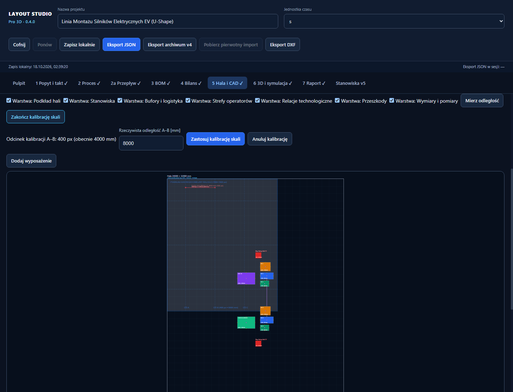

**Import geometrii DXF z weryfikacją jednostek i raportem pominiętej geometrii (5.8).** W panelu **Parametry hali** sekcja **Import geometrii DXF** umożliwia wczytanie tekstowego pliku CAD (`.dxf`, do 5 MB). Obsługiwany podzbiór geometrii 2D w sekcji `ENTITIES` obejmuje zamknięte polilinie `LWPOLYLINE` oraz `POLYLINE` (`VERTEX` + `SEQEND`), okręgi `CIRCLE` (np. słupy konstrukcyjne), osiowe odcinki `LINE` na warstwach hali/przeszkód (`FACILITY`, `HALA`, `BOUNDARY`, `OBSTACLES`, `COLUMNS`, `WALLS`) oraz etykiety `TEXT` i `MTEXT` parowane z obrysami na tej samej warstwie. Aplikacja odczytuje zmienną nagłówkową `$INSUNITS` (`4` = mm, `5` = cm, `6` = m, `1` = in, `2` = ft); jeżeli plik nie deklaruje jednoznacznej jednostki (`$INSUNITS=0` lub brak nagłówka), wyświetlany jest komunikat ostrzegawczy, a przycisk **Zastosuj import DXF** pozostaje zablokowany do momentu jawnego wyboru jednostki w polu **Jednostki pliku DXF**. Wszystkie nieobsługiwane encje CAD (m.in. `INSERT` — nierozbite bloki, `SPLINE`, `ARC`, `ELLIPSE`, `HATCH`, `DIMENSION`, `3DFACE`, polilinie z łukami `bulge` lub mniej niż 3 wierzchołkami) nie są milcząco gubione, lecz zestawiane w **Raporcie pominiętej geometrii** z podaniem typu encji, warstwy, liczby wystąpień i przyczyny pominięcia. Pole **Zakres importu DXF** pozwala wybrać aktualizację **Wymiary hali i przeszkody**, **Tylko przeszkody do istniejącej hali** albo **Pełny rzut CAD (hala, przeszkody i obiekty wizualne)** (z opcją **Zastąp istniejące przeszkody przy imporcie**).

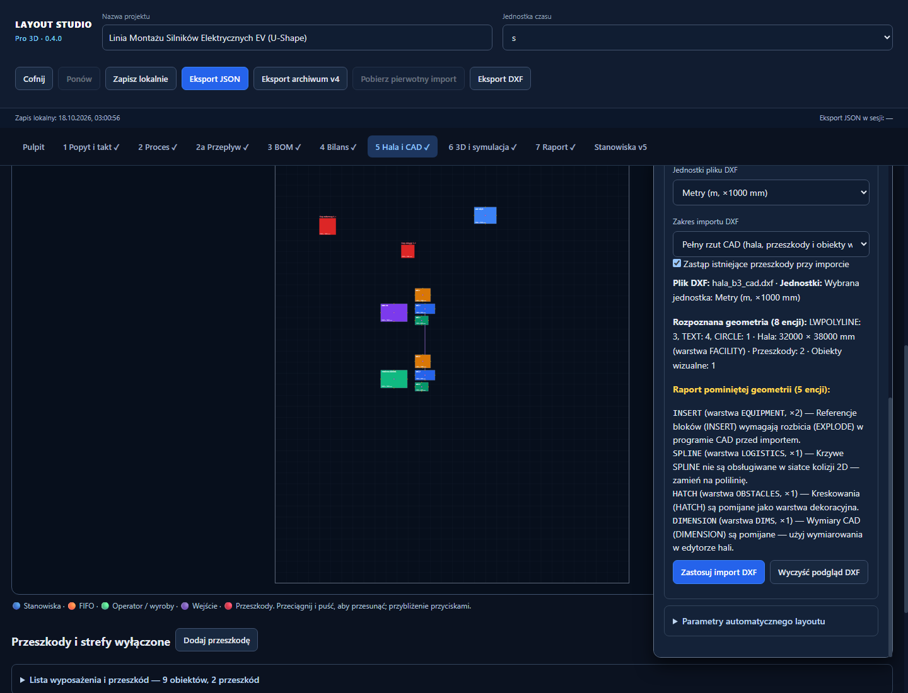

**Strefy obsługi, odkładania i komunikacji oraz rozróżnienie ostrzeżeń geometrycznych od oceny zgodności BHP (5.9).** Na rzucie 2D warstwa **Warstwa: Strefy obsługi, odkładania i komunikacji** (włączana i wyłączana na pasku **Warstwy i pomiary odległości**) czytelnie wyróżnia trzy rodzaje stref funkcjonalnych kreskowanymi obrysami i etykietami:
- **Strefa obsługi (`Strefa obsługi (...)`)** — zielona kreskowana otoczka wokół maty ergonomicznej operatora (`+150 mm`) lub przedni pas roboczy (`800 mm` głębokości) przed stołem stanowiska nieposiadającego maty.
- **Strefa odkładania (`Strefa odkładania (...)`)** — bursztynowa kreskowana otoczka wokół regałów buforowych FIFO, stref wejścia materiału oraz wyrobów gotowych (`+140 mm`).
- **Strefa komunikacji (`Strefa komunikacji międzyrzędowej` / `Strefa komunikacji wzdłuż linii`)** — błękitny pas komunikacyjny wyznaczany na podstawie parametru `Przejście / odstęp ramion [mm]`.

Pod rzutem panel **Strefy funkcjonalne i kontrola geometryczna rzutu (nie BHP)** wyświetla liczniki wyznaczonych stref oraz listę ostrzeżeń geometrycznych oznaczonych etykietą **`Geometria rzutu (nie BHP)`** (wykroczenie poza obrys hali, nakładanie obrysu 2D ze słupem/przeszkodą, kolizja dwóch obiektów wyposażenia, zbyt mały prześwit między stołami oraz wejście przeszkody w obrys strefy obsługi/odkładania/komunikacji) z przyciskiem **Zaznacz obiekt / Zaznacz kolidujące obiekty** oraz wyróżnieniem kolidującego obiektu na rzucie przerywaną czerwoną ramką. Panel zawiera jawne zastrzeżenie, że kontrola ma wyłącznie charakter geometryczny (prostokątne obrysy 2D i zadane prześwity modelowe w mm) i **nie stanowi formalnej oceny zgodności z przepisami BHP, ergonomii, ochrony przeciwpożarowej ani dopuszczenia stanowisk do eksploatacji** — również brak ostrzeżeń geometrycznych nie zastępuje odbioru BHP.

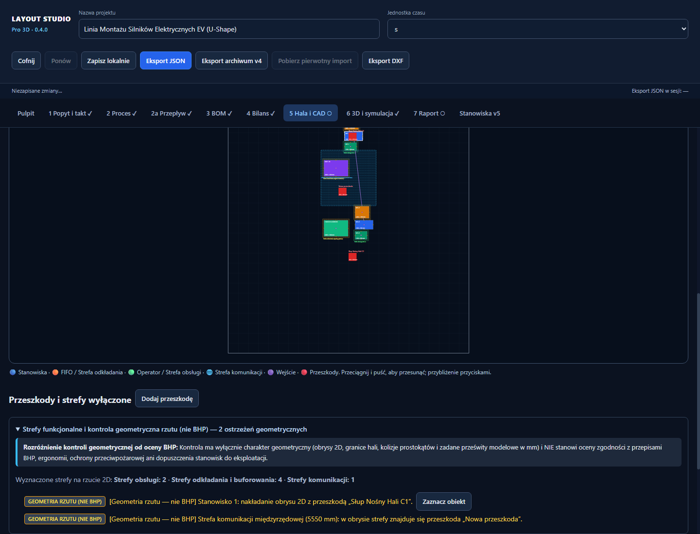

---

### Krok 8: Hala i symulacja → 3D i symulacja
Cyfrowy bliźniak i symulator zdarzeniowy:
- **Nawigacja 3D**: Lewy przycisk myszy – obrót sceny, prawy – przesuwanie (pan), kółko – zoom.
- **Tryb edycji 3D**: Przesuwanie wyposażenia po posadzce hali z zachowaniem siatki.
- **Deterministyczna symulacja w tle (Web Worker)**:
  - Ustawienie wielkości partii (np. 30 sztuk) oraz odstępu uruchamiania detali.
  - Szybkości odtwarzania od 1× do 5000× z zachowaniem pełnej precyzji zdarzeń.
  - Wskaźniki w czasie rzeczywistym: czas symulowany, ukończone wyroby, WIP (produkcja w toku), średnia wydajność linii (szt./h) oraz stan poszczególnych stacji.
  - Eksport dokładnego przebiegu zdarzeń do pliku CSV.

**Wspólne zaznaczenie i dane 2D–3D, skróty klawiszowe, blokowanie i podpowiedzi (5.10).**
- **Wspólny stan zaznaczenia 2D–3D**: Wybór obiektu na rzucie 2D (`5 Hala i CAD`) pozostaje aktywny po przełączeniu na zakładkę symulacji 3D (`6 Widok 3D i symulacja`), a kliknięcie obiektu w 3D natychmiast synchronizuje zaznaczenie i formularz właściwości w 2D.
- **Wizualna identyfikacja 3D**: Zaznaczony obiekt w 3D posiada błękitną ramkę obwiedniową (`BoxHelper`), a obiekt zablokowany – ostrzegawczą żółtą ramkę.
- **Ochrona obiektów zablokowanych (`locked`) w 3D**: Obiekty oznaczone jako zablokowane nie mogą być przypadkowo przesunięte przeciąganiem myszy w widoku 3D ani 2D. Formularz edycji 3D zawiera pole wyboru blokady oraz blokuje edycję pól współrzędnych.
- **Spójne skróty klawiszowe**:
  - Globalne: `Ctrl+Z` (Cofnij), `Ctrl+Y` (Ponów), `Ctrl+S` (Zapisz lokalnie w pamięci przeglądarki).
  - Nawigacja i rzut: `F` (Dopasuj cały layout / Dopasuj halę 3D), `T` (Widok prostopadle z góry w 3D), `G` (Przełącz przyciąganie do siatki / skoków kątowych), `M` (Przełącz tryb edycji / przesuwania myszą), `L` (Zablokuj / odblokuj zaznaczone obiekty), `S` (Relacje technologiczne procesu w 3D), `Strzałki` (Precyzyjne przesunięcie zaznaczonych obiektów o krok siatki; z klawiszem `Shift` krok 5×), `Escape` (Odznacz / zamknij panel / anuluj pomiar).
  - Manipulatory 3D (Gizmo) i widoczność (6.5): `W` (Manipulator przesuwania w osiach posadzki X, Z), `E` / `R` (Manipulator obrotu Yaw wokół osi pionowej), `Q` (Wyłącz manipulator 3D), `H` (Ukryj zaznaczone obiekty w widoku 3D), `Shift+H` / `N` (Pokaż wszystkie ukryte obiekty w 3D).
- **Spójne nazwy i podpowiedzi narzędzi**: Wszystkie przyciski pasków narzędziowych 2D i 3D posiadają atrybuty `title` z przypisanymi skrótami klawiszowymi.
- **Ściągawka skrótów pod rzutem i widokiem 3D**: Rozwijana sekcja **Skróty klawiszowe CAD i 3D** prezentuje pełną listę skrótów z czytelnymi oznaczeniami `<kbd>`.

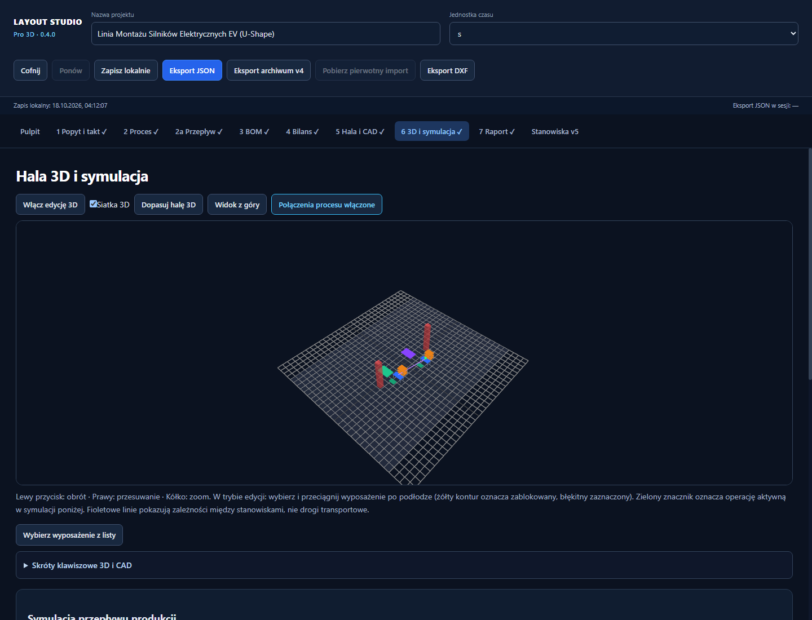

**Parametryczne wyposażenie 3D oraz nakładki stref i obrysów kolizji (6.2).**
- **Rozpoznawalne, parametryczne modele 3D**: Każdy typ wyposażenia jest generowany proceduralnie na podstawie jego rzeczywistych wymiarów i specyfikacji:
  - *Stoły montażowe i warsztatowe*: Blat roboczy z opcjonalną matą ESD, rama z profili stalowych/aluminiowych ze stopkami poziomującymi, nadstawka pionowa, tablica perforowana 5S, belka oświetleniowa LED oraz przyrządy kontrolne.
  - *Regały przepływowe FIFO*: Pochylone bieżnie rolkowe grawitacyjne z prowadnicami bocznymi, niebieskie pojemniki KLT na torach, rurkowo-złączkowa konstrukcja lean pipe oraz dolna półka zwrotna pustych pojemników.
  - *Palety i pola odkładcze*: Realistyczna geometria europalety EPAL (1200×800×144 mm — 5 desek górnych, 3 poprzecznice, 9 klocków, 3 płozy dolne) oraz narożniki wyznaczenia pola odkładczego na posadzce z pasami bezpieczeństwa.
  - *Pojemniki KLT*: Znormalizowane skrzynki VDA 4500 (obrzeże sztaplowania, ożebrowanie podstawy, uchwyty, etykiety).
  - *Wózki transportowe i AMR/AGV*: Rama platformowa ze stalowymi burtami, dyszel holowniczy i 4 koła na poziomie posadzki; roboty AGV z podwoziem, skanerami LIDAR, pierścieniem LED 360° i stołem nożycowym.
  - *Przenośniki rolkowe*: Ceowniki stalowe, ocynkowane rolki rozmieszczane automatycznie co 100 mm wzdłuż długości oraz podpory w układzie H ze stopami kotwionymi.
  - *Ergonomia i tablice 5S*: Maty amortyzujące ze skosami bezpieczeństwa, tablice cieni z narzędziami oraz 3-kolorowe kolumny sygnalizacyjne Andon.
- **Wizualne nakładki stref obsługi i obrysów kolizji 3D**:
  - Przycisk **Strefy 3D** (`Pokaż/ukryj strefy obsługi i odkładania w 3D`) wyświetla półprzezroczyste zielone prostopadłościanowe strefy pracy operatora na poziomie posadzki (zgodne z normą PN-EN ISO 14738).
  - Przycisk **Obrysy kolizji 3D** (`Pokaż/ukryj obrysy kolizji z marginesem bezpieczeństwa w 3D`) wyświetla żółte półprzezroczyste prostopadłościany skrajni z ostrzegawczymi ramkami krawędziowymi, ułatwiając natychmiastowe zlokalizowanie kolizji przestrzennych.
  - Punkty transportowe (dokowania) są wyróżnione niebieskimi markerami ze strzałkami kierunku podejścia wózka lub AGV.
- **Gospodarka pamięcią i niezależność technologiczna**: Zastosowano współdzieloną paletę materiałów PBR oraz automatyczne zwalnianie pamięci GPU WebGL (`disposeEquipmentGroup`). Zgodnie z Zasadą 6 zmiana geometrii 3D ma charakter wyłącznie wizualny i nie wpływa na czasy operacji ani wynik symulacji.

**Automatyczna pierwsza propozycja layoutu, uwzględnienie BOM i oznaczenia założeń wizualnych (5.13).**
- **Natychmiastowa propozycja layoutu**: Po wprowadzeniu lub zaimportowaniu poprawnego procesu technologicznego system automatycznie generuje i prezentuje pierwszą propozycję rozmieszczenia stanowisk opartą na grafie operacji i wstępnym bilansie (zależności technologiczne, czas taktu i wyznaczone stacje). Użytkownik nie musi szukać ani klikać osobnego przycisku generowania pierwszej propozycji.
- **Wsparcie w docelowym modelu stanowisk (schemat 5)**: Mechanizm automatycznej propozycji działa w pełni także w `Warsztacie stanowisk v5` (`deriveStationProject`), automatycznie tworząc początkowe wyposażenie z trwałymi identyfikatorami stanowisk i zapobiegając błędom braku stołów przy migracji lub imporcie nowego procesu.
- **Prezentacja przepływu materiałów z uwzględnieniem BOM**: Etykiety i oznaczenia regałów buforowych FIFO automatycznie zawierają przypisane numery części z zestawienia materiałowego BOM (`BOMComponent.partNumber`). Brak zestawienia BOM lub jego niekompletność nie blokuje utworzenia szkicu rozmieszczenia stanowisk – regały FIFO są wówczas prezentowane z ogólnym oznaczeniem stanowiska.
- **Oznaczenie założeń wizualnych (koncepcyjnych)**: Wygenerowane domyślne obrysy, gabaryty i wyposażenie otrzymują znacznik `isVisualAssumption: true` oraz są czytelnie wyróżnione odznaką `Założenie wizualne` w panelach właściwości 2D i 3D oraz banerem informacyjnym. Podkreśla to, że propozycja ma charakter geometryczno-koncepcyjny i nie przypisuje wyposażeniu automatycznej zdolności technologicznej.
- **Zastrzeżenie przy braku potwierdzonych wymiarów hali**: Jeżeli wymiary hali nie zostały zweryfikowane poprzez skalibrowany podkład posadzki (`underlay.calibratedDistanceMm`) ani potwierdzone przez użytkownika (`facility.isConfirmed`), w edytorze 2D i widoku 3D wyświetlana jest nota informująca, że model nie deklaruje dopasowania do rzeczywistej przestrzeni fizycznej.
- **Ścisła ochrona ręcznych pozycji (`layoutMode: 'manual'`)**: Jakakolwiek ręczna modyfikacja pozycji (przeciągnięcie myszą, przesunięcie klawiaturą, zmiana parametrów we właściwościach) przełącza projekt w tryb ręczny. Pozycje ręczne są bezwzględnie chronione przed automatycznym nadpisaniem przy aktualizacjach procesu i bilansu; ponowna automatyczna generacja wymaga jawnego wyboru typu układu i potwierdzenia w oknie dialogowym.
- **Weryfikacja na procesach niezależnych**: Działanie automatycznej propozycji, integracji z BOM i ochrony pozycji zostało przetestowane i odebrane na niezależnych procesach przemysłowych: montażu silników elektrycznych EV (`PROJ-MOTOR-01`, układ U) oraz montażu modułów baterii EV (`PROJ-BATTERY-02`, przepływ ciągły liniowy).

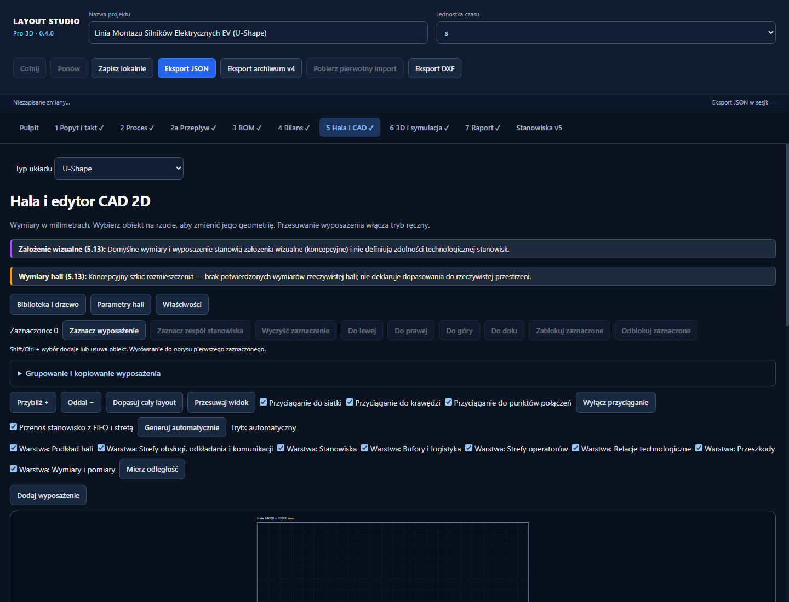

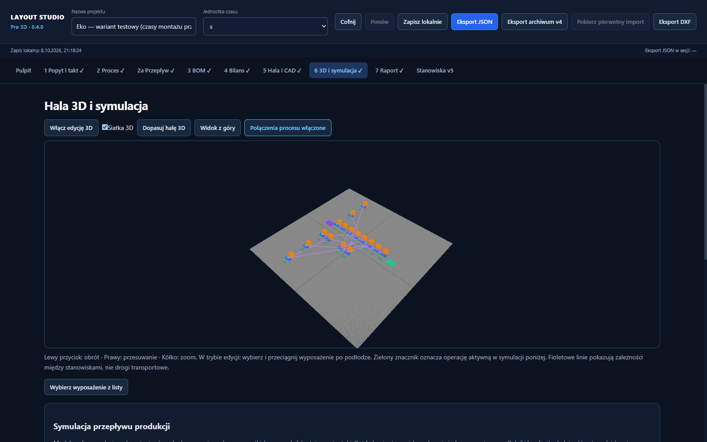
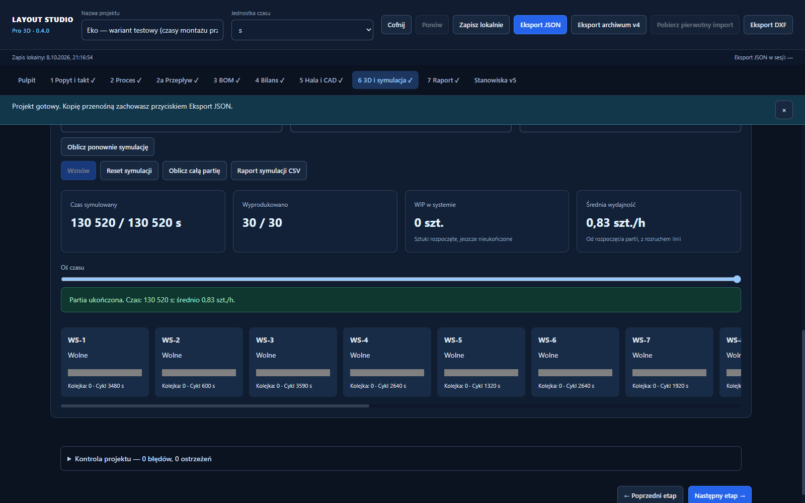

---

### Krok 9: Raporty i eksport — raport inżynierski
Zestawienie podsumowujące projekt:
- Parametry popytu, taktu i dostępności.
- Bilans stanowisk, obsada, wąskie gardła i wyliczona sprawność.
- Struktura kosztowa BOM i weryfikacja kolizji layoutu.
- Przycisk generowania wydruku / zapisu do PDF bezpośrednio z przeglądarki.

---

### Krok 10: Proces i stanowiska → Stanowiska i zasoby
Dedykowane środowisko dla złożonych procesów montażowych:
- **Trwałe identyfikatory (`ST-...`)**: Powiązania odnoszą się do ID, nie numeru na liście. Wycofanie stanowiska z zasobami wymaga jawnego rozstrzygnięcia jego powiązań; komunikatu walidacji nie należy omijać przez ręczną zmianę JSON.
- **Kontrola layoutu**: Zabezpieczenie przed brakującymi stołami lub wyposażeniem przed uruchomieniem symulacji.
- **Nowy model procesu (Szkic 6)**:
  - Rejestr fizycznych instancji wyrobu / korpusu i ich przemieszczeń.
  - Operatorzy współdzieleni i rezerwacje pracowników bez podwójnego przypisania.
  - Indywidualne kalendarze zmian i przerw.
  - Reguły dopuszczalnej równoległości montażu.

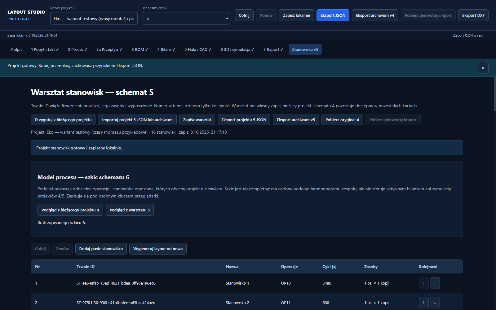
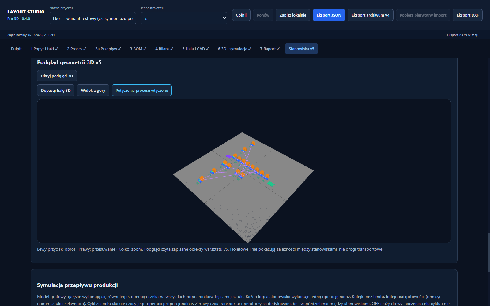

---

## 3. Praca ze szkicem 6 po Etapach 1–4

### 3.1. Wybierz właściwe środowisko i zabezpiecz dane

Zakładki procesu, bilansu, hali i 3D dotyczą aktywnego projektu 4. Warsztat **Stanowiska v5** przechowuje osobny projekt z trwałymi ID stanowisk. W tym warsztacie znajduje się **Model procesu — szkic schematu 6**, z odrębnym zapisem i własnym harmonogramem. Wynik szkicu nie steruje automatycznie bilansem ani animacją projektów 4/5.

- Otwórz **Stanowiska v5**, następnie **Podgląd z bieżącego projektu 4** albo **Podgląd z warsztatu 5**. Sprawdź operacje, przypisania i listę brakujących danych.
- Zaznacz, że rozumiesz pozostawienie braków, i wybierz **Zapisz niekompletny szkic 6**. Nie traktuj migracji jako uzupełnienia osób, wyposażenia, kalendarzy lub pomiarów.
- Przy istniejącym szkicu najpierw użyj **Pobierz szkic z oryginałem**. Zastąpienie szkicu jest osobną, potwierdzaną czynnością. Uszkodzony zapis pozostaje zachowany do pobrania surowej kopii.
- Przed istotną zmianą pobierz także **źródło**. **Cofnij dane szkicu / Ponów dane szkicu** obejmuje bieżącą sesję; nie zastępuje eksportu. Po przeładowaniu dane pozostają zapisane, ale historia sesji i obliczony wynik nie muszą pozostać dostępne.

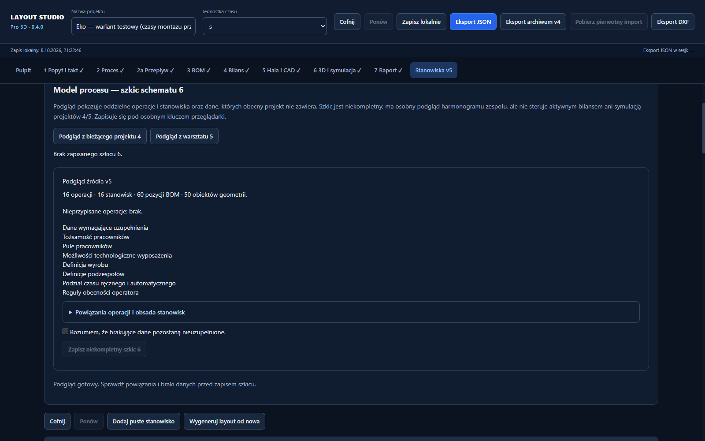

### 3.2. Uzupełnij osoby, czasy, kompetencje i wyposażenie

- W edytorze osób dodaj rzeczywiste ID i nazwy; pule są jawnymi listami osób. Liczba operatorów starego stanowiska nie tworzy automatycznie tożsamości pracowników.
- W profilach czasu operacji podaj czas całkowity i rozdziel pracę ręczną, maszynową oraz obecność operatora. Wskaż, czy czas jest zmierzony, czy założony. Praca ręczna musi mieścić się w okresie obecności.
- Dla obsady zadeklaruj minimum i jawne warianty czasu. Następnie w wyborze zespołu przebiegu zapisz skład, liczebność dla każdej operacji i dopuszczone osoby. Większa obsada nie dzieli czasu automatycznie.
- W **Kompetencjach obsady** dodaj słownik ID/nazw, zaznacz kompetencje osób i wymagania operacji, następnie wybierz **Zapisz kompetencje**. Obsada może się uzupełniać: każda wymagana kompetencja musi wystąpić u co najmniej jednej rzeczywiście wybranej osoby.
- Tabela pokrycia dotyczy zapisanych danych. Kompetencje wszystkich dopuszczonych osób nie wystarczą, jeśli żadna obsada wybranej liczebności nie pokrywa wymagań. Brak wyboru obsady oznacza brak oceny; brak wymagań nie jest potwierdzeniem uprawnień.
- Zapisane ID kompetencji są stałe. Przed usunięciem definicji odznacz jej przypisania i wymagania. **Odrzuć zmiany kompetencji** usuwa niezapisane edycje formularza.
- Wyposażenie definiuj osobno od jego geometrii. Jawnie wskaż operacje, które urządzenie może wykonywać, jego stanowisko i kopię, a następnie wymagane egzemplarze w dopuszczeniu operacji. Typ stołu lub nazwa modelu 3D nie nadaje możliwości technologicznych.

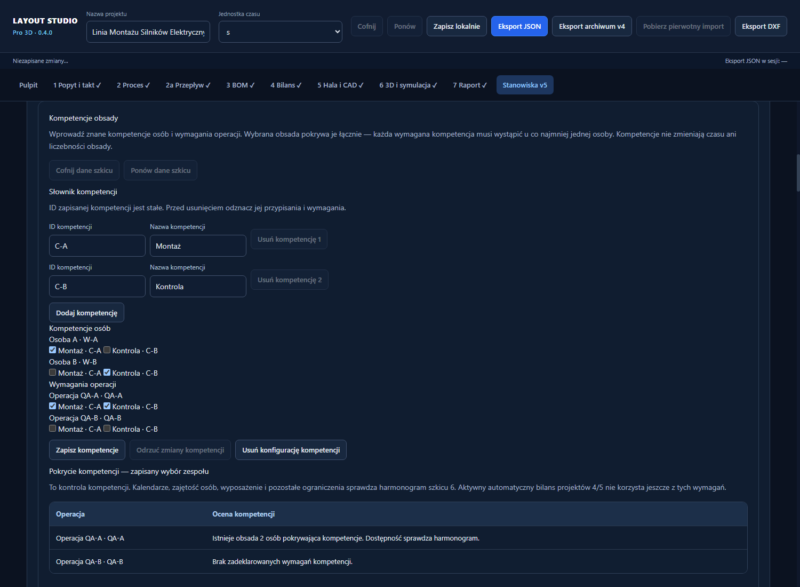

### 3.3. Kalendarze, kopie i fizyczny transport

Wprowadź jawne zmiany i przerwy osób oraz stanowisk. Harmonogram korzysta ze wspólnej dostępności wybranego zespołu i kopii, a rezerwacje chronią osoby przed nakładaniem prac. Brak wymaganego kalendarza lub wariantu czasu wymaga uzupełnienia danych, nie przyjęcia domyślnej dostępności.

- Zadeklaruj dopuszczone kopie każdej operacji i wymagane wyposażenie. Najwcześniejszy start ma pierwszeństwo; potwierdzona trasa rozstrzyga właściwe remisy zgodnie z konfiguracją.
- Dla fizycznego korpusu określ role operacji, rzeczywiste instancje i lokalizacje początkowe oraz przypisanie do sztuk przebiegu. Nie twórz kilku lokalizacji tego samego korpusu.
- Trasa wymaga potwierdzonej długości i źródła oraz wpisanego czasu lub jawnych parametrów obliczenia. Czas wyliczony pozostaje założeniem.
- W transporcie montażu określ konkretne wózki/przenośniki i obsadę. Dojazdy pustych wózków w zestawie odbywają się kolejno według zapisanej kolejności urządzeń, także przy rozłącznych załogach. Przewóz czeka na wszystkie wymagane wózki.
- Jawnie określ zachowanie po rozładunku i trasy/obsadę powrotów. Nie zakładaj teleportacji ani domyślnej pracy magazynierów. Zaopatrzenie magazynowe opisuje dostępność materiału, nie rezerwacje operatorów magazynu.
- Dla podzespołów zadeklaruj ilości, jednostki i wykonania producenta/odbiorcy. Cała jawna partia jest dostępna po zakończeniu producenta, a przypisane zużycie następuje atomowo przy starcie odbiorcy.

Dalsze przykłady korpusu i ról opisano w [Korpus_v6.md](Korpus_v6.md). Jawna grupa równoległości jest tylko dopuszczeniem: nie znosi poprzedników, ograniczeń miejsca ani wyłączności zasobów.

### 3.4. Bufory i zaopatrzenie montażu

W **Buforach stanowisk** wybierz stanowisko, zakres kopii, pojemności wejścia/wyjścia i politykę operatora. Zapisz konfigurację. „Wszystkie kopie osobno” oznacza tę samą pojemność osobno dla każdej kopii, nie wspólną pulę. Nie nakładaj reguły wszystkich kopii na osobną regułę tej samej kopii.

- Pojemność wejścia 0 oznacza odbiór bez składowania: odbiorca musi być gotowy przy przyjeździe. Miejsce docelowe jest zabezpieczane przed wyjazdem.
- Pełne wyjście blokuje po zakończeniu pracy. Stanowisko i wyposażenie pozostają zajęte; polityka określa, czy operator jest zatrzymany, czy zwolniony.
- Wyjście 0 utrzymuje korpus na stanowisku do rzeczywistego wyjazdu. Kolejne operacje na tej samej kopii pozostawiają korpus na miejscu; oczekiwanie lokalne jest odrębne od blokady wyjścia.

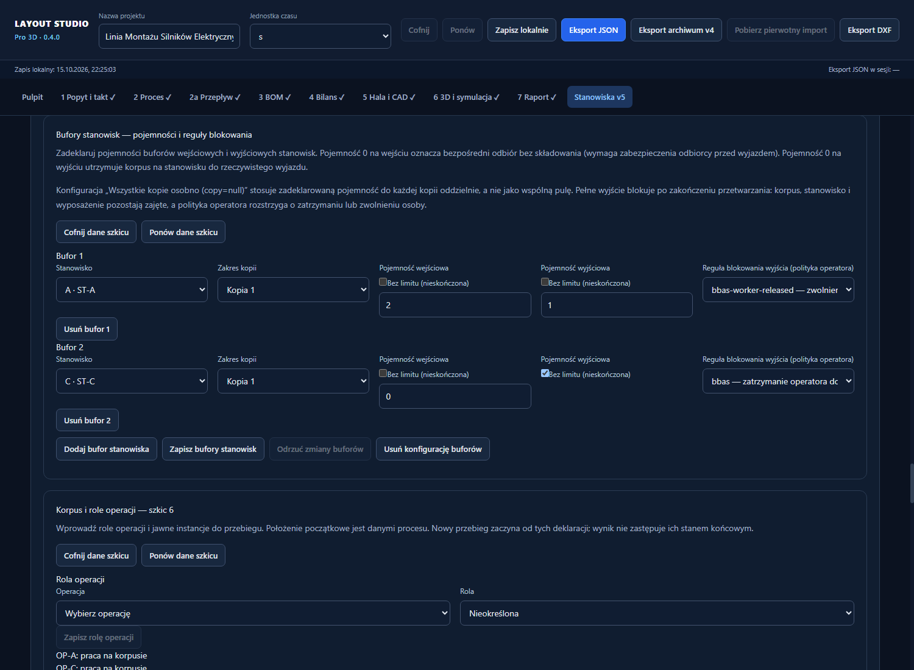

**Osobne bufory podmontaży.** Każdy podzespół i każda kopia stanowiska mają odrębną pojemność w sztukach; bufory korpusów pozostają osobne. Nie używaj formularza **Bufory stanowisk** do nadawania limitów podzespołom. W obszarze **Proces i stanowiska → Stanowiska i zasoby** sekcja **Bufory podmontaży — pojemności i reguły blokowania** pozwala dodać, edytować i usunąć konfigurację szkicu 6.

Wybierz podzespół, wpisz jednostkę zgodną z jego partiami, wybierz stanowisko oraz kopię albo wszystkie kopie osobno. Dla wejścia i wyjścia wybierz konkretną nieujemną całkowitą pojemność albo **Bez limitu**; wybierz też politykę operatora. Wartości wymagają jawnego podania. **Zapisz bufory podmontaży** zatwierdza zmiany, **Odrzuć zmiany podmontaży** przywraca zapisane dane, a przyciski cofania i ponawiania działają na historii szkicu. Formularz odrzuci m.in. nakładające się zakresy kopii i niezgodne jednostki. Samo otwarcie formularza nie dopisuje konfiguracji.

Pojemność 0 na wejściu wymaga gotowego odbiorcy oraz pełnego pobrania partii bez reszty; wyjście 0 zatrzymuje partię u producenta do wyjazdu. Jedna partia bezpośrednia może być pobrana razem z partiami z osobnych dodatnich buforów, gdy korpus jest już w kopii. Dodatnie bufory korpusów z gałęziami są obsługiwane w zakresie opisanym poniżej. Więcej niż jedna partia bezpośrednia oraz połączenie wejścia 0 podmontażu ze skończonymi buforami korpusu wymagają dalszej integracji.

Po obliczeniu rozwiń **Bufory podmontaży — pojemność i zapas**. Sprawdź podzespół, jednostkę, stanowisko/kopię, wejście/wyjście, pojemność, zajętość i rezerwacje. Partia 5 sztuk rezerwuje 5 przed wyjazdem. Po pobraniu 3 pozostają 2 w buforze odbiorcy; nadal zajmują pojemność i są pokazane jako zapas bez dalszego przypisania. Nie są samoczynnie przenoszone ani ponownie zużywane. Brak miejsca może zatrzymać proces zamiast zwrócić poprawny wynik.

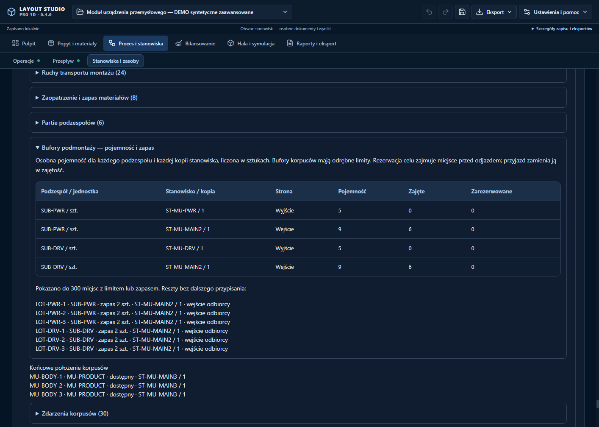

Na ilustracji dla każdej z trzech sztuk wyrobu producent wytwarza partię po 5 sztuk danego podzespołu, a odbiorca pobiera po 3. Końcowy zapas wynosi po 6 sztuk dla SUB-PWR i SUB-DRV. Każdy ma własny limit wejścia 9; nie jest to wspólna pula 9. To jawnie zmodyfikowany scenariusz testowy, a nie dane produkcyjne ani domyślna konfiguracja pobieranego C2-A. Po odświeżeniu oblicz wynik ponownie; zapis i eksport pakietu zachowują konfigurację.

**Zatrzymanie operatora i odbiór bez składowania (C2-B2b).** Przy polityce zatrzymania operatora pełne wyjście utrzymuje także przypisany zespół po obróbce. Nie można obiecać tych osób innej operacji ani powrotowi wózka do czasu rzeczywistego zwolnienia. Producent musi mieć zadeklarowaną obecność od początku do końca operacji; częściowa obecność w tym wariancie wymaga dalszej integracji. Polityka zwolnienia operatora zachowuje profil bez przedłużania rezerwacji osób.

Wyjście 0 pozostawia partię na producencie do wyjazdu. Wejście 0 wymaga gotowego odbiorcy dokładnie przy przyjeździe i pełnego pobrania jednej partii, bez reszty. Jeśli odbiorca wymaga korpusu, korpus musi już być w jego kopii. Miejsce, wyposażenie, osoby, kalendarz i wymagane materiały są zabezpieczane przed wyjazdem. Monter zwalnianego źródła może przewieźć ostatnią oczekującą partię; nie może wcześniej wykonać pustego dojazdu, zostawiając partię mimo reguły zatrzymania.

W sekcji **Bufory podmontaży — pojemność i zapas** odczytaj kolumnę **Operator przy blokadzie**. Dla pojemności 0 zajętość bufora pozostaje 0 — partia jest na producencie, w przewozie lub w operacji. W inspekcji wykonania sprawdź **Zwolnienie stanowiska**, **blokadę po pracy** i **Rezerwację osób**; inspekcja ruchów pokazuje odrębny przewóz i powrót.

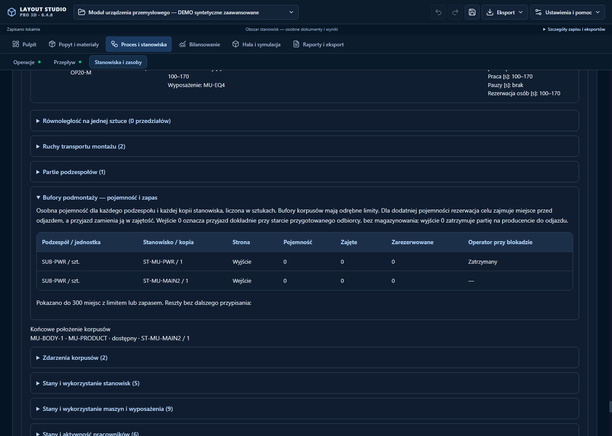

Ta ilustracja dotyczy odrębnej, zredukowanej próby syntetycznej: jedna partia 5/5 sztuk, jawna podwójna kwalifikacja jednego montera, korpus już na odbiorcy i bez modułu zaopatrzenia. Obróbka trwa 0–50 s, źródło i monter czekają do 90 s, przewóz trwa 90–100 s, montaż 100–170 s, powrót 170–180 s. Koniec wyrobu wynosi 170 s. Nie jest to wynik całego pobieranego C2-A ani pomiar produkcji.

**Wspólny odbiór mieszany (C2-B3a).** Operacja może pobrać jedną partię z wejścia 0 razem z partiami już dostarczonymi do osobnych dodatnich buforów. Najpierw docierają partie możliwe do składowania. Przewóz bezpośredni rusza po zabezpieczeniu wspólnego startu; wtedy następuje pobranie wszystkich przypisanych ilości oraz ewentualnych materiałów. Buforowana partia 5 szt., z której operacja pobiera 3, zachowuje zapas 2. Korpus musi już znajdować się w kopii odbiorcy.

Jeżeli jeden producent wytwarza partie z różnymi politykami operatora i choć jedno skończone wyjście wymaga zatrzymania obsady, wspólny zespół pozostaje zajęty do odłożenia lub wyjazdu wszystkich oczekujących partii. Odłożenie samej partii z polityką zatrzymania nie zwalnia osób, gdy pozostała partia nadal czeka na producencie.

Nadal odrzucane są: więcej niż jedna partia bezpośrednia przy wejściu 0, reszta po pobraniu na wejściu 0, jednoczesny przewóz korpusu do tego odbiorcy, lokalne wejście i wyjście oba 0 oraz bezpośredni odbiorca z przezbrojeniem/równoległością lub zatrzymujący własną obsadę przy dalszej produkcji. Przeczytaj komunikat zamiast traktować odmowę jako poprawną symulację.

**Dodatnie bufory korpusów z gałęziami (C2-B3b/B3c).** W **Buforach stanowisk** możesz zadeklarować dodatnie pojemności korpusów na jednej uporządkowanej ścieżce procesu z podmontażami. Każda operacja korpusu wymaga jednej jawnej kopii. Na skończonych wyjściach wybierz zwolnienie operatora po obróbce. Korpusy muszą zaczynać w pierwszej kopii ścieżki. Ostatnie wyjście pozostaw bez limitu, bo program nie dopowiada odbioru wyrobów.

Miejsce docelowe jest rezerwowane przed odjazdem, również podczas ruchu. Korpus może czekać w dodatnim wejściu na podmontaże, kalendarz lub dostawę materiału. Pełne wyjście po obróbce zatrzymuje korpus, stanowisko i wyposażenie; osoba kończy według profilu pracy. W sekcji **Bufory i zwalnianie stanowisk** sprawdź zdarzenia blokady i rzeczywistego zwolnienia. Odrębna sekcja podmontaży nadal pokazuje ich własne limity i reszty.

**Lokalna kontynuacja w grafie (C2-B3c).** Jeśli następna operacja ma tę samą kopię, korpus pozostaje zajęty na stanowisku do jej rzeczywistego startu. Poprzednie wyposażenie także pozostaje zajęte; operator kończy według swojego profilu. Nie powstaje pośredni depozyt w buforze ani przejazd. Podmontaże i materiał są pobierane przy starcie kontynuacji. W wyniku odczytaj **Przekazanie do kolejnej operacji** i **oczekiwanie lokalne**; to inny czas niż blokada pełnego wyjścia. Przykład: obróbka kończy się przy 20 s, dostawa pozwala na następny start przy 50 s — oczekiwanie lokalne wynosi 30 s, a korpus nie opuszcza kopii.

Bieżący zakres grafu nie obsługuje zerowych pojemności korpusów, zatrzymania ich obsady, alternatywnych kopii ścieżki, przezbrojeń ani wejścia 0 podmontażu jednocześnie ze skończonymi buforami korpusu. Odebrany proces liniowy zachowuje swój dotychczasowy zakres. Wynik z gałęziami zależy od jawnych zasobów i kolejności gotowych zadań; nie jest obietnicą optymalnego transportu lub maksymalnej przepustowości.

W **Zaopatrzeniu materiałowym** zadeklaruj pozycję materiałową przy stanowisku, zapas początkowy, jednostkę, dostawy i zużycie przypisane do operacji. Ilości nie powstają z BOM. Dostawa cykliczna wymaga jawnego pierwszego terminu do wykonania; nie zakładaj terminu 0. Całe zużycie następuje przy rzeczywistym starcie operacji, a dostawy są przetwarzane przed pobraniem przy równym czasie.

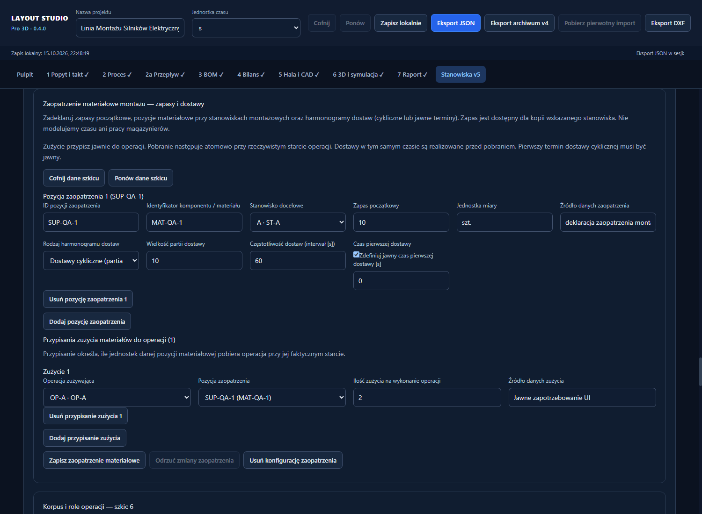

### 3.5. Oblicz harmonogram i znajdź przyczynę zatrzymania

- W panelu **Harmonogram zespołu — szkic 6** podaj wielkość partii oraz dodatni, jawny odstęp przybycia sztuk. Wybierz **Oblicz harmonogram szkicu 6**. Obliczenia można anulować.
- Domyślnie obowiązuje skonfigurowany transport. Opcja **Symulacja bez transportu — wszystko dostępne just in time** świadomie pomija transport i fizyczne położenia oraz zakłada dostępność materiału. Zachowuje zależności i ograniczenia zasobów montażu. Nie usuwa zapisanej konfiguracji.
- Wynik pokazuje operacje, osoby, kopie, czasy pracy/oczekiwania i blokady. W Gantcie przełącz widok operacji, stanowisk lub pracowników; zaznaczenie wiąże wykres z inspekcją wykonania.
- Przy zatrzymaniu przeczytaj diagnostykę: niewystarczający materiał, brak dostępnej obsady, wyczerpanie kalendarza, blokada bufora lub transportu nie są poprawnym zakończeniem partii.
- Panel **Co ogranicza przebieg — dowody z harmonogramu** prowadzi od obserwacji do wykonania na Gantcie. Oczekiwania mieszane nie mają znanego udziału każdej przyczyny. Najdłużej pracująca kopia jest kandydatem do analizy, a nie dowiedzionym wąskim gardłem.

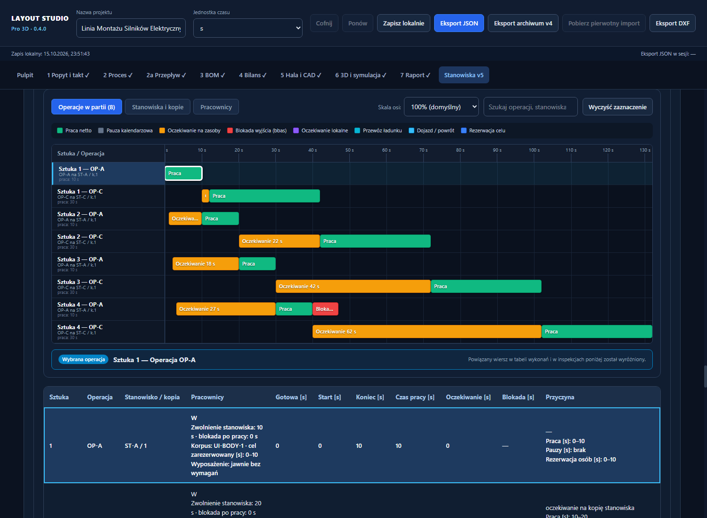

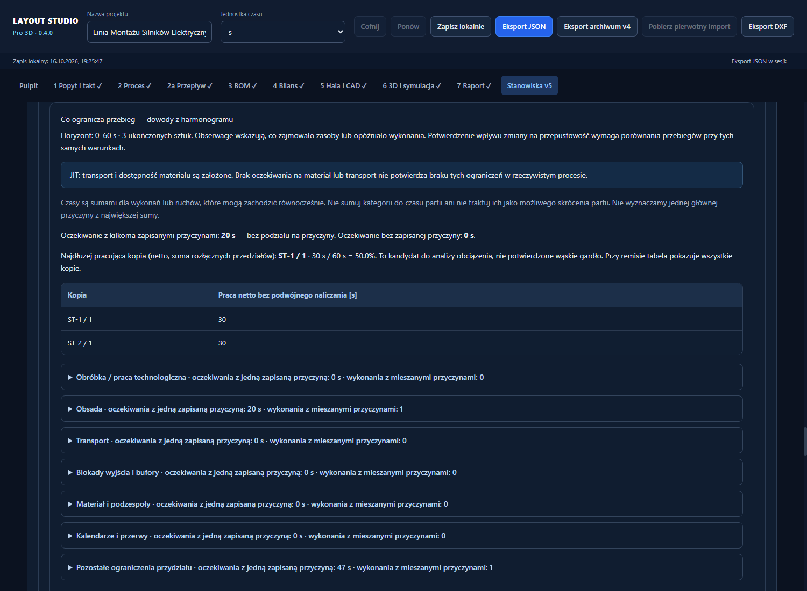

### 3.6. Przygotuj i zatwierdź bilans z ograniczeniami

W **Bilansie z wyposażeniem i kompetencjami** podaj limit obciążenia kopii w s/szt. oraz priorytet RPW lub LCR. Wybierz **Oblicz propozycję bilansu szkicu 6**. Wymagane są jawne dopuszczenia kopii i wybór czasu obsady wszystkich operacji.

Propozycja wykorzystuje wyłącznie istniejące dopuszczone kopie. Pokazuje ID, wyposażenie i czas wybranego wariantu z pochodzeniem. Limit dotyczy sumy czasów technologicznych na kopię; nie jest prognozą rzeczywistej przepustowości. Bilans respektuje blokady stanowisk, miejsca zaopatrzenia i kolejność ręcznego rejestru. Limit przeszukiwania oznacza nierozstrzygniętą wykonalność, nie dowód braku rozwiązania.

Przejrzyj przypisania i zaznacz akceptację przed **Zatwierdź przydziały bilansu szkicu 6**. Zapis zawęża dopuszczenia do pokazanych kopii. Trasy, geometria, wyposażenie i trwałe ID są zachowane; poprzednie alternatywy przywraca **Cofnij dane szkicu**. Następnie ponownie oblicz harmonogram.

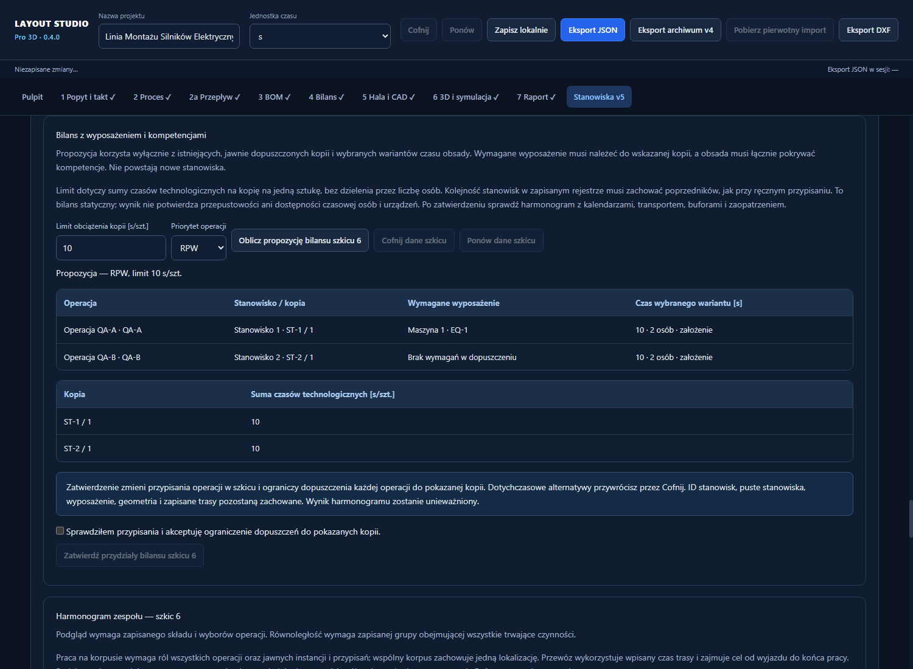

### 3.7. Zapisz i porównaj warianty

- W panelu **Porównanie wariantów szkicu 6** nazwij przygotowany szkic, wybierz typ **Wariant bazowy** i użyj **Zapisz wariant szkicu 6**. Biblioteka przechowuje migawki, nie żywe odsyłacze do późniejszych edycji szkicu.
- Przygotuj zmianę na podstawie jawnych danych, np. inny wariant obsady lub dopuszczoną kopię. Zapisz pod inną nazwą i właściwym typem. Sama etykieta „Dodatkowy pracownik” nie dodaje osoby.
- Zaznacz co najmniej dwa kompatybilne warianty, wybierz **Wariant bazowy odniesienia**, wspólną partię, odstęp przybycia i tryb transportu. Warianty z innym źródłem nie są automatycznie traktowane jako porównywalne.
- Kliknij **Porównaj warianty w symulacji**. Porównuj dopiero ukończone wyniki; odmowę lub brak danych odróżniaj od zerowej wartości wskaźnika.
- **Wczytaj do szkicu 6** zastępuje roboczy szkic migawką wariantu, korzystając z historii szkicu. Pobrany **JSON** zabezpiecza wariant. Biblioteka jest lokalna; nie oznacza współpracy online ani synchronizacji między przeglądarkami.

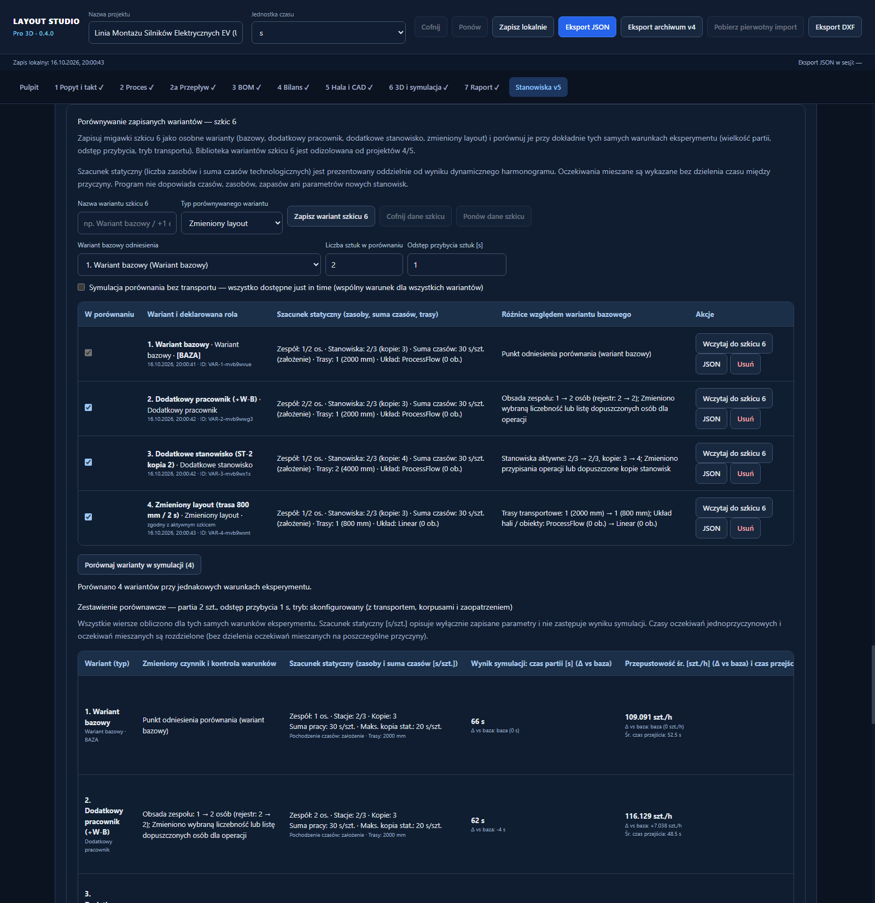

### 3.8. Czytaj metryki i jawne koszty

Tabela syntezy porównuje wydajność, czas partii, czas przejścia, WIP, obsadę oraz powierzchnie. Zwracaj uwagę na definicje i jednostki. Powierzchnia obrysów wyposażenia nie jest powierzchnią całej hali ani potwierdzeniem wymaganych przejść. Różnica względem bazy dotyczy danego przebiegu i jego warunków.

Stawki operatora, stanowiska i powierzchni są opcjonalne. Jeżeli je podajesz, określ walutę, podstawę oraz źródło/założenie. Wybierz właściwy sposób rozliczenia. Nie porównuj kosztu zasobów utrzymywanych przez całą partię z kosztem samych aktywności bez odnotowania zmiany podstawy. Brak stawki to brak wyliczenia, nie koszt 0. Koszt materiałów z BOM i koszt zasobów nie są tym samym.

Wynik i raport Markdown umożliwiają udokumentowanie warunków oraz założeń. Zmiana parametrów unieważnia wcześniejsze porównanie i wymaga nowych obliczeń.

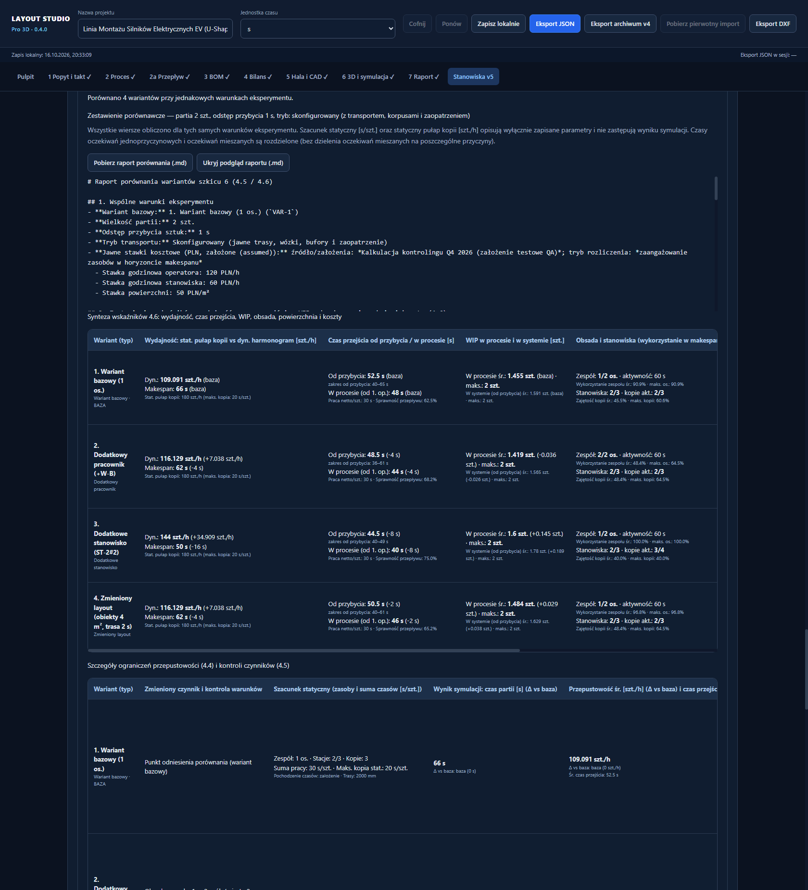

### 3.9. Sprawdź propozycje usprawnień

Przycisk **Generuj i sprawdź propozycje zmian w symulacji (4.7)** analizuje roboczy szkic jako punkt odniesienia i sprawdza kandydatów przy wspólnych warunkach eksperymentu. Wykorzystuje wyłącznie zadeklarowane zasoby i warianty czasu; pominięte kategorie są wyjaśniane. Nie tworzy pomiarów, kompetencji, nowych urządzeń ani stawek.

Przeczytaj uzasadnienie, zakres zmiany oraz status: **Poprawa w symulacji**, **Brak zmiany**, **Pogorszenie** albo **Odmowa / niewykonalność**. Szacunek statycznej zdolności nie zastępuje wyniku dynamicznego. Również poprawa w symulacji nie jest gwarancją optimum ani potwierdzeniem wyniku rzeczywistej produkcji.

**Zapisz jako wariant** zachowuje propozycję w bibliotece do dalszego porównania. **Zastosuj do szkicu 6** zmienia roboczy szkic i korzysta z jego historii. Przed przyjęciem sprawdź szczególnie politykę zwolnienia operatora przy pełnym buforze: wynik symulacji nie potwierdza, że taka zmiana jest technologicznie dopuszczalna u klienta. Raport Markdown pozwala zachować propozycje, uzasadnienia, wyniki i założenia.

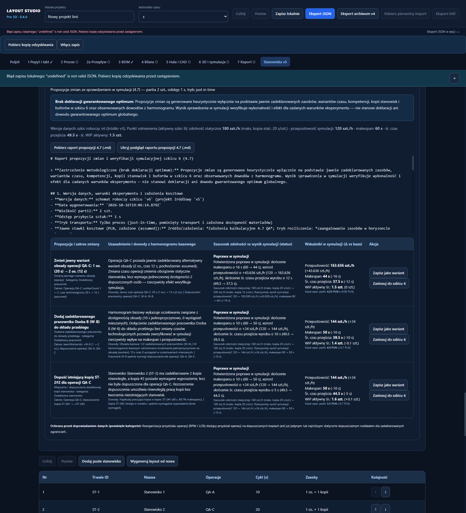

## 4. Ważne zasady Lean i ograniczenia modelu
1. **Czas nie dzieli się sam**: Dodanie drugiego pracownika do stacji nie skraca czasu automatycznie o połowę – należy podać zmierzony/założony czas zespołu.
2. **Animacja to nie obliczenia**: Ruch kamerą i szybkość odtwarzania 3D nie mają wpływu na matematyczny wynik symulacji partii.
3. **Ochrona geometrii**: Zmiana w technologii nie przestawia ręcznie dopracowanego layoutu w hali – program zgłasza ewentualną potrzebę korekty zamiast automatycznie niszczyć układ.
4. **Standard wyposażenia i niezależność wizualna (6.1 i 6.2)**: Model wizualny 3D i obrys CAD nie są źródłem prawdy technologicznej. Wymiana wyglądu obiektu, koloru, detali konstrukcyjnych lub siatki geometrycznej nie zmienia czasu operacji, zdolności maszynowej ani bilansu linii. Wymiary fizyczne podawane są w milimetrach [mm] (w silniku Three.js przeliczane jako 1 jednostka = 1 m). Generatory 3D tworzą parametryczne, rozpoznawalne stoły, regały FIFO, palety EPAL, wózki i przenośniki z opcją nakładek stref obsługi i obrysów kolizji. Strefy obsługi i odkładania są wytycznymi przestrzennymi i nie stanowią formalnej oceny zgodności z przepisami BHP.

## 5. Pomocnicza karta wyposażenia do modelowania (6.3a)

Jeżeli chcesz przygotować dane do charakterystycznego modelu maszyny lub wyrobu, otwórz lokalny plik **tools/equipment-editor/index.html** w Edge lub Chrome. Narzędzie jest osobne od aplikacji; działa bez serwera i internetu. Nie zastępuje projektu ani jego wyposażenia.

Wpisz nazwę/ID, znane wymiary zewnętrzne w mm, punkt bazowy i opis charakterystycznych elementów. Każdy wymiar ma osobne pochodzenie (pomiar, dokumentacja, potwierdzone dane albo założenie) i opis źródła. Nieznane liczby pozostaw puste — plik zachowa je jako `null`. Poziom podstawy nad posadzką wpisz jawnie, także gdy wynosi zero. Wybór typu z aplikacji nie wstawia wymiarów katalogowych.

Dodaj lokalizacje zdjęć, rysunków lub CAD i informację o uprawnieniach do materiałów. **Pobierz JSON** zapisuje kartę; **Wczytaj kartę JSON** pozwala wrócić do pracy. **Pobierz pusty szablon** udostępnia tę samą strukturę do ręcznego uzupełnienia. Lista braków pozwala zapisać szkic przed zgromadzeniem wszystkich informacji. Narzędzie nie zapisuje automatycznie, więc pobierz JSON przed zamknięciem.

Do wykonania modelu przekaż kartę i wskazane materiały osobno: JSON zawiera ścieżki/adresy, bez zdjęć i geometrii CAD. Karty nie importuj jako projektu Layout Studio. Obrys X/Y jest tylko orientacyjnym prostokątem, nie modelem maszyny ani potwierdzeniem jej gabarytów. Karta nie określa zdolności produkcyjnej. Szczegółowa instrukcja i opis formatu są w **tools/equipment-editor/README.md**.

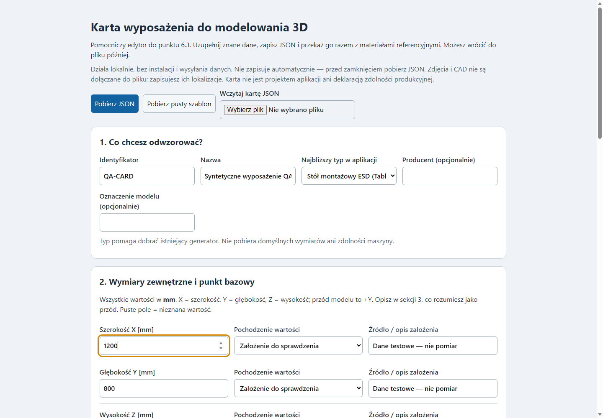

### 5.1. Autorskie koncepty wyposażenia inspirowane kategoriami Jabama (6.3b)

W pomocniczym edytorze rozwiń **Trzy autorskie koncepty wyposażenia — inspiracje Jabama**. Są tam stanowisko montażowe z nadbudową, wózek półkowy i regał na drobne części. Każdy ma własny render oraz pliki Blender, GLB i JSON; odnośnik **Inspiracja** prowadzi do strony użytej jako odniesienie do ogólnego rodzaju wyposażenia. Nie skopiowano zdjęć, tekstur, oznaczeń ani modeli producenta.

**Użyj karty koncepcyjnej** ładuje przykład do formularza. Wszystkie jego gabaryty i uproszczone detale są autorskimi założeniami demonstracyjnymi — nie wymiarami katalogowymi ani parametrami stanowiska klienta. Dopasuj je do własnych danych i pobierz własny JSON. Niezapisana karta jest chroniona potwierdzeniem zastąpienia. Pliki GLB są w metrach, z osią Y pionowo; pliki Blender mają Z pionowo, a formularz wymiary w mm. Wysokość stanowiska obejmuje nadbudowę, nie tylko poziom blatu.

Koncepty nie są automatycznie wstawiane do głównej aplikacji, nie tworzą stanowisk technologicznych ani nie zwiększają zdolności linii. Wybór ich wyglądu dla zapisanego obiektu opisano w 6.4 poniżej. Specyfikacja, źródła inspiracji i sposób odtworzenia są w **tools/equipment-editor/concepts/README.md**.

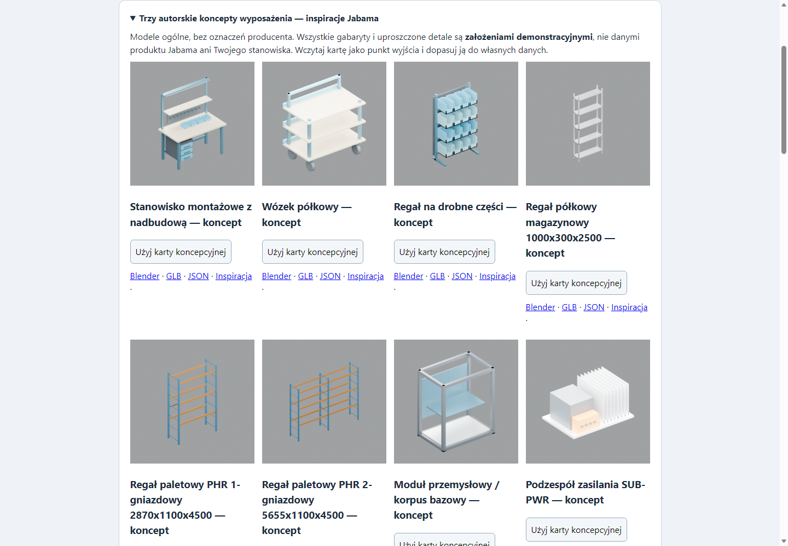

### 5.2. Zmiana wyglądu wyposażenia w aplikacji (6.4)

W aktywnym projekcie wybierz zapisany obiekt na rzucie 2D, w drzewie albo w widoku 3D. W sekcji **Wygląd wyposażenia** wybierz model i kliknij **Zastosuj wygląd**. Sam wybór w polu nie zapisuje zmiany. Dostępne są dotychczasowy generator według typu oraz trzy koncepty 6.3b: stanowisko z nadbudową, wózek półkowy i regał na części. Nowy obiekt najpierw zapisz w projekcie.

Wybór modyfikuje tylko wygląd — dotychczasowy typ, ID, przypisanie do stanowiska, gabaryty, czasy, obsada i zdolności pozostają bez zmiany. Nawet wygląd wózka na obiekcie stołu nie zamienia stołu w środek transportu. Przy niezapisanych zmianach obiektu przycisk zatwierdzania wyglądu jest zablokowany; najpierw zapisz albo anuluj zmiany geometrii, aby ich nie utracić.

Koncept zachowuje proporcje i mieści się w zapisanych gabarytach, więc może być mniejszy od obrysu CAD. Wysoki model stanowiska wybrany dla niskiego obiektu zostanie zmniejszony w całości — aplikacja nie podnosi samodzielnie zapisanej wysokości. Fizyczne wymiary zmieniasz osobno, świadomie w edycji geometrii. Nakładki stref/portów i znaczniki operacji nadal korzystają z istniejących przypisań, a nie z wyglądu siatki.

Działają **Cofnij/Ponów**, zapis lokalny i JSON oraz ponowne otwarcie. Zmiana wyglądu zachowuje tryb automatyczny/ręczny. Aby wrócić do poprzedniego generatora, wybierz **Generowany według typu obiektu** i zatwierdź. Podgląd warsztatu v5 odczytuje zapisany wygląd, ale zachowuje swój dotychczasowy tryb tylko do odczytu; edycja jest dostępna w aktywnym edytorze projektu 4. Konfigurator konstrukcji/półek jest zaplanowany w 8.3, a import plików CAD w 8.4.

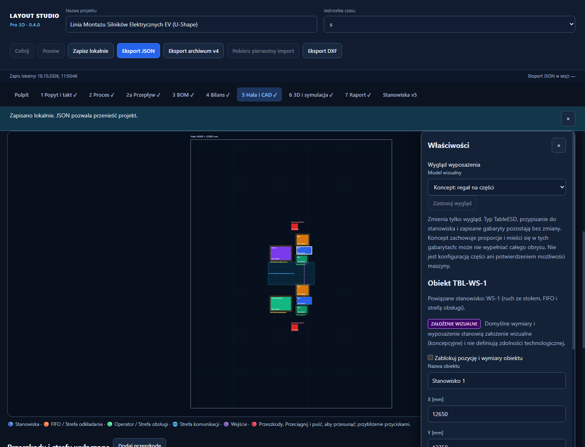

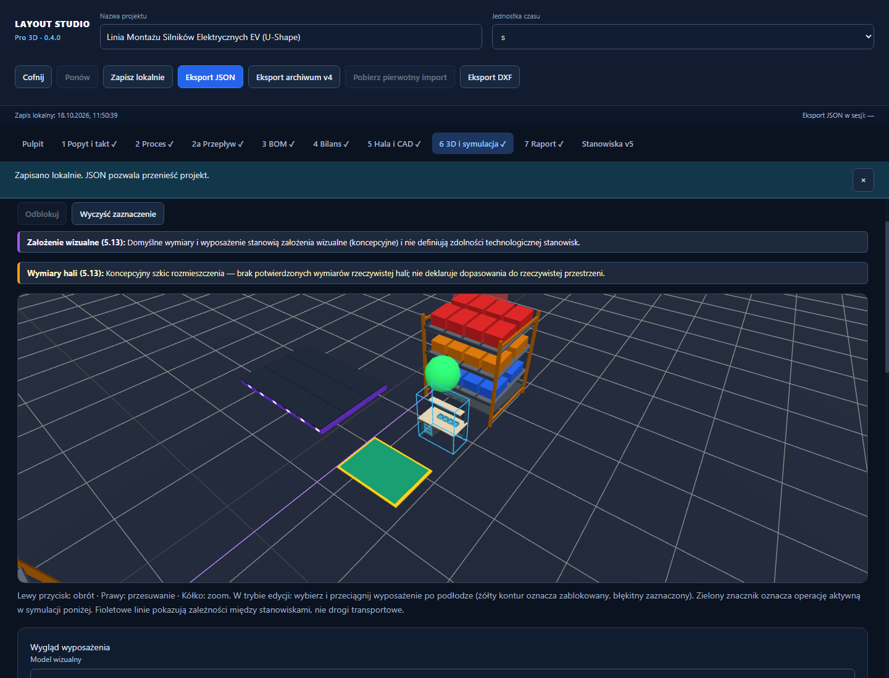

### 5.3. Manipulatory 3D przesuwania i obrotu oraz ukrywanie warstw i obiektów (6.5)

W widoku 3D (`6 Widok 3D i symulacja`) edycja położenia obiektów wyposażenia odbywa się za pomocą wygodnych manipulatorów przestrzennych (Three.js TransformControls) oraz precyzyjnych filtrów widoczności warstw:

- **Manipulatory 3D przesuwania i obrotu (Gizmo)**:
  - **Przesuwanie w osiach posadzki (`W`)**: Manipulator translacji pozwala płynnie przesuwać zaznaczony stół, regał czy wózek wzdłuż osi posadzki $X$ i $Z$ (odpowiadających współrzędnym CAD $X, Y$ w milimetrach). Przesuwanie w osi pionowej $Y$ jest zablokowane, dzięki czemu wyposażenie zawsze spoczywa stabilnie na poziomie posadzki hali ($Y=0$) i nie ma ryzyka niekontrolowanego uniesienia obiektu w powietrze.
  - **Obrót wokół osi pionowej (`E` / `R`)**: Manipulator rotacji (zielony pierścień Yaw) umożliwia precyzyjne obracanie obiektu wokół osi pionowej (kąt `rotationDeg` 0–360°).
  - **Wyłączenie manipulatora (`Q`)**: Klawisz `Q` lub przycisk `Wyłącz manipulator 3D (Q)` ukrywa gizmo, przywracając czysty podgląd bryły 3D.
  - **Przyciąganie do siatki i kątów 15° (`G`)**: Gdy włączony jest przełącznik `Siatka 3D (G)`, przesuwanie przyciąga pozycję do siatki posadzki (`gridSizeMm` w metrach), a obrót skokowo przyciąga do wielokrotności kąta 15°.
  - **Ochrona obiektów zablokowanych (`locked`)**: Jeżeli zaznaczony obiekt posiada aktywną blokadę (`locked: true`), manipulator 3D nie zostaje do niego podłączony, zapobiegając przypadkowemu przesunięciu. W nagłówku formularza 3D wyświetlana jest czytelna odznaka `🔒 Zablokowany (brak manipulacji)`.
  - **Jednokrokowa historia operacji (`Ctrl+Z` / `Ctrl+Y`)**: Przeciąganie manipulatora aktualizuje podgląd na żywo na ekranie, natomiast zapis do historii następuje wyłącznie na zakończenie ruchu (po zwolnieniu przycisku myszy). Pojedyncze przesunięcie lub obrót cofa się jednym naciśnięciem `Ctrl+Z`.

- **Ukrywanie i widoczność warstw w 3D**:
  - Rozwijane menu **Warstwy 3D** na górnym pasku narzędziowym widoku 3D pozwala niezależnie włączać i wyłączać widoczność 5 logicznych warstw zgodnych z rzutem CAD 2D: `Stanowiska`, `Bufory i logistyka`, `Strefy operatorów`, `Przeszkody` oraz `Połączenia procesu (spaghetti)`.
  - Przycisk menu dynamicznie informuje o liczbie ukrytych warstw (np. `Warstwy 3D (2 ukryte)`), a wewnątrz menu dostępne są przyciski szybkiego zaznaczenia `Wszystkie` oraz `Domyślne`.

- **Ukrywanie pojedynczych i zaznaczonych obiektów w 3D**:
  - Przycisk **Ukryj w 3D (H)** oraz skrót klawiszowy `H` natychmiast ukrywają aktualnie zaznaczony obiekt na scenie trójwymiarowej.
  - Przycisk **Pokaż ukryte w 3D (N)** oraz skrót `Shift+H` natychmiast przywracają widoczność wszystkich indywidualnie ukrytych obiektów.

- **Niezmiennik technologiczny (Zasada 6 i Plan 6.4)**:
  - Manipulatory 3D, wizualne obrysy oraz ukrywanie warstw i obiektów mają charakter wyłącznie ergonomiczno-wizualny. Nie wpływają na czasy operacji, marszrutę technologiczną, obsadę stanowisk ani wyniki symulacji partii.

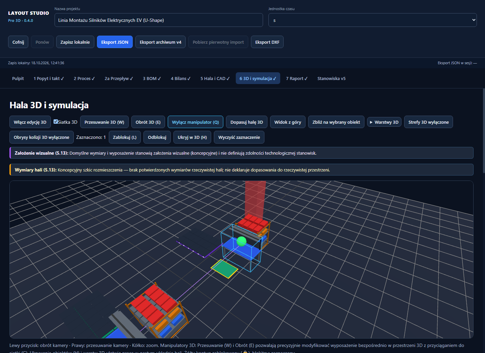

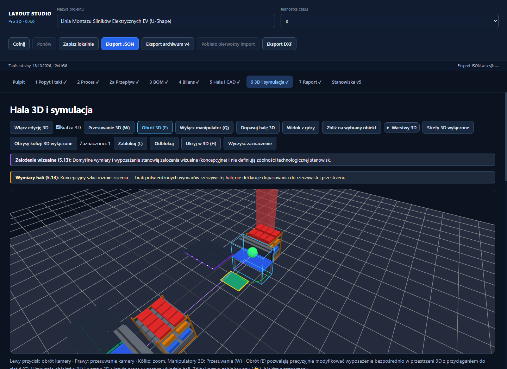

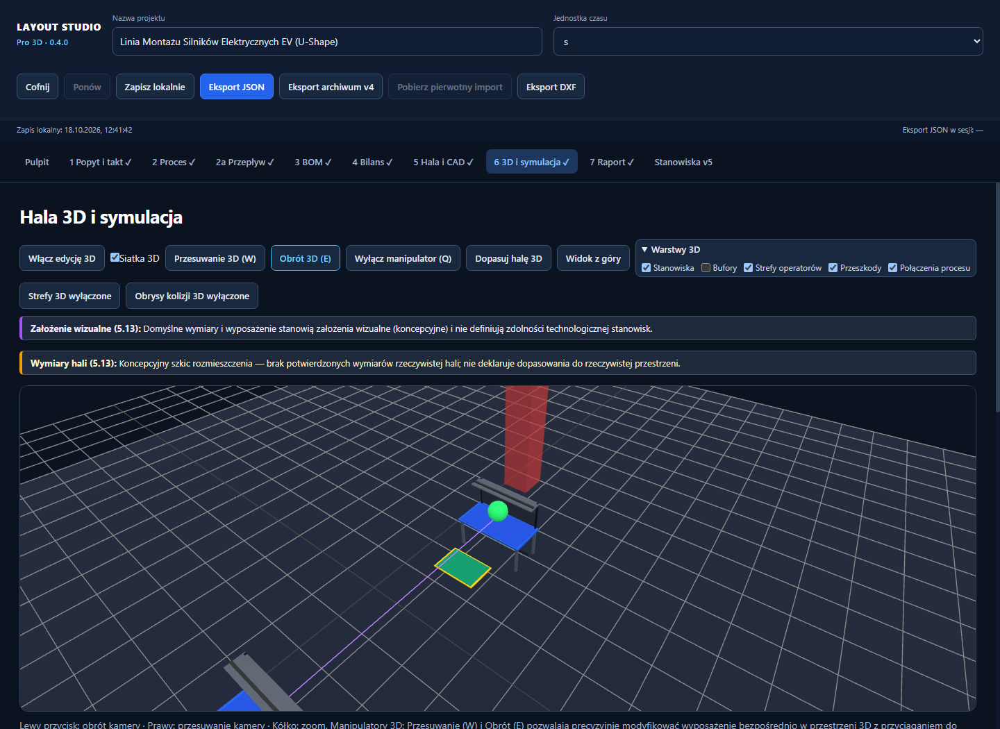

### 5.4. Animacja 3D produktów, podzespołów i transportu oraz inspekcja stanu (6.6)

W widoku 3D (`6 Widok 3D i symulacja`) wprowadzono pełną synchronizację przestrzenną z deterministycznym harmonogramem symulacji partii:

- **Deterministyczna animacja przepływu na osi czasu**:
  - Każda sztuka z partii produkcyjnej jest reprezentowana w przestrzeni hali jako trójwymiarowy wyrób poruszający się ściśle według harmonogramu symulacji.
  - Wyroby w trakcie montażu lub obróbki (`processing`) spoczywają stabilnie na powierzchni stołu roboczego danego stanowiska (wysokość blatu $Z \approx 890\text{ mm}$).
  - Transport międzyoperacyjny (`in_transit`) oraz wprowadzenie na linię (`entering`) poruszają się po posadzce za pośrednictwem wózków platformowych (`CartTuggerPlatform`) lub autonomicznych wózków podnośnikowych (`AGVMiniLifter`).
  - Ukończone wyroby (`finished`) są automatycznie odkładane na palecie wyrobów gotowych (`FinishedGoods`).
  - Płynny scrubbing: przesunięcie suwaka czasu natychmiast przestawia pozycje wszystkich detali i pojazdów do dokładnego stanu z danej sekundy symulacji.

- **Mini-pasek sterowania odtwarzaniem w 3D (`.sim-mini-playback-bar`)**:
  - Bezpośrednio w oknie widoku 3D dostępny jest kompaktowy panel sterowania:
    - Przyciski `▶ Start` / `⏸ Pauza` oraz `⏮ Reset`.
    - Suwak czasu animacji z dokładnością do $0.1\text{ s}$.
    - Licznik czasu bieżącego i całkowitego partii.
    - Przycisk szybkiego włączania inspekcji `🔍 Inspekcja 3D`.

- **Karta inspekcji stanu detalu (`.simulation-inspector-card`)**:
  - Kliknięcie bezpośrednio w dowolny detal w widoku 3D lub naciśnięcie przycisku inspekcji wyświetla szczegółową kartę stanu:
    - **Numer sztuki**: Identyfikator wyrobu w partii (np. `Sztuka #1`).
    - **Faza cyklu życia**: Aktualny stan (`W toku`, `Transport`, `Kolejka / Bufor`, `Ukończono`).
    - **Stanowisko i kopia**: Nazwa stacji i numer równoległej kopii, na której detal się znajduje.
    - **Operacja technologiczna**: Kod i nazwa aktualnie realizowanego kroku procesu.
    - **Postęp etapu**: Pasek graficzny oraz wartość procentowa postępu.
    - **Pozostały czas**: Dokładny czas do ukończenia operacji oraz łączny czas trwania kroku.
    - **Części z BOM**: Wykaz komponentów i materiałów pobieranych w bieżącej operacji.
  - Badana sztuka zostaje w przestrzeni 3D oznaczona jaskrawoczerwonym pierścieniem inspekcyjnym.

- **Niezmiennik Zasady 6**:
  - Animacja 3D i inspekcja wyrobu mają charakter czysto odczytowy. Wyliczanie snapshotu animacji nie modyfikuje w żaden sposób wyników symulacji, czasów operacji ani struktury bilansu.

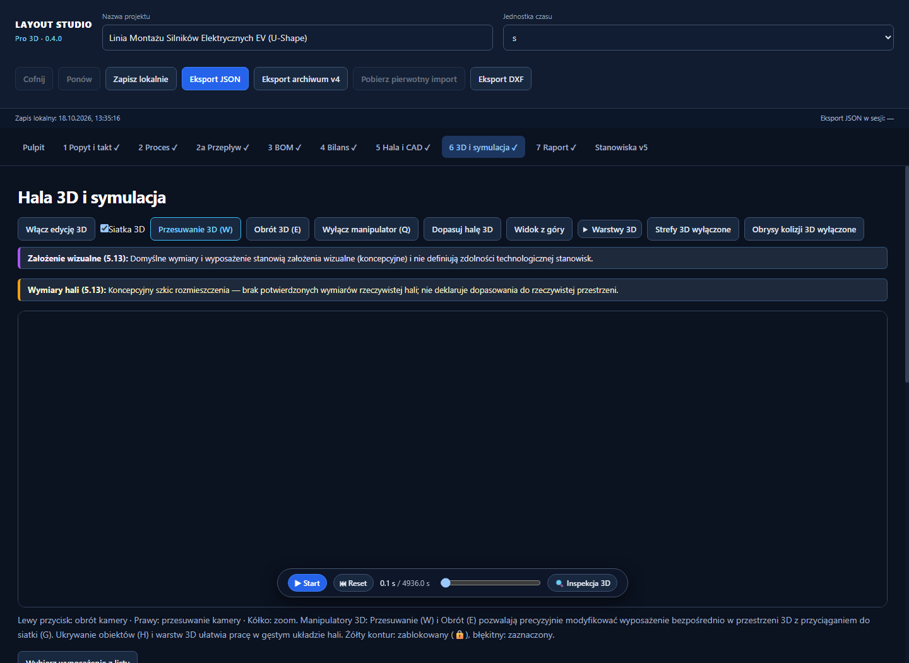

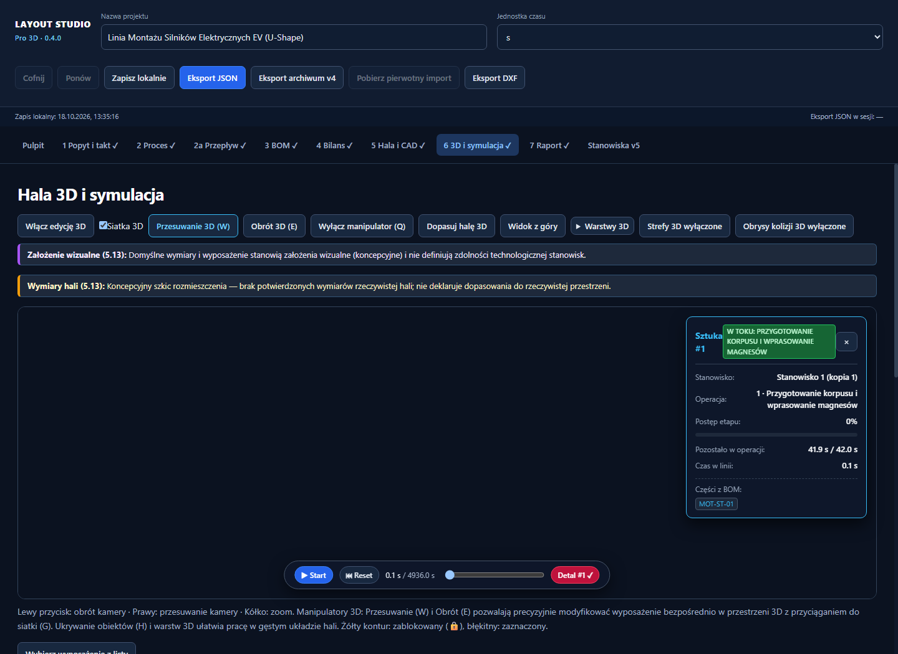

### 5.5. Tryb uproszczony 3D i osobne okna — Popout (6.7)

W widoku 3D przycisk **Tryb uproszczony (LOD)** przełącza szczegółowe modele na prostsze bryły. Stan aktywny jest oznaczony jako **Tryb uproszczony: WŁ**. Użyj go przy dużej liczbie obiektów lub na słabszym komputerze. Zmienia wyłącznie reprezentację wizualną: czasy, zasoby i wyniki symulacji pozostają takie same. Nadal można wybrać obiekt z listy i skierować na niego kamerę; klawisz **F** dopasowuje widok.

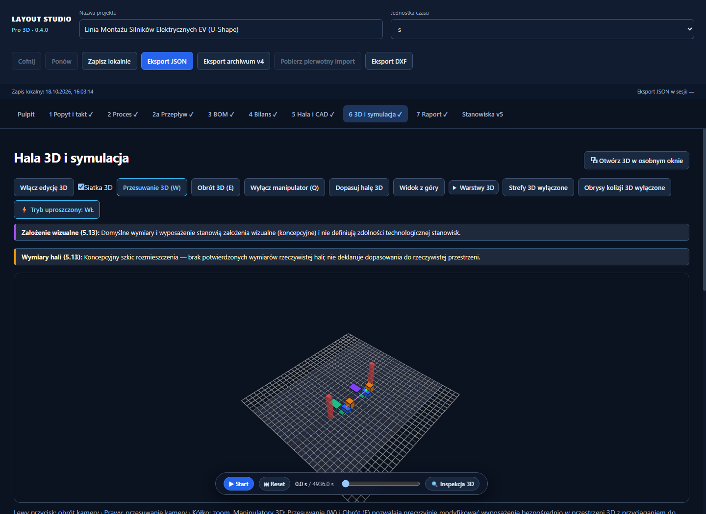

Widoki 3D, CAD i przepływu można otworzyć w **osobnym oknie** przyciskiem odłączenia widoku (Popout). Pozwala to przenieść widok na drugi monitor. Okna korzystają ze wspólnego projektu; zamknięcie okna przywraca widok w aplikacji. Jeśli okno się nie otwiera, zezwól przeglądarce na wyskakujące okna dla aplikacji. Skróty lokalne działają w oknie, które ma fokus; Ctrl+S oraz Ctrl+Z/Ctrl+Y służą do zapisu i cofania/ponawiania.

Odbiór 6.7 obejmował sceny 100 i 300 obiektów. Dla 300 obiektów LOD zmniejszył liczbę wywołań renderowania z 9960 do 607, a trójkątów ze 191176 do 3816. To pomiar złożoności sceny w teście, a nie gwarancja FPS na komputerze użytkownika. Nie zmierzono zimnego startu ani animacji w tym benchmarku.

### 5.6. Warianty wyrobów, macierz przezbrojeń i zlecenia partii produkcyjnych (Plan 7.3)

W zaawansowanym modelu procesu (szkic 6) wprowadzono pełne wsparcie dla produkcji wielowariantowej (`ProductVariant`), macierzy czasów przezbrojeń (`ChangeoverMatrix`), sekwencjonowania zleceń partii produkcyjnych (`ProductionOrderBatch`) oraz ich integracji z symulacją i wykresem Gantta:

- **Definiowanie wariantów produktów (`ProductVariant`)**:
  - W module `Warianty wyrobów, macierz przezbrojeń i zlecenia partii` użytkownik definiuje unikalne warianty wyrobów (np. `VAR-A: Wariant standardowy`, `VAR-B: Wariant premium`).
  - Każdy wariant posiada jawne identyfikatory (`id`), nazwy (`name`), kody (`code`), opcjonalny opis oraz kolor identyfikacyjny na wykresach.

- **Macierz czasów przezbrojeń (`ChangeoverMatrix`) i hierarchia reguł**:
  - Czasy przezbrojeń określają czas przygotowania linii lub poszczególnych stanowisk przy przejściu z jednego wariantu wyrobu na inny (`fromVariantId → toVariantId`).
  - **Niezmiennik bazy czasu (Zasada 5)**: Każda reguła przezbrojenia wymaga jawnego określenia podstawy czasu: `measured` (czas zmierzony/potwierdzony) lub `assumed` (czas założony/szacowany). Zakaz zmyślania pomiarów produkcyjnych.
  - **Hierarchia dopasowania reguł przejść (determinizm)**:
    1. Reguła dedykowana dla konkretnego stanowiska i dokładnej pary wariantów (`stationId + fromVariantId → toVariantId`).
    2. Reguła dedykowana dla stanowiska z symbolem uniwersalnym (`stationId + wildcard *`).
    3. Ogólna reguła linii dla dokładnej pary wariantów (`line-wide + fromVariantId → toVariantId`).
    4. Ogólna reguła linii z symbolem uniwersalnym (`line-wide + wildcard *`).
    5. Czas domyślny macierzy (`defaultDurationSeconds`).
    6. Brak przezbrojenia (0 s) dla tego samego wariantu wyrobu.
  - Opcjonalne pole `cleanoutRequired` pozwala oznaczyć konieczność przeprowadzenia czyszczenia/mycia gniazda lub przedmuchania formy przed rozpoczęciem nowej partii.

- **Zlecenia partii produkcyjnych (`ProductionOrderBatch`) i strategie szeregowania**:
  - Zlecenia partii definiują sekwencję produkcyjną: identyfikator partii (`batchId`), wariant wyrobu (`variantId`), wielkość partii w sztukach (`quantity`) oraz priorytet.
  - Dostępne strategie automatycznego szeregowania sekwencji (`orderBatches`):
    - **`as-declared`**: zachowanie kolejności dokładnie według wprowadzonych zleceń w tabeli.
    - **`minimize-changeover-greedy`**: heurystyka najbliższego sąsiada minimalizująca łączny czas przezbrojeń (grupowanie partii o tych samych lub zbliżonych wariantach).
    - **`heijunka-leveling`**: równomierne poziomowanie miksu produkcyjnego poprzez przeplatanie partii różnych wariantów w cyklach powtarzalnych.

- **Wizualizacja przezbrojeń na wykresie Gantta**:
  - W silniku harmonogramowania (`bufferedProcessSchedule`, `workerSchedule`) przejście na inny wariant automatycznie rezerwuje stanowisko i zespół na czas trwania przezbrojenia przed rozpoczęciem obróbki kolejnej sztuki (`changeovers`).
  - Wykres Gantta (`GanttChart`) prezentuje dedykowane, pomarańczowe bloki przezbrojeń (`kind: changeover`), wyraźnie odróżniające się od pracy operacyjnej (`work`), transportu (`transfer`), oczekiwania buforowego (`blocked`) oraz przerw kalendarzowych (`pause`).
  - Bloki przezbrojeń są w pełni widoczne zarówno w widoku stanowisk roboczych (`Widok stanowisk`), jak i w widoku pracowników (`Widok pracowników`).

### 5.7. Symulacja stochastyczna Monte Carlo, zmienność czasów i awarie maszyn (Plan 7.4)

W zaawansowanym modelu procesu (szkic 6) wprowadzono moduł symulacji stochastycznej Monte Carlo (`StochasticSimulationConfig`), umożliwiający rzetelne badanie odporności linii produkcyjnej na niepewność i losowe zaburzenia:

- **Deterministyczny generator liczb pseudolosowych (Zasada 5 & Niezmiennik determinizmu)**:
  - Zastosowano wysokiej jakości algorytm PRNG (SplitMix32 / Mulberry32), który dla podanego ziarna (`seed`) gwarantuje w 100% identyczny, bitowo powtarzalny przebieg eksperymentu.
  - Dzięki temu inżynier procesu może przekazać współpracownikom dokładną wartość ziarna (np. `seed: 42`), uzyskując identyczne serie replikacji i identyczne przedziały statystyczne na dowolnym komputerze.
  - Wygodny przycisk `🎲 Losuj` umożliwia natychmiastowe wylosowanie nowego ziarna w celu przetestowania innego scenariusza losowego.

- **Modelowanie zmienności czasów operacji (`DurationVariabilityConfig`)**:
  - Użytkownik ma do wyboru uznane w inżynierii przemysłowej rozkłady prawdopodobieństwa:
    - **Trójkątny (`triangular`)**: parametryzowany mnożnikiem minimalnym (np. 0.85 = -15%), modalnym (1.0) i maksymalnym (1.15 = +15%). Idealny do modelowania naturalnej zmienności manualnej pracy operatora.
    - **Normalny Gaussa (`normal`)**: parametryzowany współczynnikiem zmienności / odchyleniem standardowym w procentach czasu nominalnego.
    - **Jednostajny (`uniform`)**: równomierne rozproszenie w zadanym przedziale `[min, max]`.
    - **Lognormalny (`lognormal`)**: rozkład asymetryczny z wydłużonym prawym ogonem, typowy dla trudnych manualnych operacji montażowych podatnych na incydentalne opóźnienia.
    - **Stały (`none`)**: brak zaburzeń (wartości nominalne).
  - Skalowanie czasu proporcjonalnie zachowuje relacje pracy ręcznej (`manualWork`) i maszynowej (`machineRun`).

- **Model awarii i napraw maszyn — MTBF / MTTR (`EquipmentBreakdownModel`)**:
  - Możliwość zdefiniowania niezawodności dla pojedynczych stanowisk lub globalnie dla całej linii:
    - **MTBF (Mean Time Between Failures)**: średni czas bezawaryjnej pracy w sekundach (czas do awarii generowany jest z rozkładu wykładniczego).
    - **MTTR (Mean Time To Repair)**: średni czas naprawy / usuwania przestoju w sekundach.
    - **Rozkład czasu naprawy**: stały (`constant`), wykładniczy (`exponential`) lub normalny (`normal`).
  - W trakcie symulacji awarie generują dynamiczne przerwy w kalendarzu stanowiska, blokując jego dostępność i wstrzymując obróbkę do chwili ukończenia naprawy.

- **Wielokrotne replikacje i agregacja statystyczna (`StochasticSummaryReport`)**:
  - Użytkownik określa liczbę replikacji (np. od 5 do 100 powtórzeń). Silnik wykonuje symulacje z postępem w czasie rzeczywistym.
  - Raport statystyczny wyznacza:
    - **Czas całkowity partii (Makespan [s])**: wartość minimalną, maksymalną, średnią arytmetyczną, medianę, odchylenie standardowe, 90% przedział ufności `[p10–p90]` oraz kwantyl 95% pewności (`p95`).
    - **Przepustowość linii (Throughput [szt./h])**: średnią przepustowość oraz zakresy niepewności w warunkach zmienności i awaryjności.
    - **Częstotliwość występowania wąskich gardeł (Bottleneck Frequency)**: wykaz stanowisk, które najczęściej stawały się ograniczeniem przepływu, wraz z procentowym udziałem w replikacjach.
    - **Szczegółową tabelę replikacji**: zestawienie wyników każdego pojedynczego przebiegu serii (Makespan, Przepustowość, łączny czas awarii, zidentyfikowane wąskie gardło).

### 5.8. Dekompozycja strat OEE i ochrona przed podwójnym naliczaniem strat (Plan 7.5)

W module planowania zapotrzebowania i czasu taktu (`DemandWizardView`) wprowadzono automatyczną dekompozycję strat OEE oraz mechanizm ochrony przed podwójnym buforowaniem strat:

- **Zrozumienie zjawiska podwójnego naliczania strat (*Double Counting of Operational Losses*)**:
  - Tradycyjny wzór na czas taktu wykorzystuje ogólny wskaźnik OEE (np. 80%), który zakłada ryczałtowe 20% strat na dostępność, wydajność i jakość.
  - W zaawansowanym modelu procesu (szkic 6) straty te są modelowane bezpośrednio na osi czasu:
    - awarie maszyn (MTBF / MTTR w symulacji stochastycznej),
    - przezbrojenia partii (`changeoverMatrix`),
    - przerwy obiadowe i technologiczne (`resourceCalendars`),
    - czasy dojazdu wózków i oczekiwanie na odjazd transportu (`assemblyTransport`),
    - blokady buforów wyjściowych (`bbas`).
  - Zastosowanie jednocześnie ryczałtowego OEE 80% w takcie oraz modelowania tych samych awarii w symulacji prowadziło do podwójnego obniżenia tempa i sztucznego przewymiarowania liczby operatorów i stanowisk roboczych.

- **Dekompozycja na straty jawne i rezerwę rezydualną**:
  - Karta `3. Dekompozycja Strat OEE` w widoku popytu w czasie rzeczywistym analizuje projekt i prezentuje:
    - **Straty jawne w symulacji**: dokładny procent czasu tracony na awarie, przezbrojenia, przerwy i transport.
    - **Rezerwę rezydualną OEE**: część wskaźnika OEE przeznaczoną wyłącznie na straty niemodelowane dynamicznie (np. braki jakościowe, drobne opóźnienia organizacyjne).
    - **Wskaźnik ryzyka podwójnego naliczenia**: alert zielony (`Spójny`), bursztynowy (`Umiarkowane`) lub czerwony (`Wysokie`).
  - **Przycisk szybkiej korekty Lean**: pozwala jednym kliknięciem dostosować suwak OEE do sugerowanego poziomu rezydualnego, eliminując dublowanie strat.
  - **Podgląd Taksu netto**: prezentacja Taksu skorygowanego (`adjustedTaktSeconds`) w karcie głównej ze wskazaniem zysku czasu cyklu.

### 5.9. Dystrybucja, uruchamianie offline i Disaster Recovery (Plan 7.6)

Wersja produkcyjna Layout Studio Pro 3D została zoptymalizowana pod kątem pełnej autonomii, bezpieczeństwa danych projektowych oraz niezawodności w środowiskach przemysłowych pozbawionych stałego dostępu do Internetu.

- **Dystrybucja i architektura 100% Offline-First**:
  - Aplikacja nie pobiera żadnych zasobów, czcionek, skryptów ani stylów z zewnętrznych sieci CDN w trakcie działania.
  - Wszystkie silniki (Three.js 3D, silnik fizyki, biblioteki DXF, generator PDF, Web Workery) są spakowane lokalnie w katalogu produkcyjnym `dist/`.
  - Uruchomienie na czystym stanowisku (Windows/Linux/macOS) wymaga jedynie środowiska Node.js (v20.19.0 LTS lub nowszego) oraz dowolnej nowoczesnej przeglądarki (Edge, Chrome, Firefox).

- **Skrót uruchomieniowy (`Uruchom_Layout_Studio.bat`)**:
  - Na komputerach z systemem Windows aplikację uruchamia się dwuklikiem w plik `Uruchom_Layout_Studio.bat`.
  - Skrypt automatycznie weryfikuje obecność skompilowanego pakietu `dist/` (w razie potrzeby buduje go automatycznie), uruchamia lokalny, bezpieczny serwer HTTP na porcie `4173` i otwiera domyślną przeglądarkę internetową pod adresem `http://127.0.0.1:4173`.

- **Kopia środowiska (`.lsbackup.json`)** obejmuje pięć zapisanych obszarów: aktywny projekt 4, bibliotekę wariantów 4, warsztat stanowisk 5, szkic procesu 6 i bibliotekę wariantów 6. Nie obejmuje całej historii Cofnij/Ponów ani wszystkich ustawień paneli przechowywanych tylko w sesji. To kopia środowiska, nie importer pojedynczego przykładu.
- Otwórz **Kopie i odzyskiwanie** i wybierz **Pobierz Pełną Kopię (.lsbackup.json)**, aby zachować zapisane dane. Sprawdź plik w folderze pobierania. SHA-256 sprawdza integralność zawartości, nie potwierdza jakości danych produkcyjnych ani autorstwa pliku.

**Przywracanie:**

1. Zachowaj bieżącą pracę. Przy otwieraniu okna aplikacja próbuje zapisać aktywny projekt. Jeśli zapis się nie powiedzie, zamknij okno i pobierz aktualny **Eksport JSON** przed przywracaniem. Autozapis i skróty zapisu/cofania są wstrzymane podczas pracy w oknie odzyskiwania.
2. Wybierz plik `.lsbackup.json`. Niezgodna suma SHA-256, nieobsługiwana wersja lub uszkodzona zawartość blokują przywrócenie. Sprawdzane są projekty, otoczka szkicu, biblioteki, ich źródła i odwołania. Podsumowanie jest wyliczane z danych, w tym rzeczywista liczba wariantów 6.
3. Pamiętaj: to **pełne zastąpienie pięciu obszarów**. `null` w kopii usuwa poprzedni zapis tego obszaru; nie oznacza zachowania poprzedniego projektu. Inne klucze przeglądarki pozostają nietknięte. Niezależne dokumenty 4/5/6 mogą mieć różne źródła, ale każda biblioteka 6 musi zachowywać spójne własne źródło.
4. Kliknij **Pobierz kopię ratunkową przed przywróceniem**. Sprawdź, czy plik został zapisany, i zaznacz **Potwierdzam zapisanie kopii ratunkowej i zastąpienie pięciu obszarów danych**. Samo kliknięcie pobierania nie potwierdza, że przeglądarka zapisała plik.
5. Kliknij **Przywróć stan z kopii i zrestartuj**. Jeśli stan pamięci zmienił się po przygotowaniu kopii ratunkowej, aplikacja nie nadpisze go — pobierz świeżą kopię i potwierdź ponownie. Po powodzeniu aplikacja od razu się przeładowuje.
6. Przy błędzie zapisu aplikacja próbuje odtworzyć dokładny poprzedni stan i sprawdza wynik. Dostępny jest **Pobierz stan sprzed błędu**. Jeśli wycofanie nie jest potwierdzone, dalsza edycja i zamknięcie okna są zablokowane; zachowaj plik i przywróć poprawną kopię przed powrotem do pracy. Trwała awaria pamięci może uniemożliwić także wycofanie — nie ma gwarancji transakcji obejmującej wszystkie klucze przeglądarki.

Kopia ratunkowa zachowuje również surowe uszkodzone zapisy, jeżeli takie były przed odzyskiwaniem. Jest wtedy materiałem do naprawy, a nie plikiem gwarantującym poprawne wczytanie. Nie ma osobnego przycisku cofającego całe odzyskiwanie jednym kliknięciem; poprawną kopię ratunkową wczytuje się tą samą ścieżką.

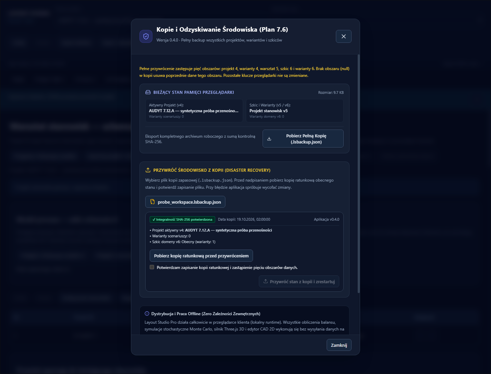

### 5.10. Zgodność licencyjna, prawa do modeli 3D i bezpieczeństwo (Plan 7.7)

Przed komercyjnym wdrożeniem i instalacją na komputerach zakładowych przeprowadzono całościowy audyt prawno-autorski oraz bezpieczeństwa kodu:

- **Pełna zgodność licencyjna zależności runtime (100% Permissive)**:
  - Wszystkie biblioteki ładowane do środowiska wykonawczego aplikacji (`react`, `react-dom`, `three`, `lucide-react`, `xlsx`, `@vercel/analytics`) objęte są wyłącznie uznanymi licencjami permisywnymi (**MIT**, **Apache-2.0**, **ISC**).
  - W aplikacji **nie występuje żadna zależność typu Copyleft** (GPL / AGPL), co gwarantuje pełną ochronę własności intelektualnej modeli procesowych klienta i pełną swobodę komercyjnego wykorzystania wewnątrz przedsiębiorstwa.
  - Narzędzia pomocnicze i kompilacyjne czasu budowania (np. `lightningcss` — MPL-2.0, `caniuse-lite` — CC-BY-4.0) są odseparowane i nie przenikają do kodu wynikowego klienta.

- **Prawa autorskie modeli 3D i wyposażenia**:
  - Wszystkie standardowe modele wyposażenia (16 typów w standardzie 6.1: stoły montażowe, regały FIFO, palety EPAL, wózki, roboty AGV, przenośniki) są generowane proceduralnie z kodu źródłowego Three.js i objęte licencją projektu (**MIT**).
  - Modele konceptualne (stanowisko z nadbudową, regał na części, wózek półkowy) stanowią autorskie opracowania demonstracyjne Blender/GLTF i nie naruszają praw osób trzecich ani wzorów przemysłowych.

- **Bezpieczeństwo i brak podatności (0 Vulnerabilities)**:
  - Przeprowadzono audyt bezpieczeństwa (`npm audit`), potwierdzając **0 luk podatności** (0 critical, 0 high, 0 moderate, 0 low).
  - Architektura odcięta od Internetu (Air-Gapped): aplikacja nie wykonuje w runtime żadnych zapytań sieciowych, a nagłówki serwera wymuszają rygorystyczną politykę bezpieczeństwa Content-Security-Policy (CSP).
  - Bezpieczne parsowanie formatów wejściowych (DXF, Excel, JSON): importy operują na rygorystycznie białej liście bezpiecznych struktur, uniemożliwiając wykonanie złośliwego kodu lub makr.
  - Automatyczna weryfikacja stanu licencji i podatności: polecenie `npm run audit:licenses`.

### 5.11. Profesjonalny raport inżynierski PDF i wykres Yamazumi (Plan 7.10)

W zakładce `7 Raport` dostępny jest dokument inżynierski przeznaczony do przeglądu i wydruku w formacie **PDF / A4 portrait**. Dokument nie zastępuje walidacji procesu ani odbioru przemysłowego:

- **Hierarchia dokumentu i układ sekcji**:
  - **Nagłówek formalny**: nazwa i kod projektu, autor, data sporządzenia, wersja silnika aplikacji oraz wskaźnik statusu walidacji (`Zgodny`, `Ostrzeżenia`, `Błędy krytyczne`).
  - **1. Podsumowanie wykonawcze (KPI Cards)**: kluczowe metryki linii zestawione w kontrastowych kartach:
    - Czas taktu ($TT$),
    - Wąskie gardło ($CT_{max}$),
    - Liczba stanowisk roboczych i operatorów,
    - Efektywność zbalansowania linii ($Line\ Efficiency\ [\%]$),
    - **Zdolność Produkcyjna**: nominalny szacunek statyczny, 3600 podzielone przez największy efektywny odstęp stanowiska z przypisanymi operacjami. Uwzględnia jawny czas zespołu i kopie stanowiska; sama liczba osób nie skraca czasu. Bez poprawnego dodatniego odstępu widoczna jest kreska. Nie stosuje się ponownie OEE i nie jest to wynik symulacji partii.
    - **Wymagane tempo**: cel wynikający z popytu i rezerwy OEE, odrębny od zdolności. Przykład testowy: cykl 127 s daje 28,3 szt./h zdolności, podczas gdy wymagane tempo wynosi 22,2 szt./h.
  - **2. Założenia produkcyjne i popytowe**: tabela parametrów wejściowych (czas pracy, wielkość zmiany, liczba dni roboczych, popyt w okresie, bufor bezpieczeństwa).
  - **3. Bilansowanie linii i Wykres Yamazumi**:
    - **Wektorowy wykres słupkowy Yamazumi (SVG/CSS)**: prezentuje czasy cyklu poszczególnych stanowisk roboczych z wyróżnieniem operacji dodających wartość (VA) i niedodających wartości (NVA).
    - Czerwona, przerywana linia odniesienia Takt Time ($TT$) pozwala natychmiast zidentyfikować stacje przeciążone ($CT > TT$) oraz stację stanowiącą wąskie gardło linii.
    - Szczegółowa tabela stanowisk z wyliczonym obciążeniem procentowym i przypisaną obsadą.
  - **4. Operacje technologiczne (Routing & Process)**: pełny wykaz kroków procesu z numeracją sekwencji, czasami standardowymi, relacjami poprzedników i przypisanymi stacjami.
  - **5. Zestawienie materiałowe (BOM) i koszty komponentów**: zestawienie części, indeksów magazynowych, typów pojemników logistycznych, wielkości opakowań oraz kalkulacja łącznego kosztu komponentów na sztukę wyrobu.
  - **6. Parametry przestrzenne hali i rozmieszczenia layoutu**: wymiary hali produkcyjnej, powierzchnia ($m^2$), typ przepływu linii (np. linia prosta, U-kształtna), tryb pozycjonowania stanowisk oraz zestawienie stref bezpieczeństwa i przeszkód OHS/BHP.
  - **7. Raport walidacji i Quality Gate**: automatyczny audyt poprawności technologicznej i przestrzennej (wykrywanie braków stacji, przekroczeń taktu, kolizji geometrycznych).
  - **8. Klauzule formalne i metryka akceptacji**:
    - Przypomnienie niezmienników inżynierskich: Zasada 5 (niefałszowanie danych produkcyjnych), Zasada 6 (niezależność stanu procesu od geometrii 3D), zgodność z normami OHS/BHP.
    - Metryka podpisów akceptacyjnych dla Inżyniera Procesu / Industrial Engineera oraz Kierownika Produkcji / Lean Championa.

- **Dedykowany arkusz wydruku (`@media print`)**:
  - Narzucony format `size: A4 portrait` z marginesami $12\text{ mm} \times 10\text{ mm}$.
  - Automatyczna ochrona przed ucinaniem wierszy (`break-inside: avoid; page-break-inside: avoid;`) na tabelach, kartach KPI, wykresie Yamazumi i blokach podpisów.
  - Powtarzanie nagłówków tabel na kolejnych stronach wydruku (`thead { display: table-header-group; }`).
  - Automatyczne ukrywanie elementów interfejsu studia, paska akcji raportu oraz nawigacji podczas drukowania i eksportu do PDF.

- **Przełącznik trybu widoku (`Profesjonalny Raport A4` / `Źródło Markdown`)**:
  - Domyślny widok A4 prezentuje sformatowany dokument inżynierski.
  - Tryb surowego tekstu Markdown umożliwia szybkie skopiowanie raportu do systemów ERP/MES lub edytorów zewnętrznych.

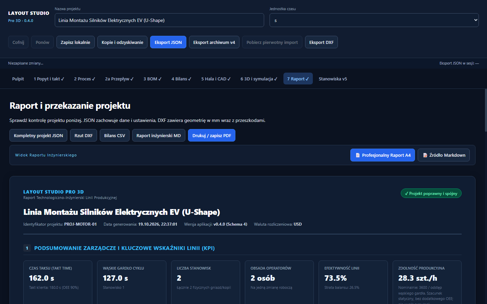

### 5.12. Uniwersalność procesowa: baterie EV i silniki elektryczne (Plan 7.11)

Odbiór 7.11a sprawdza dwa niezależne, syntetyczne procesy w aktywnym schemacie 4: baterie EV (6 operacji, 6 pozycji BOM, EUR, układ liniowy) i silniki EV (6 operacji, 5 pozycji BOM, USD, układ U). Są to przykłady do nauki i testów, bez potwierdzonych pomiarów produkcji. Odbiór nie obejmuje pełnej fizycznej konfiguracji i symulacji szkicu 6 ani dowolnej sieci procesu.

Aby przeprowadzić porównanie na własnych danych:

1. Na pulpicie wybierz **Rozpocznij od zera**, wpisz nazwę projektu, walutę i popyt. W zakładkach procesu i BOM zaimportuj własne arkusze XLSX; identyfikatory operacji w BOM muszą odpowiadać procesowi.
2. W bilansowaniu utwórz wariant bazowy, np. **Każda operacja osobno — zachowaj gałęzie**. Na pulpicie wpisz **Nazwa wariantu** i kliknij **Zapisz wariant**.
3. Zmień przydział operacji, np. wybierz RPW, zachowując te same czasy, BOM i popyt. Zapisz drugi wariant. Tabela na pulpicie pozwala porównać liczbę stanowisk, takt i efektywność. Mniejsza liczba stanowisk w tym porównaniu nie dowodzi zwiększenia dynamicznej przepustowości.
4. W procesie pobierz **Eksport CSV**. Możesz ponownie wczytać pobrany plik. **Eksport JSON** zapisuje projekt; ponowny import JSON i odświeżenie aplikacji pozwalają sprawdzić odtworzenie danych i konfiguracji.

W teście dla baterii zmiana przydziału zmniejszyła liczbę stanowisk z 6 do 1 przy takcie 303,75 s; dla silników z 6 do 2 przy takcie 151,875 s. Popyt i dane wejściowe były niezmienne w każdej parze. Nie stwierdzono przeciążenia stanowisk względem taktu.

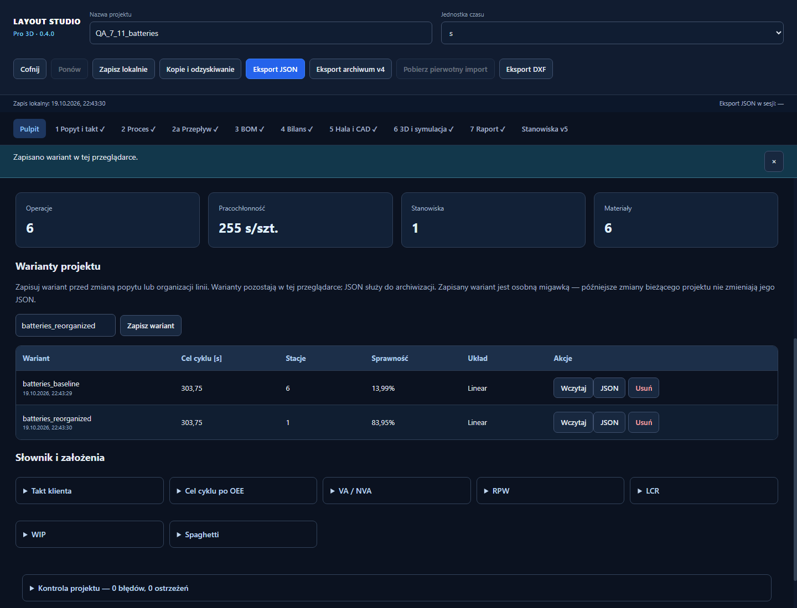

Biblioteka wariantów jest wspólna w danej przeglądarce. Migawki zachowują dane własnego projektu; stosuj nazwy zawierające nazwę projektu i wariantu. Test dwóch projektów potwierdził zachowanie pierwszych migawek podczas pracy nad drugim projektem oraz brak zmieszania procesu, BOM, waluty i układu przy eksporcie, imporcie i odświeżeniu. Obcy BOM z nieznanymi identyfikatorami operacji jest odrzucany bez częściowego nadpisania projektu.

Niepotwierdzone wymiary hali i wygenerowany układ są oznaczane jako założenia. Wczytanie przykładu lub wygenerowanie rozmieszczenia nie zastępuje pomiarów hali, potwierdzenia wyposażenia i odbioru technologicznego.

### 5.13. Przenoszenie projektu ze szkicem i wariantami — Pakiet projektu (7.12.A1)

Przycisk **Pakiet projektu** w górnym pasku przenosi jedną rodzinę projektu: źródło 4, opcjonalne stanowiska 5, zapisany szkic 6 i jego bibliotekę wariantów. Zwykły **Eksport JSON** nadal zapisuje aktywny projekt 4. Pełna kopia `.lsbackup.json` służy do odzyskiwania całego środowiska, łącznie ze wspólną biblioteką scenariuszy 4.

Aby wyeksportować rodzinę projektu:

1. Zapisz potrzebne zmiany w szkicu 6 i wariantach w zakładce **Stanowiska v5**. Eksport pakietu pobiera zapisany szkic; może dotyczyć innego projektu niż widoczny w głównych zakładkach.
2. Otwórz **Pakiet projektu**, wybierz **Pochodzenie danych** (dla przykładów: **Syntetyczne / pokazowe**) i kliknij **Pobierz pakiet projektu**. Domyślne „Nieokreślone” nie potwierdza pomiarów rzeczywistych. Sprawdź plik `Projekt_Layout_Studio.project.json` w folderze pobierania.
3. Gdy szkic powstał ze źródła 5, a oryginału 4 nie ma w zapisie warsztatu, wskaż jego oryginalny plik w polu **Oryginalny plik 4**. Użytkownik odpowiada za wybór właściwego źródła; sama nazwa lub podobne ID go nie odtwarzają. Obca biblioteka wariantów 6 blokuje eksport zamiast być pominięta.

Aby wczytać pakiet:

1. Otwórz **Pakiet projektu** i wybierz **Plik pakietu** (JSON do 25 MB). Sprawdź podgląd nazwy, ID, liczników i pochodzenia oraz komunikat o integralności SHA-256. Nie używaj dotychczasowego importu JSON 4 do tego formatu.
2. Import zastąpi **projekt 4, warsztat 5, szkic 6 i warianty 6**. Brak źródła 5 usuwa poprzedni warsztat; brak biblioteki 6 usuwa poprzednie warianty 6. Wspólna biblioteka scenariuszy 4 pozostaje zachowana. Przed importem zachowaj niezapisane zmiany przez zapis lub aktualny eksport JSON.
3. Kliknij **Pobierz kopię ratunkową przed importem**, sprawdź zapisany plik i zaznacz potwierdzenie. Następnie wybierz **Wczytaj pakiet i przeładuj**. Zamknięcie okna przed tą czynnością anuluje import.
4. Po przeładowaniu znajdziesz projekt źródłowy w głównych zakładkach, a pełny szkic i warianty w **Stanowiska v5**. Sprawdź dane przed uruchomieniem obliczeń. Ustaw jawnie liczbę sztuk, odstęp przybyć, tryb transportu/JIT i inne ustawienia eksperymentu sesji zgodnie z opisem projektu — pakiet ich automatycznie nie odtwarza.

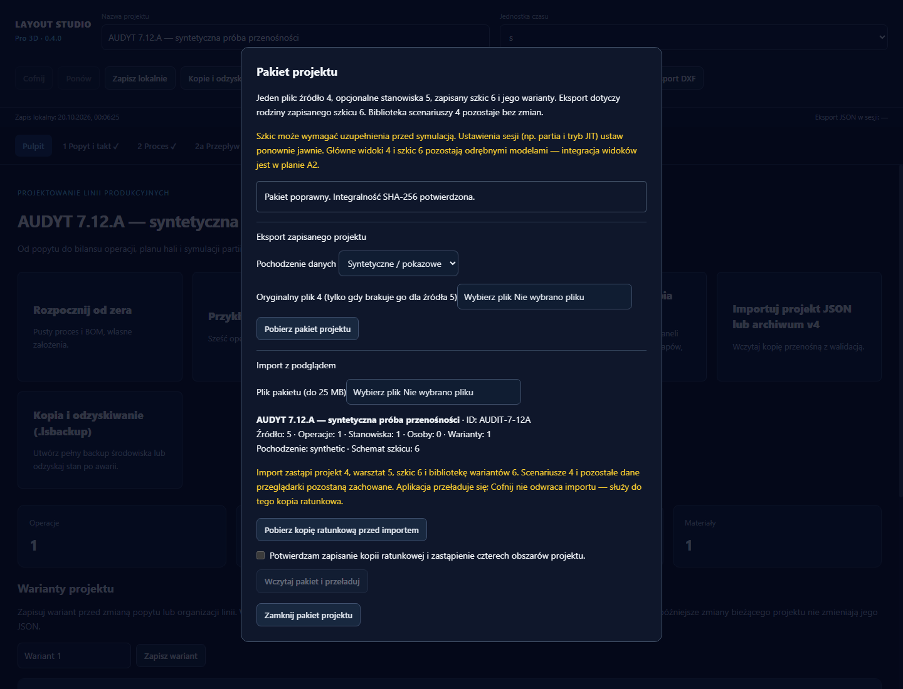

Jeżeli dane zmieniły się od pobrania kopii, import zatrzyma się przed zapisem; pobierz nową kopię i ponownie sprawdź zakres. Błąd pamięci wywołuje wycofanie do poprzedniego stanu. Gdy wycofanie nie jest potwierdzone, edycja i zamknięcie okna pozostają zablokowane. **Pobierz stan sprzed błędu** zachowuje snapshot, a **Odtwórz pełną kopię ratunkową** otwiera odzyskiwanie całego środowiska. Po usunięciu przyczyny można też wczytać poprawny pakiet. Cofnij nie odwraca importu po przeładowaniu; użyj kopii ratunkowej.

Poprawny import nie oznacza kompletności danych do symulacji. Główne widoki, animacja i raport 4 oraz obliczenia szkicu 6 pozostają odrębnymi ścieżkami; ich integracja jest osobnym punktem A2. Pierwszy projekt pokazowy B opisano poniżej; pozostałe powstaną w C. Pliki prób odbiorowych A/A1 nie zastępują tych przykładów.

### 5.14. Pierwszy zewnętrzny projekt pokazowy — zestaw uchwytu (7.12.B)

Katalog **`przyklady/01_zestaw_montazowy/`** zawiera gotowy przykład i szablony: `projekt-pokazowy.json`, manifest z wersją i sumami, arkusze `dane/proces.xlsx` i `dane/bom.xlsx`, projekcje danych 4/6, warunki eksperymentu, słownik pól, README oraz niezależne obliczenia referencyjne. Wszystkie czasy, ceny i wymiary są syntetyczne. Projekt nie jest wbudowany w aplikację; trzeba wskazać plik z katalogu. Udostępnianie paczek z ekranu startowego pozostaje w 7.13.

1. Zachowaj własną pracę. Na pulpicie możesz wybrać **Rozpocznij od zera**; potem otwórz **Pakiet projektu** i wybierz `projekt-pokazowy.json`. Podgląd ma pokazać trzy operacje, trzy stanowiska, trzy osoby i dwa warianty. Pobierz kopię ratunkową, potwierdź i wczytaj pakiet.
2. W głównych zakładkach sprawdź bazę: takt **60 s**, czasy **20/30/40 s**, BOM **25 PLN/szt.** i trzy stanowiska. Hala i stoły mają wymiary koncepcyjne. Arkusze XLSX służą także do ćwiczenia importu w **2 Proces** i **3 BOM**, lecz sam arkusz nie odtwarza zasobów ani biblioteki 6; pełną demonstrację przywraca pakiet.
3. Przejdź do **Stanowiska v5**, do panelu harmonogramu szkicu 6. Ustaw **3 sztuki**, **odstęp 1 s** i jawnie zaznacz **Symulacja bez transportu — just in time**. Oblicz harmonogram: baza kończy sztuki po **90/130/170 s**. Tryb JIT zakłada dostępne materiały, pomija transport i fizyczne lokalizacje korpusów. Jest wyłączony po ponownym otwarciu — trzeba wybrać go jawnie.
4. W panelu porównania wariantów również ustaw **3 sztuki**, **1 s**, jawny **JIT** i oba zapisane warianty. Wybierz bazę na trzech stanowiskach i uruchom porównanie. Baza: **170 s**, trzy osoby i trzy aktywne stanowiska; konsolidacja: **190 s**, dwie osoby i dwa aktywne stanowiska. Nominalna zdolność statyczna wynosi odpowiednio **90 i 72 szt./h**. To odrębne miary od dynamicznej przepustowości małej partii. Pobierz **raport porównania (.md)**.

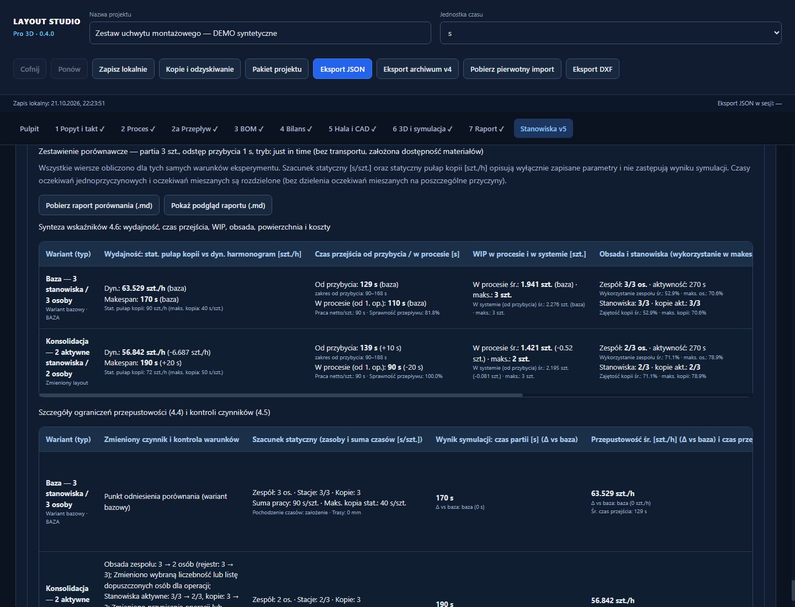

Konsolidacja przenosi drugą operację do pierwszego stanowiska i osoby W1, nie zmieniając czasów. Trzecie stanowisko/osoba W3 nadal wykonuje kontrolę i pakowanie. S2/W2 pozostają rezerwą. Zdefiniowane bufory mają wejścia po 3 szt., wyjścia pośrednie po 3 szt. i jawnie nieograniczone końcowe wyjście w modelu (null). Lokalna kontynuacja na tej samej kopii nie jest przerywana inną sztuką. Pojemność nie blokuje tej partii; to założenie przykładu, nie stwierdzenie o rzeczywistym magazynie.

Mniejsza obsada nadal mieści się w takcie 60 s, ale zmniejsza maksymalną zdolność i wydłuża partię. Bez stawek nie deklarujemy oszczędności pieniężnych. Zmieniono przydział, skład i położenie rezerwowego stołu, więc raport uczciwie ostrzega o wielu zmienionych czynnikach.

Możesz wczytać konsolidację do szkicu przyciskiem **Wczytaj do szkicu 6**, użyć **Cofnij dane szkicu / Ponów dane szkicu**, zapisać własny wariant pod nową nazwą i wyeksportować pakiet. Ponowne wczytanie oraz odświeżenie zachowują szkic i warianty. Ustawienia sesji wybierz ponownie jawnie. Główne widoki i raport A4 schematu 4 nadal dotyczą źródłowej bazy; raportem konsolidacji jest tutaj raport porównania szkicu 6. To ograniczenie pozostaje do integracji A2, przed fizycznymi przykładami średnim i zaawansowanym.

### 5.15. Przydziały, rzut i raport aktywnego szkicu 6 (7.12.A2a)

W **Stanowiska v5**, pod informacją o zapisanym szkicu 6, znajduje się panel **Aktywny szkic 6 — przydziały, rzut i raport**. Wszystkie jego elementy korzystają z tego samego aktywnego modelu. Nie wykonuje się nowego bilansu źródła 4 ani automatycznej migracji. Panel jest do odczytu; dane zmieniasz w edytorach szkicu i przez przywracanie wariantów.

1. Po wczytaniu projektu podstawowego panel pokazuje przydziały OP10/OP20/OP30 do trzech stanowisk, wybrane czasy 20/30/40 s, założone pochodzenie i pułap statyczny 90 szt./h. Rzut pokazuje zapisane stoły z trwałymi ID stanowisk.
2. Wczytaj konsolidację z biblioteki wariantów do szkicu. Ten sam panel ma teraz OP10 i OP20 na ST-ZM-1 (suma 50 s), ST-ZM-2 jako rezerwę i OP30 na ST-ZM-3. W składzie są W1/W3, pułap statyczny to 72 szt./h, a rezerwowy stół S2 na rzucie ma Y=4000 mm zamiast 2000 mm. Cofnij/Ponów odtwarza także ten widok.
3. Kliknij **Pobierz raport statyczny aktywnego szkicu 6 (.md)**. Raport zawiera bieżące przydziały, czasy, dopuszczenia i współrzędne geometrii. Skrót SHA-256 w nagłówku raportu musi być taki sam jak w panelu. Zmiana danych zmienia skrót; skrót identyfikuje model, nie jest certyfikatem jego poprawności ani podpisem autora.
4. Zapis, eksport/import pakietu i ponowne otwarcie tego samego modelu zachowują widok i treść raportu statycznego. Harmonogram nadal wymaga osobnego uruchomienia dla jawnych warunków; w przykładzie konsolidacja dla 3 szt./1 s/JIT daje 190 s.

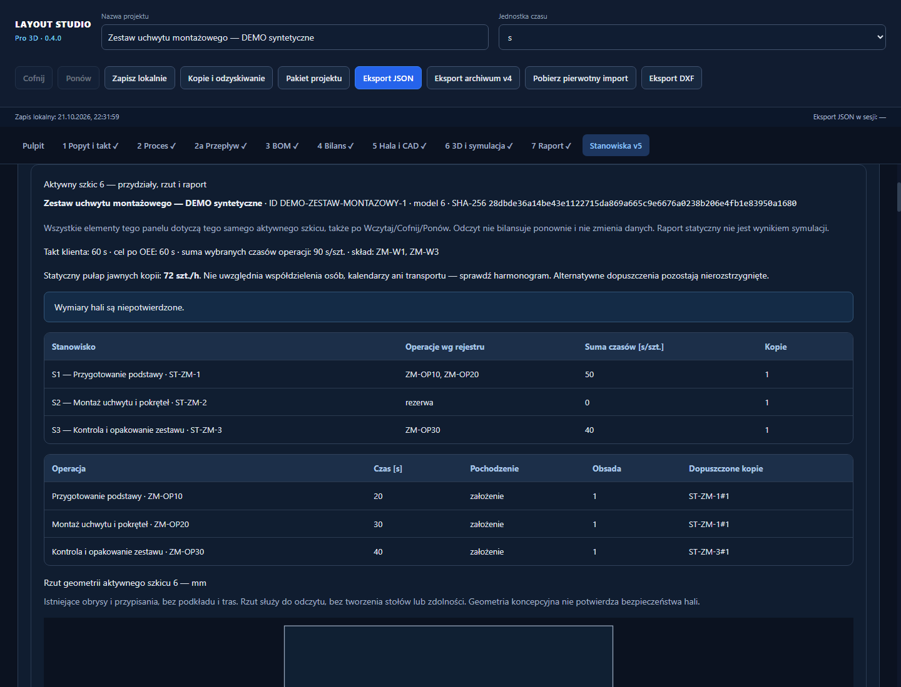

Panel nie uzupełnia brakujących czasów domyślnym czasem standardowym. Nie wybiera też pierwszej z kilku dopuszczonych kopii i nie dzieli przez ich liczbę: gdy brak jednoznacznego wyboru, zdolność kopii pozostaje **brak**. Suma czasów według rejestru stanowisk i dopuszczenia kopii są pokazane odrębnie. Pułap statyczny nie potwierdza dostępności pracowników, kalendarzy, transportu ani dynamicznej przepustowości.

Rzut przedstawia istniejące obrysy z obrotem, przypisania i przeszkody, bez podkładu i tras. Nie tworzy brakującego wyposażenia, nie jest edytorem ani oceną BHP. Główne widoki/raport A4 projektu 4 pozostają oddzielne; ich wyników nie należy podpisywać jako wyników aktywnego 6. Odtwarzanie operacji i historii fizycznych instancji opisano poniżej. Całe A2 pozostaje w trakcie do pozostałego odbioru.

### 5.16. Widok 3D i historia fizyczna projektu (7.12.A2b1/A2b2b)

W panelu harmonogramu zespołu znajduje się **Widok 3D i odtwarzanie operacji projektu**. Wczytuje geometrię tego samego aktywnego projektu, z którego obliczono harmonogram. Nie korzysta z głównej symulacji starszego projektu i nie uruchamia drugiego silnika obliczeń.

1. Zaznacz **Pokaż geometrię 3D**. Możesz obracać kamerę i przybliżać widok myszą. Geometria jest dostępna także przed obliczeniem harmonogramu; sterowanie czasem pojawia się dopiero po poprawnym obliczeniu wyniku. Obiekty mają zapisane wymiary, współrzędne, obrót i wygląd. Widok służy do odczytu.
2. Dla przykładu zestawu ustaw 3 sztuki, odstęp 1 s, jawny JIT i oblicz harmonogram. Baza ma koniec 170 s, konsolidacja 190 s. Odtwarzanie pokazuje dokładnie ten wynik i jego warunki, oznaczone skrótem wyniku. JIT nie oblicza fizycznej lokalizacji wyrobu ani transportu.
3. Wybierz **Odtwarzaj harmonogram**, **Pauza odtwarzania**, **Krok +1 s**, **Początek odtwarzania** lub **Koniec odtwarzania**. Czas możesz wpisać liczbowo lub przesunąć suwak. Zmiana czasu zatrzymuje odtwarzanie. Prędkości od 1× do 5000× zmieniają tempo oglądania, nie czasy operacji i wynik partii.
4. W polu **Wybierz wykonanie** wskaż konkretną sztukę i operację. Możesz również kliknąć przycisk operacji w tabeli bieżących stanów. Wybrany znacznik jest żółty; pozostałe kolory: zielony — praca, niebieski — przerwa kalendarza, pomarańczowy — zajęcie stanowiska po obróbce. Tabela odróżnia też oczekiwanie na start.

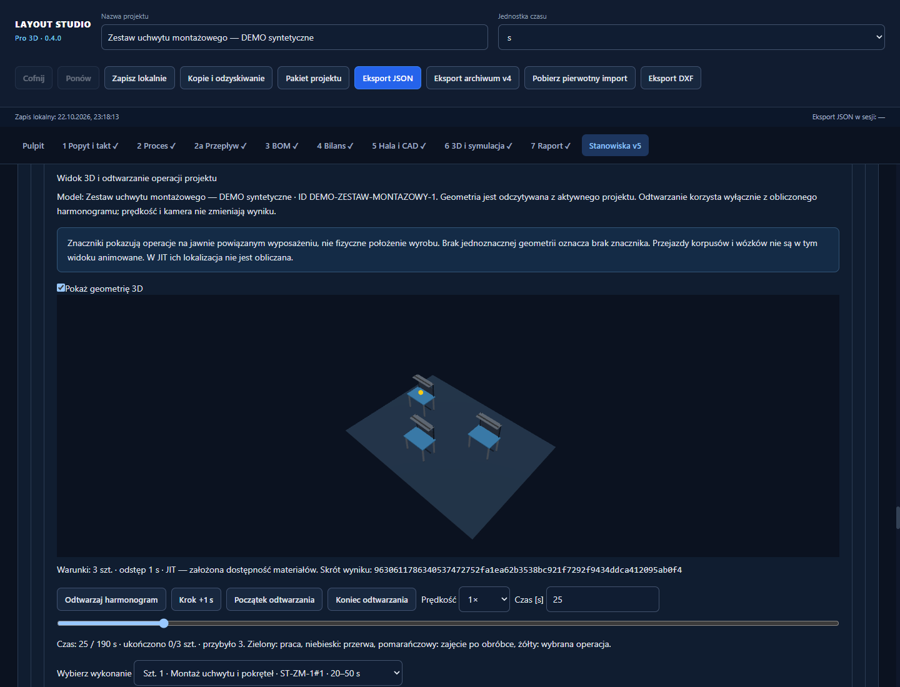

**Kula oznacza operację na stanowisku.** Pokazuje się nad wyposażeniem powiązanym w danych; niejednoznaczna kopia albo brak geometrii oznaczają brak znacznika. Operacje oczekujące na start nie są przedstawiane jako znajdujące się już na stanowisku.

Rozwiń **Korpusy i wózki — historia fizyczna**. Tabela pokazuje zadeklarowane instancje, stan i kopię stanowiska albo końce i czas przejazdu. Procent przejazdu oznacza upływ czasu, nie przebytą drogę. Dane pochodzą z tego samego wyniku obliczeń; można cofać czas i sprawdzać granice zdarzeń. Oś odtwarzania obejmuje także powrót wózka po zakończeniu produkcji, bez zmiany czasu ukończenia wyrobu.

W 3D **fioletowy romb oznacza korpus**, a **błękitny sześcian wózek** przy symbolicznym punkcie odniesienia stanowiska. Nie są to gabaryty wyrobu ani dokładna pozycja dokowania wózka. Statyczny model śledzonego wózka jest ukryty, aby nie pokazywać drugiego egzemplarza w pozycji edytora. Przy braku jednoznacznej geometrii instancja pozostaje w tabeli bez znacznika.

**Model tras zawiera końce, długość i czas, ale nie geometryczny przebieg drogi.** Dlatego podczas przejazdu znacznik fizycznej instancji znika, a tabela zgłasza brak pozycji 3D. Nie jest rysowany pozorny ruch po prostej. W JIT lokalizacje fizyczne nie są obliczane; widoczna statyczna geometria przedstawia projekt hali. Bez deklaracji instancji aplikacja nie tworzy ich z wyposażenia lub numeru sztuki.

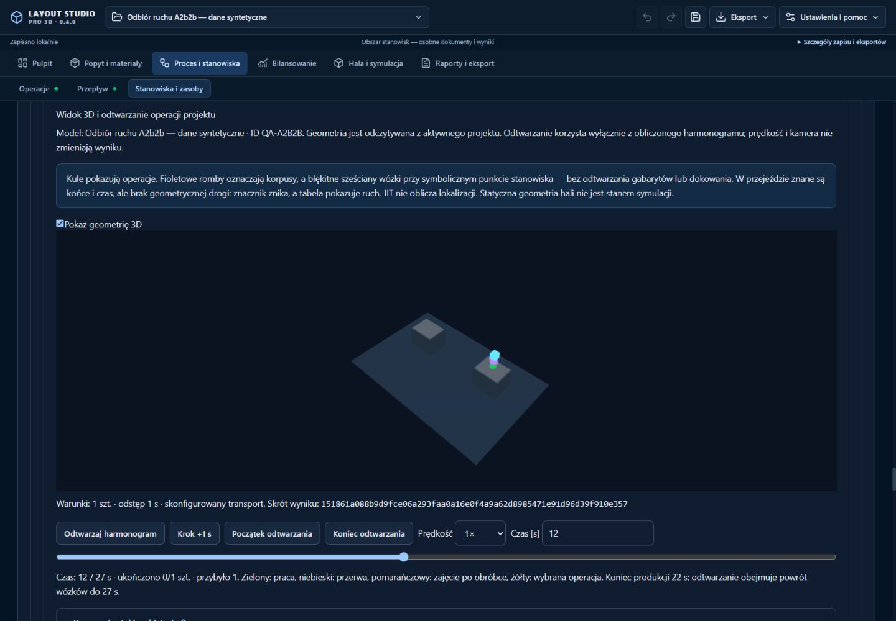

Zmiana liczby sztuk, odstępu przybyć, trybu transportu lub danych projektu usuwa stary wynik i odtwarzanie. Po przywróceniu innego wariantu trzeba ponownie obliczyć harmonogram. Zapis i odświeżenie zachowują projekt, ale nie wznawiają starego wyniku sesji — ustaw warunki i uruchom obliczenia ponownie. Kamera, wybór i prędkość nie zmieniają projektu ani zapisanego harmonogramu.

Widok 3D wymaga WebGL. Jeżeli nie jest dostępny, komunikat zastępuje scenę, a wynik i tabela harmonogramu pozostają dostępne. Dla dużej liczby obiektów używany jest uproszczony wygląd. Główne widoki i raport A4 starszego projektu pozostają oddzielne. Techniczne nazwy „szkic”, „schemat” i „Stanowiska v5” mają zostać uporządkowane w 7.13.U; na razie wskazują bieżącą ścieżkę tego panelu.


### 5.17. Kompaktowa rama aplikacji i menu mobilne (UI1a)

Nagłówek zawiera 56 px wysokości na desktopie i dwa zwarte wiersze na telefonie. Na małym ekranie wszystkie sześć obszarów wybierzesz z jednej listy; dodatkowa lista pojawia się tylko w obszarze z kilkoma widokami. Pasek nie wymaga przewijania przez dziesięć zakładek. Zamknięcie menu nie zmienia danych.


Ten pakiet zmienia dojście do istniejących funkcji. Same formularze, duży viewport CAD, panele sceny, raport i Pulpit są przebudowywane w kolejnych pakietach. Nie dodano importu STEP, nowych ocen ergonomii ani certyfikacji bezpieczeństwa. Wspólny nagłówek nie oznacza jeszcze połączenia zapisów projektu głównego i modelu domenowego.


### Edytor hali 2D — zwarty pasek i tryb skupienia (UI2a)

W obszarze **Hala i symulacja → Hala i CAD 2D** narzędzia znajdują się teraz w grupach **Zaznaczenie i kopie**, **Przyciąganie i układ** oraz **Warstwy i pomiary**. Otwarta jest jedna grupa naraz. Zamknij ją przyciskiem **Zamknij narzędzia**, ponownym wyborem nagłówka albo klawiszem Escape. Rozwinięcie narzędzi nie zapisuje zmian projektu ani nie kasuje wpisanych wartości kopiowania. Biblioteka/drzewo, parametry hali i właściwości pozostają panelami na żądanie.

**Tryb skupienia** powiększa edytor na całe okno. Przycisk **Opuść tryb skupienia** przywraca nawigację; Escape najpierw zamyka otwartą grupę lub panel, a następnie opuszcza skupienie. Tab pozostaje w widocznym edytorze; globalne skróty Cofnij/Ponów/Zapisz działają nadal. Powiększanie, oddalanie, dopasowanie i przesuwanie widoku mają ikony z dostępnymi nazwami i podpowiedziami. Na telefonie pasek przewija się poziomo, a narzędzia otwierają się u dołu okna.

Oznaczenia **Geometria koncepcyjna** i **Wymiary hali niepotwierdzone** pozostają widoczne przy zwiniętym opisie; pełne objaśnienia otwiera **Założenia i obsługa**. Aktywny pomiar lub kalibracja są oznaczone nad rzutem także po zamknięciu narzędzi. Zmiany tego pakietu dotyczą 2D; porządkowanie widoku 3D i symulacji pozostaje kolejnym krokiem UI2b. Po korekcie UI2c zwykły widok przy 1280×720 i 1440×900 mieści cały rzut o wysokości 60% okna, gdy panele i opisy są zamknięte. Powrót z 3D zachowuje możliwość edycji zaznaczonego obiektu w panelu Właściwości. Cofnij/Ponów odczytuje aktualną geometrię projektu i usuwa niezapisane zmiany formularza.


### Hala 3D — narzędzia i parametry na żądanie (UI2b)

Wybierz **Hala i symulacja → 3D i symulacja**. Pasek zawiera grupy **Edycja i manipulatory** oraz **Warstwy i widoczność**, a także ikony dopasowania hali i widoku z góry. Otwarta jest jedna grupa naraz. Zamknij ją przyciskiem **Zamknij narzędzia 3D**, nagłówkiem lub Escape. **Założenia i obsługa 3D** zawierają objaśnienia geometrii, wymiarów hali i sterowania kamerą; oznaczenia niepotwierdzonych danych są widoczne również przy zwiniętym opisie.

**Tryb skupienia 3D** powiększa scenę. **Opuść tryb skupienia 3D** lub Escape przywraca nawigację; przy otwartej sekcji Escape najpierw ją zamyka. Tab i Shift+Tab pozostają w widocznym edytorze. Skupienie i zwijanie sekcji zachowują tę samą instancję symulacji oraz jej czas. Nie są zapisywane w projekcie.

Sterowanie **Start/Pauza, Reset, suwak i Inspekcja 3D** pozostaje bezpośrednio pod sceną. Przewinięcie czasu zatrzymuje odtwarzanie. Zwięzłe podsumowanie pokazuje partię, czas, liczbę ukończonych sztuk i prędkość. Rozwiń **Parametry, wyniki i eksport symulacji**, aby zmienić partię/odstęp/prędkość, przeliczyć wynik, obejrzeć szczegóły lub pobrać CSV. Błędy obliczeń, postęp, anulowanie oraz stan aktualności CSV pozostają poza zwijaną sekcją. Gdy WebGL nie działa, komunikat błędu sceny i dane symulacji są nadal dostępne.

Prędkość odtwarzania zmienia animację, a nie harmonogram. Po wyjściu z zakładki lub przeniesieniu widoku do osobnego okna sesja może zostać uruchomiona od początku; pakiet nie wprowadza przenoszenia czasu między zamontowaniami widoku. Odczyt fizycznej historii modelu domenowego pozostaje zakresem A2b2b.


