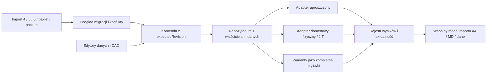

# Architektura integracji modeli V1

Data: 2026-11-01. Status: **projekt do zatwierdzenia, bez implementacji**. Decyzja właściciela A-02; ustalenia S-08/S-11; powiązanie PLAN: 2.1, 1.5–1.7, 4.1–4.7, 7.10, 7.12.I, 7.13.X/U. Bazowy SHA: `6aa84d8129b7f7cc4d92c3c00b4d8a99a255d3eb`.

Dokument określa rekomendację techniczną, nie zatwierdza nowego formatu ani zmiany reguł procesu. Kolejność i bramki opisuje [plan remediacji](PLAN_REMEDIACJI_PO_AUDYCIE_RC1.md), a odbiór [plan testów](PLAN_TESTOW_RC2.md).

**Reweryfikacja 2026-11-02:** aktualny `origin/main` po `git fetch origin`, historyczny RC1 i podstawa gałęzi `codex/v1-audit-remediation` mają SHA `6aa84d8129b7f7cc4d92c3c00b4d8a99a255d3eb`. Drzewo kodu i kontraktów nie różni się od RC1, dlatego porównanie trzech opcji oraz rekomendacja C pozostają aktualnym projektem, a nie założeniem przeniesionym z audytu. Nie zatwierdza to architektury ani nie usuwa luk dowodowych.

W P1 trzeba ponownie pobrać main, porównać zmienione od tej bazy źródła modeli, edytorów, migracji, wariantów i raportów oraz potwierdzić właścicieli danych. Jeśli pojawiły się istotne zmiany, aktualizuje się macierz opcji, strategię migracji i testy **przed** odbiorem G2. Każdy późniejszy pakiet ma jawny bazowy SHA main oraz wymagane SHA odebranych poprzedników; RC1 jest materiałem porównawczym, nie domyślną bazą implementacji. Pełna procedura i metryka są w sekcji 2 planu remediacji.

## 1. Rzeczywisty stan kodu

| Obszar | Właściciel i obecne zachowanie | Konsekwencja integracji |
|---|---|---|
| Projekt główny | `src/core/models/types.ts`: `ProjectData`, `processSteps`, BOM, demand, facility, layoutObjects; `App.tsx`: historia, autosave, biblioteka wariantów; `project.ts:derive` wylicza bilans i automatyczny layout | Nie traktować `balancing` ani wygenerowanego layoutu jako drugiej definicji technologii; przy odczycie nie regenerować ręcznej geometrii |
| Stanowiska 5 | `stationMigration.ts`, `stationProject.ts`, `stationRegistry.ts`: trwałe ID `ST-`, `stations[].operationIds`; podgląd mapuje starsze identyfikatory | Zachować mapę i istniejące ID; nie wiązać po nazwie/numerze wiersza |
| Model 6 | `domainProject.ts`: rozszerzenie modelu 5, `operations`, stanowiska, BOM/popyt/geometria oraz zasoby, profile, routing, korpusy, bufory i materiały; parser odrzuca zdublowane processSteps i cache | Model już zawiera część wspólnych danych; nie dodawać trzeciej edytowalnej kopii |
| Migracja i zapis | `domainMigrationPreview.ts`, `domainDraftStorage.ts`: dokładny oryginał 4/5, oddzielny klucz i kontrola poprzedniego raw; utworzenie 6 jest jednorazową kopią | Wspólne ID projektu nie dowodzi równości treści; późniejsze zmiany 4 i 6 mogą być rozbieżne |
| Edytory | `DataEditors`, `ProcessFlow`, `ResourceEditor`, `BalancingBoard` pracują na 4; `StationWorkspace`/`DomainDraftPanel` i `Domain*Editor` mają własny dokument/historię | Wspólny nagłówek nie zapewnia wspólnych komend; potrzebne przekierowanie zapisów |
| Bilans | `lineBalancingEngine.ts` oraz `domainBalancing.ts` mają różne kontrakty; domenowy działa na jawnie dopuszczonych istniejących kopiach, kompetencjach i wybranym czasie obsady | Zachować obie metody; propozycja statyczna nie dowodzi przepustowości ani globalnej wykonalności |
| Symulacja | `network.worker.ts`/`networkSimulation.ts`: model uproszczony; `schedule.worker.ts`/`workerSchedule.ts`, `bufferedProcessSchedule.ts`, `graphBodyBuffers.ts`: zasoby i fizyka lub jawny JIT | Wspólny przepływ nie oznacza identycznych silników lub wyników |
| Warianty i raporty | App: statyczna biblioteka 4; `domainVariantComparison.ts`: snapshoty 6, wspólne warunki eksperymentu i raport MD; `EngineeringReportView`: statyczny A4 bez wyników harmonogramu | Nowy raport musi zbierać wyniki z określonego wariantu i rewizji; nie doklejać ostatniego wyniku z innego widoku |
| Przenoszenie/DR | `projectPackage.ts`: format 1 przenosi źródło, szkic i warianty; `workspaceBackup.ts`: pięć slotów localStorage, kontrola sumy, konfliktu i rollback | Nowy magazyn musi wejść do backupu/odtwarzania; stare backupy pozostają czytelne |

Kontrakty nadrzędne: `MODEL_PROCESU_2_1.md`, `MODEL_CZASU_2_2.md`, `MODEL_OBSADY_2_3.md`, `MODEL_OPERATOROW_2_4.md`, `MODEL_KALENDARZA_2_5.md`, `MODEL_STANOWISK_2_6.md`, `MODEL_KORPUSU_2_7.md`, `MODEL_ROWNOLEGLOSCI_2_8.md`, transport 3.2–3.4, bufory/zaopatrzenie 3.5 i C2, stany 3.6, kompetencje 4.3 i wygląd 6.4. Historyczne akapity „nadal poza symulacją” czytać z późniejszymi odbiorami; nie cofają wdrożonego C2.

## 2. Porównanie trzech rozwiązań

Oceny są jakościowe. Brak podstaw do wiarygodnego oszacowania osobodni przed prototypem migracji; nie podano fikcyjnych terminów.

| Kryterium | A. Jeden nowy kanoniczny model i adaptery zgodności | B. Dwa pełne modele, wspólne źródło i kontrolowana synchronizacja | C. Warstwa integracyjna, właściciele pól i graf zależności |
|---|---|---|---|
| Poprawność domenowa | Wysoka po odwzorowaniu wszystkich kontraktów; ryzyko spłaszczenia obsady, czasu i routingu przy „wszystko do 6” | Dobra wyłącznie z pełną macierzą własności i konfliktów; dwa zapisy tych samych pól tworzą okna rozbieżności | Wysoka: każdy fakt ma jednego właściciela; adaptery tworzą tylko przejściowe wejścia silników |
| Migracja | Wysokie ryzyko jednorazowej konwersji całego projektu i wszystkich wariantów | Średnie/wysokie: uzgodnienie historii i atomowa aktualizacja kilku dokumentów | Średnie: import do nowej koperty, zachowanie oryginałów, jawne rozstrzygnięcie różnic |
| Nakład | Największy początkowy: parser, edytory, eksportery i oba silniki | Duży, również stały koszt synchronizacji i konfliktów | Umiarkowany/duży: repozytorium projektu, komendy, adaptery, wyniki; etapami bez przepisywania silników |
| Testy | Pełna równoważność wszystkich konwersji i funkcji | Wszystkie kierunki synchronizacji, pętle, kolejność, wyścigi, częściowe zapisy | Macierz właściciel→komenda→adapter→wynik; transakcje, odrzucanie spóźnionych wyników i migracje |
| Funkcje dotychczasowe | Możliwa utrata cech niemieszczących się w nowym schemacie | Łatwo zachować ekrany, trudniej jednoznaczny aktywny stan | Zachowane silniki i formaty źródłowe; stare edytory muszą zostać podłączone jako adaptery komend |
| Regresje | Wysokie przez szerokość jednoczesnej wymiany | Wysokie przez subtelne rozjazdy i nadpisania danych 6 po zmianie 4 | Średnie, skupione na granicach; ryzyko obejścia komend wymaga testu wszystkich zapisów |
| V2 | Dobra baza po kosztownej migracji, ale silne sprzężenie domen | Narastający koszt kolejnych modeli i synchronizacji | Dobra: kolejne moduły mają jawne wejścia, właścicieli i wersje; można później konsolidować reprezentacje |

**Rekomendacja: C.** Jedna aktywna rodzina projektu z właścicielami danych, kontrolowanymi komendami i adapterami obliczeń. Nie utrzymywać dwóch edytowalnych dokumentów tego samego procesu. Nie zmieniać reguł silników i nie usuwać modelu 4. Od opcji A odróżnia to brak wymiany wszystkich kontraktów na jeden monolityczny schemat; od B — brak trwałego dwukierunkowego synchronizowania pełnych kopii.

## 3. Kontrakt docelowy i właściciele

Proponowane nowe moduły (nazwy do zatwierdzenia w P1): `src/core/integration/projectEnvelope.ts`, `projectRepository.ts`, `projectCommands.ts`, `legacyAdapters.ts`, `resultRegistry.ts`, `engineeringReport.ts`. To lista przyszłych plików, obecnie nie istnieją.

`IntegratedProjectEnvelope` ma niezależne `formatVersion: 1`, `projectId`, `branchId`, `revision`, identyfikator bazowej rewizji, sekcje poniżej, metadane kwalifikacji oraz odwołania do oryginałów. Nie podszywa się pod `schemaVersion: 6`; stare parsery nie muszą akceptować nowego zapisu.

| Sekcja/właściciel | Dane autorytatywne | Projekcje i zakazy |
|---|---|---|
| Definicja procesu | ID/nazwy operacji, DAG, klasyfikacja VA/NVA, dotychczasowy czas standardowy, BOM, produkt/podzespoły, popyt, waluta | `processSteps` 4 i `operations` 6 są budowane z tej sekcji. Nie zapisują zmian niezależnie |
| Stanowiska i przydziały | Trwałe stanowiska, operacje w rejestrze, kopie/ustawienia, blokady; jawne dopuszczenia i wybór kopii odrębne od przydziału bazowego | Wskaźnik `assignedWorkstationId` tylko w adapterze 4; lista dopuszczeń nie staje się automatycznie przydziałem |
| Technologia wykonania | Profile referencyjne, warianty czasu dla liczebności obsady, osoby/pule, kompetencje, możliwości i egzemplarze wyposażenia, kalendarze, role korpusu, równoległość | Nie tworzyć osób z liczby operatorów, profilu z VA/NVA ani zdolności z obrysu. Zmiana standardu nie nadpisuje profili |
| Logistyka i eksperyment | Jawne trasy i czasy, załogi przewozów, kolejność wózków, korpusy i zlecenia, partie podmontaży, zapasy/dostawy/zużycie, bufory i polityki, przezbrojenia, Monte Carlo | BOM nie jest zapasem/dostawą/pojemnością; roczny kalendarz popytu nie jest kalendarzem zasobu |
| Hala i geometria | Hala, podkład/kalibracja, przeszkody, layoutObjects z ID, wizualne grupy/blokady/wygląd i powiązania do stanowisk | Wygląd/LOD/kamera nie zmienia technologii. Przesunięcie nie przepisuje zatwierdzonej długości trasy; może zgłosić potrzebę jej ponownego sprawdzenia |
| Kwalifikacja | Pochodzenie i kompletność pola/źródła, dowód, autor potwierdzenia, data; osobne od wartości | `measured`, `assumed`, `unknown` oraz osobno `complete/incomplete` i `verified/unverified`. Brak metadanych starego pola = unknown, nigdy automatyczny pomiar |
| Wyniki | Niezmienne artefakty obliczeń z identyfikatorem wariantu, fingerprintem wejść, wersją silnika i jednostkami | Wynik nie jest źródłem operacji lub konfiguracji; nie odtwarzać technologii z animacji |

Pochodzenie syntetyczne to etykieta zbioru/źródła, nie czwarty rodzaj pomiaru w starym parserze profilu. `PackageOrigin: user` nie dowodzi, że wszystkie pola są mierzone. Istniejące `basis: measured/assumed` i `confirmed/assumed` pozostają bez zmian w adapterach; `unknown` jest w metadanych integracji. Gdy silnik wymaga jawnego basis, braku nie wolno uzupełnić automatycznie.

### Czas i bilans — rozstrzygnięcie bez zmiany fizyki

Kontrakty 2.2/2.3 wymagają zachowania odrębnie `standardTimeSeconds`, referencyjnego `timeProfile` i `staffing.timeVariants`. Wspólne źródło nie oznacza zrównania tych liczb. Zmiana jednej oznacza konieczność przeglądu zależnej konfiguracji, nie automatyczne skalowanie innych. UI pokazuje wybraną podstawę: „bilans standardowy” albo „bilans dla jawnej obsady”. Model 4 może nadal używać standardu; model 6 wybranego wariantu. Raport opisuje różnicę i nie przedstawia obu jako tego samego wyniku.

Propozycja RPW/LCR w uproszczonym trybie pozostaje projektem przydziału. Nie nadaje nowemu stanowisku wyposażenia, dopuszczeń czy pracowników. Przeniesienie jej do konfiguracji fizycznej wymaga podglądu mapy i walidacji tych referencji. Usunięcie operacji/stanowiska z zależnymi BOM, rolami, trasami, wyposażeniem, zaopatrzeniem albo wariantami jest blokowane do jawnego uzgodnienia; nie usuwać kaskadowo danych klienta.

## 4. Komendy i przepływ danych

Komenda zawiera projekt, gałąź, `expectedRevision`, zmianę i potwierdzenie ryzykownego zakresu. Waliduje cały stan i referencje przed commit; dopiero udany commit publikuje nową rewizję, wpis historii i listę unieważnionych wyników. Brak zapisu do localStorage przez stary edytor po aktywacji integracji. Adaptowany edytor ma funkcję komendy, a niesprzężony pozostaje tylko do odczytu z jawnym źródłem.

Jedna historia zmian danych obejmuje wszystkie sekcje aktywnego wariantu. Cofnij/Ponów to walidowana zmiana rewizji; nie cofa surowych migracji/originals ani innych projektów. Preferencje UI, kamera i odtwarzanie pozostają poza historią technologii. Oddzielne okna korzystają z tej samej rewizji; druga karta przeglądarki musi przejść kontrolę konfliktu.

### Wyniki i ich unieważnianie

Identyfikator wyniku obejmuje: projekt/gałąź/wariant, hash znormalizowanego wejścia, tryb i wersję adaptera, wersję algorytmu, parametry przebiegu, jednostki, ziarno/próby MC i kwalifikację danych. Hash nie obejmuje kamery ani `updatedAt`. SHA identyfikuje dane; sam nie potwierdza poprawności ani autentyczności źródła.

| Zmiana | Wyniki wymagające ponownego obliczenia/przeglądu |
|---|---|
| Operacja, DAG, czas standardowy, przydział | Odpowiedni bilans, uproszczona symulacja; wyniki domenowe zależne od zmienionego pola lub powiązań; raport zawsze oznacza nową rewizję |
| Profil/obsada/kompetencje/kalendarz/dopuszczenia | Bilans domenowy, harmonogram, wykorzystanie, porównanie dynamiczne; bez zmiany starego czasu standardowego |
| Trasy/transport/bufory/zapasy/zużycie/dostawy | Fizyczny harmonogram i zależne KPI/porównanie; JIT zgodnie z faktycznymi wejściami adaptera, bez przypisywania mu ignorowanych ograniczeń |
| Popyt/OEE | Takt/cel, zależne bilansowanie i raport; harmonogram tylko jeśli zmieniono użyte wejścia, bez podwójnego odejmowania OEE |
| BOM/koszt/pochodzenie | BOM/koszty/kwalifikacja i raport; harmonogram tylko przy jawnej zależności, nigdy przez domyślne zużycie BOM |
| Geometria hali/przeszkód | Kontrole layoutu, spaghetti i raport; fizyczne wyniki wymagają przeglądu zatwierdzonych tras, bez automatycznego przeliczania zdolności |
| Wygląd, kolor, kamera, warstwa, LOD, prędkość animacji | Widok/ilustracja raportu; hash wejścia technologicznego i liczby symulacji identyczne |

Stan wyniku: brak, obliczanie, aktualny, nieaktualny, anulowany, błąd, nieobsługiwany. Spóźniony worker z inną rewizją/requestId nie może podmienić aktywnego wyniku. Nieaktualny wynik wolno zachować jako historyczny z etykietą; nie wolno użyć go jako aktualnego KPI ani w bieżącym porównaniu. Cofnięcie nie przywraca zielonego statusu bez weryfikacji fingerprintu i zgodności wersji silnika.

Trzy odrębne rodzaje wyników: `network-simplified`, `domain-process-only-jit`, `domain-physical`. Logiczny/kalendarzowy tryb harmonogramu pozostaje dodatkowym wymiarem. JIT domyślnie OFF, bez transportu, rezerwacji przewozów i śledzenia fizycznej lokalizacji korpusu, z zachowaniem zależności oraz wymaganych zasobów/kalendarzy. Nie utożsamiać go z uproszczonym silnikiem 4. Odmowa fizycznego przebiegu nie uruchamia automatycznie JIT.

Wariant to kompletna niezmienna migawka właścicieli + kwalifikacja + konfiguracja eksperymentu, nie sama lista operacji. Modyfikacje tworzą gałąź bez przepisywania bazy. Porównanie wymaga wspólnych, jawnych warunków i wylicza różnice czynników; inny tryb lub zakres partii wymaga oznaczenia nieporównywalności.

## 5. Trwałość, migracja i odzyskiwanie

Rekomendowany magazyn nowej koperty: **IndexedDB**, jedna transakcja na migawkę sekcji, rewizję, historię i wskaźnik aktywnego dokumentu. Decyzję potwierdzić w P1 prototypem błędu/przerwania i dostępu z drugiej karty. localStorage pozostaje źródłem legacy tylko do odczytu po aktywacji. Nie udawać atomowości pięciu osobnych `setItem`.

1. Przed pracą nad P2a: backup modułów i zweryfikowany manifest SHA-256 oraz osobna kopia środowiska użytkownika. Kopia plików repo nie jest kopią przeglądarki.
2. Inwentaryzować wszystkie sloty, źródła, biblioteki i archiwa. Zachować dokładne bajty plików, raw localStorage i ich sumy; niczego nie naprawiać przy odczycie. Brak dostępu/quota = przerwanie bez zastąpienia.
3. Źródło 4 przechodzi sprawdzony podgląd mapy 4→5; źródło 5 zachowuje swoje ST-ID; istniejący 6 zachowuje profile i logistykę. Zapisać mapę ID i źródło każdego pola. Dla 4 bez danych fizycznych powstaje niekompletna konfiguracja, bez wygenerowanych osób/dostaw.
4. Jeśli występują razem 4/5 i 6: wspólny `projectId` jest warunkiem koniecznym, ale niewystarczającym. Porównać oryginał z koperty 6 jako wspólną bazę oraz bieżące dane obu stron. Trójstronny diff po trwałych ID; zgodne pola można zaproponować automatycznie w podglądzie. Sprzeczny czas/BOM/przydział/geometria wymagają wyboru per pole, zachowania obu jako oddzielnych gałęzi lub anulowania. Brak wiarygodnej bazy = osobne projekty/gałęzie, bez zgadywania.
5. Szkic bez źródła, uszkodzony dokument, osierocone ID i obca biblioteka: tylko eksport surowego stanu/diagnostyka; brak zapisu „częściowo naprawionego” projektu. Nie łączyć rodzin po podobnej nazwie.
6. Przygotować nową kopertę pod nowym ID magazynu, zwalidować wszystkie sekcje i odczytać ją ponownie. Pokazać zachowane dane, konflikty, braki i ograniczenia. Użytkownik potwierdza zakres; expectedRevision/porównanie źródeł chroni zmianę w czasie podglądu.
7. Dopiero transakcja aktywuje kompletny nowy dokument. Przerwanie nie pozostawia połowy projektu. Starsze klucze i oryginały pozostają zachowane; nie kontynuować równoległego autosave 4 po aktywacji.
8. Nowy format backupu/pakietu **v2** przenosi kopertę, warianty, źródła i manifest. Czytniki przyjmują dotychczasowe v1 oraz nowe v2; stary czytnik ma odmówić v2. Zmiana appVersion nie zmienia schemaVersion. W RC kod backupu sprawdza appVersion jako niepustą metadaną, nie jako równą bieżącej wersji; zgodność 0.4.0→1.0.0 nadal wymaga testów.
9. Eksport do 4/5/6 jest jawną projekcją kompatybilności z raportem utraty niedostępnych pól; domyślnie oferować pełny v2. Nigdy nie nadpisywać oryginału uproszczonym eksportem. Legacy aplikacja nie może edytować nowego projektu przez stare sloty.
10. Rollback wydania: uruchomić poprzedni kod na zachowanym legacy albo odtworzyć oddzielną kopię. Nowsze edycje wymagają eksportu v2 i świadomej projekcji; cofnięcie kodu nie cofa automatycznie danych. Nie usuwać nowego magazynu przy rollback.

## 6. Jeden raport inżynierski

Wspólny `EngineeringReportSnapshot` powstaje z jednej zamrożonej rewizji aktywnego wariantu. A4/druk do PDF, MD i eksport danych renderują ten sam model, bez własnego przeliczania wskaźników. Raport roboczy może pokazać brak/nieaktualność, ale nie zastępuje jej zerem lub ostatnią liczbą.

| Sekcja | Wymagana treść i kwalifikacja |
|---|---|
| Metryka | Projekt, wariant, revision/fingerprint, app/build SHA, wersje silników, data generacji i obliczeń, jednostki, stan walidacji |
| Proces/BOM | DAG i stabilne ID, przypisania, ilości/jednostki, koszty tylko jawne, źródła i braki; BOM oddzielony od fizycznej dostępności |
| Takt/bilans | Takt klienta i cel po OEE osobno; metoda, podstawa czasu i wybrana obsada, blokady, ograniczenia heurystyki; bilans nie jest przepustowością |
| Layout | Hala i status potwierdzenia, podkład/kalibracja, geometria/przeszkody, założenia wizualne, ilustracja odpowiadająca wariantowi; kontrola geometryczna bez deklaracji ISO/BHP/CE |
| Symulacja | Nazwa rodzaju silnika i trybu, partia/odstęp, kalendarze, materiały, transport/JIT, seed/próby, makespan i status przebiegu; błąd/deadlock nie daje KPI sukcesu |
| Przepustowość/zasoby | Definicja horyzontu i mianownika, ukończone sztuki i jednostka; wykorzystanie ludzi/kopii/wyposażenia oddzielnie; praca, pauzy, blokada wyjścia i lokalne oczekiwanie bez podwójnego liczenia |
| Warianty | Baza i kandydaci ze snapshotami, jednakowe warunki eksperymentu, różnice czynników; stawki/źródło/waluta i tryb kosztów; brak stawki = brak wyniku kosztowego |
| Ograniczenia | Pomiary/założenia/nieznane dane, wykonane i niewykonane kontrole, nieobsługiwane kombinacje, brak walidacji zakładowej i ograniczenia statystyczne |

Status „brak błędów walidacji struktury” nie staje się „projekt poprawny i zatwierdzony”. Pola podpisu są pustymi polami do późniejszej rzeczywistej akceptacji; brak automatycznego podpisu, certyfikatu czy gotowości produkcyjnej. Plik PDF powstaje przez rzeczywisty druk i oględziny stron, nie sam build.

## 7. Bramka zatwierdzenia i testy rozstrzygające

P1 wymaga akceptacji właściciela dla: opcji C, macierzy właścicieli i czasu, IndexedDB/transakcji, koperty/backup v2, jawnych konfliktów oraz semantyki aktualności raportu. Claude Opus jako zewnętrzny audytor ocenia kontrakty i migrację niezależnie; ten dokument nie jest takim odbiorem. Prototyp P1 dopiero po zatwierdzeniu planu.

Obowiązkowe dowody przed aktywacją: brak podwójnego zapisu; zachowanie ID i oryginałów 4/5/6; konflikt obu stron; przerwanie transakcji/quota/utrata dostępu; dwie karty; Cofnij/Ponów przez sekcje; poprawne zamrożenie wariantu; spóźniony worker; rozdział standard/profil; identyczne wyniki fizyczne po zmianie wyglądu; identyczne referencje przed/po adapterze; raport tej samej rewizji. Pełna macierz i wartości referencyjne są w planie testów.
